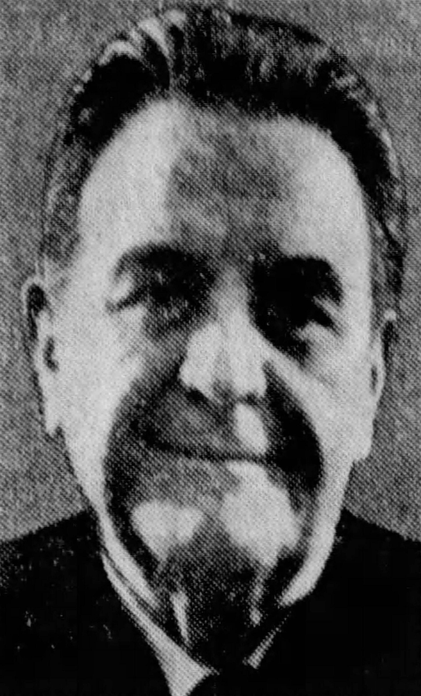
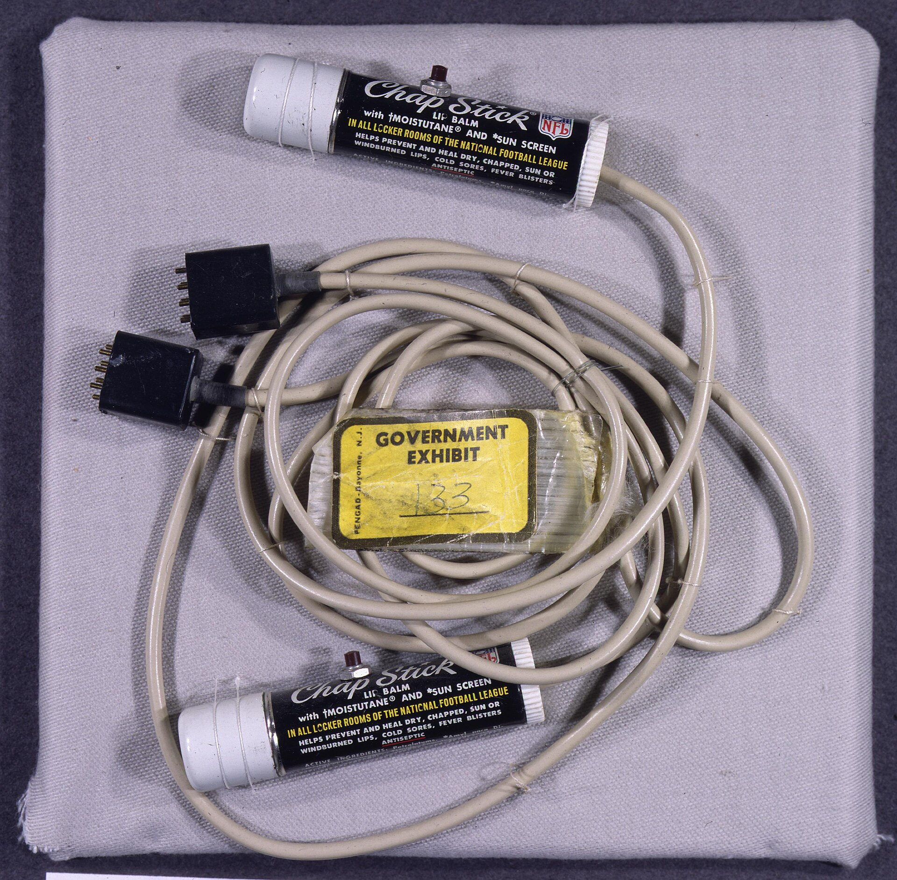
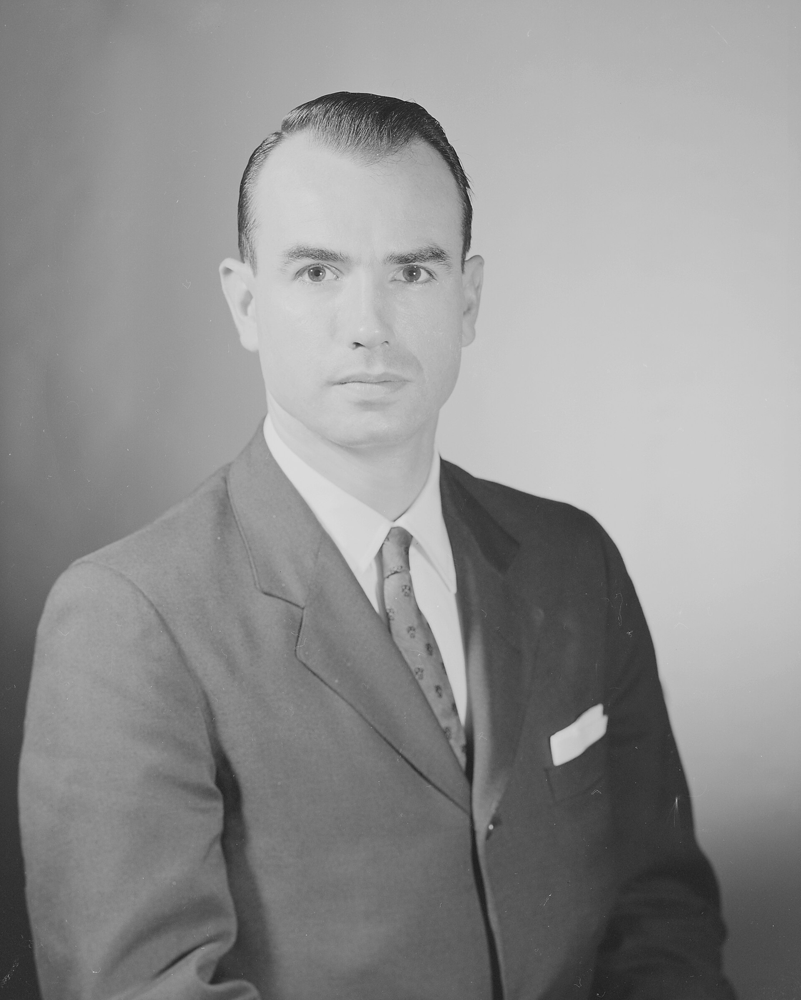

Fifty-three years ago today, on November 9, 1973, federal Judge John Sirica sentenced six conspirators involved in the Watergate scandal. Among them was E. Howard Hunt Jr., a former CIA officer and central figure in the Nixon administration's clandestine operations, who was ordered to serve between two and a half and eight years in federal prison.

## Sentencing Day in Judge Sirica's Courtroom

On November 9, 1973, the long legal fallout from the break-in at the Democratic National Committee headquarters reached a major milestone in Washington. Judge John Sirica formally sentenced six men who had taken part in the conspiracy. Everette Howard Hunt Jr. received a term of two and a half to eight years in prison and was ordered to pay a $10,000 fine for his central role in planning the operation. Fellow conspirator James W. McCord Jr. was sentenced to a term of one to five years, while Frank Sturgis, Virgilio Gonzalez, and Eugenio Martinez also received their prison sentences.

## From Military Service to Covert CIA Missions

Hunt was far from an ordinary political operator. Born in Hamburg, New York, he graduated from Brown University in 1940 before serving during World War II in the United States Navy aboard the destroyer USS Mayo and later in the Army Air Corps. He also served in China with the Office of Strategic Services, the wartime forerunner to the Central Intelligence Agency. In October 1949, Hunt joined the CIA's Office of Policy Coordination as a covert action officer specializing in political influence. He soon served as station chief in Mexico City, where he helped lay the groundwork for covert regime change in Guatemala, and was later assigned to posts in Japan and Uruguay.

*Archive, 1973 — Photo: Associated Press / Public domain*

## The Novelist Behind the Espionage

Throughout his intelligence career, Hunt maintained an active dual life as an author, writing under his own name and a series of pseudonyms including Robert Dietrich, Gordon Davis, and David St. John. After receiving a Guggenheim Fellowship in 1946, he went on to publish dozens of hardboiled detective novels and spy thrillers, including titles such as East of Farewell and Bimini Run. In 1964, while on CIA assignment in Madrid under diplomatic cover, he worked on a series of spy novels intended as an American counterpart to Ian Fleming's James Bond books. Over his lifetime, Hunt authored 73 published books.

*Government Exhibit 133, Chapstick Tubes with Hidden Microphones - NARA - 304967 — Photo: Unknown authorUnknown author or not provided / Public domain*

## The White House Plumbers and the Break-In

After retiring from the CIA in 1970, Hunt entered the inner machinery of President Richard Nixon's administration. Alongside G. Gordon Liddy, he became a core operative of the Special Investigations Unit, commonly known as the White House Plumbers. Originally formed to investigate government leaks, the unit soon expanded into covert political sabotage. Hunt and Liddy devised the plan to break into the Democratic National Committee offices inside the Watergate complex, deploying wiretaps and photographing sensitive campaign documents. When five burglars were arrested on site in June 1972, the trail quickly led back to Hunt and the White House.

*G. Gordon Liddy c 1964 — Photo: Department of Justice. Federal Bureau of Investigation. (193 / Public domain*

## Conviction and the 33-Month Prison Term

Hunt ultimately faced charges of burglary, conspiracy, and wiretapping. While his official sentence from Judge Sirica was two and a half to eight years alongside the $10,000 fine, Hunt ultimately served 33 months in federal custody before his release. Following his time in prison, he moved first to Mexico and later settled in Miami, where he resumed his writing career and published nearly twenty additional spy novels between 1980 and 2000 before passing away in January 2007.

## A Turning Point in the Watergate Crisis

The courtroom proceedings on November 9, 1973, delivered a decisive blow to the secrecy surrounding the Nixon administration's covert activities. By handing down firm prison sentences to Hunt, McCord, and their fellow operatives, Judge Sirica signaled that the judicial system would hold the conspirators accountable regardless of their high-level political connections. The sentencing intensified congressional inquiries and public pressure, ensuring that the Watergate break-in would remain an enduring symbol of executive overreach and legal accountability.

### Sources

- <https://www.nytimes.com/1973/11/10/archives/6-get-watergate-terms-hunt-given-2-12-to-8-years-six-get-watergate.html>
- <https://commons.wikimedia.org/wiki/File:Impeach_Nixon_retouched.jpg>
- <https://commons.wikimedia.org/wiki/File:John_Sirica_c._1973.jpg>
- <https://commons.wikimedia.org/wiki/File:Government_Exhibit_133,_Chapstick_Tubes_with_Hidden_Microphones_-_NARA_-_304967.jpg>
- <https://commons.wikimedia.org/wiki/File:G._Gordon_Liddy_c_1964.jpg>
