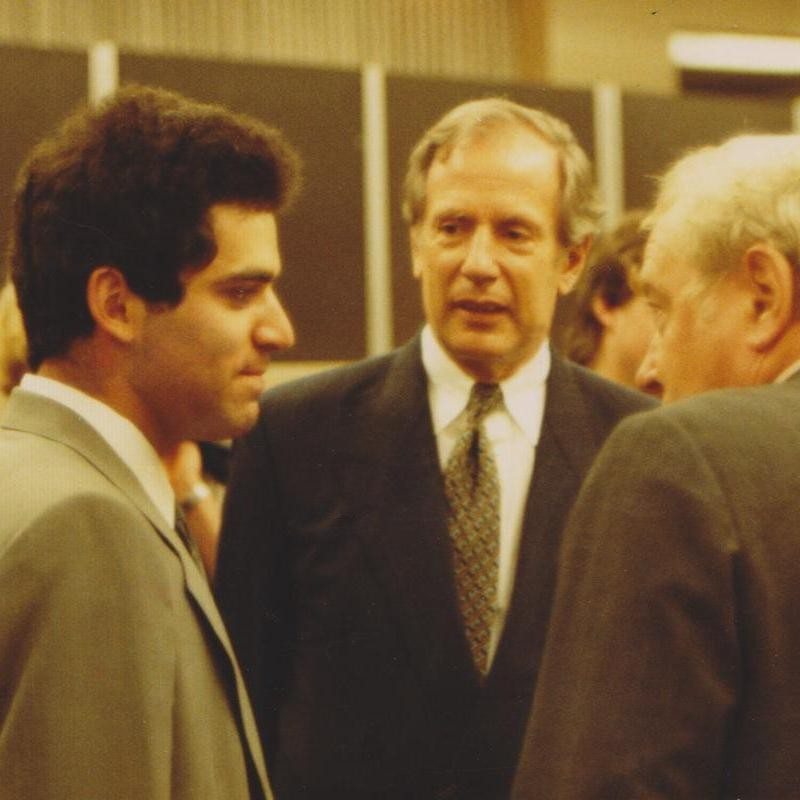
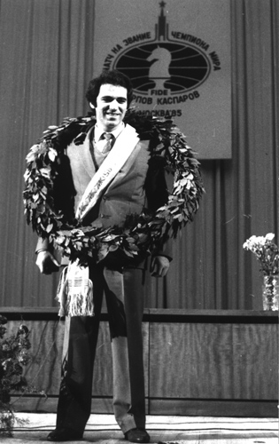
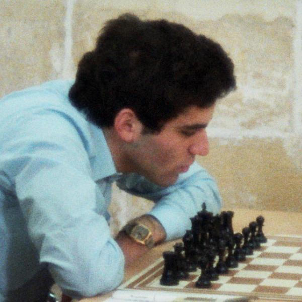

41 years ago today, November 9, 1985. Twenty-two-year-old Garry Kasparov of the Soviet Union defeated reigning champion Anatoly Karpov to become the youngest undisputed World Chess Champion in history. The historic victory marked the beginning of a fifteen-year reign at the summit of world chess.

## A Prodigy from Baku

Kasparov was born Garik Kimovich Weinstein on April 13, 1963, in Baku, Azerbaijan SSR. His father was Jewish and his mother was Armenian. Kasparov later explained that his parents named him after United States President Harry S. Truman, whom his father admired for taking a firm stance against communism. When Kasparov was only seven years old, his father died of leukemia. At age twelve, he took his mother's surname, Kasparov.

His chess journey began when he proposed a solution to a chess problem his parents had set up. By age seven, he was attending the Young Pioneer Palace in Baku. At age ten, he entered the prestigious chess school run by former world champion Mikhail Botvinnik, training under coach Vladimir Makogonov. Makogonov helped shape the boy's positional foundation, teaching him the Caro-Kann Defence and the Tartakower System. Botvinnik recognized Kasparov's immense gifts almost immediately, writing when Kasparov was just eleven: 'The future of chess lies in the hands of this young man.'

## A Meteoric Rise Through the Ranks

Kasparov proved Botvinnik right with unprecedented speed. At age 13, he won the 1976 Soviet Junior Championship in Tbilisi with 7 out of 9 points. He repeated that championship victory the next year, coached by Alexander Shakarov, scoring 8½ out of 9 points.

In 1978, at only 15 years old, Kasparov won a 64-player Swiss tournament at Daugavpils to qualify for the USSR Chess Championship, becoming the youngest player ever to reach that stage. The following year, in April 1979, he played his first international tournament in Banja Luka, Yugoslavia. Though still unrated, he won the event by two full points, establishing a provisional rating of 2545 that placed him tied for 40th in the world. By 1980, he won the World Junior Chess Championship in Dortmund, played for the Soviet team at the Chess Olympiad in Malta, and earned the Grandmaster title. By July 1982, the 19-year-old Kasparov was ranked second in the world behind only Anatoly Karpov.

*Kasparov Dohnanyi 1985 Hamburg — Photo: GFHund / CC BY 3.0*

## Cold War Politics and the Pasadena Match

In 1982, Kasparov won the Moscow Interzonal to reach the Candidates Tournament at age 19, making him the youngest Candidates participant since Bobby Fischer in 1958. In the quarter-finals, he defeated Alexander Beliavsky by a score of 6–3, setting up a semi-final against Victor Korchnoi.

That match was scheduled to be played in Pasadena, California. However, Soviet authorities refused to grant Kasparov permission to travel to the United States. Under official rules, Korchnoi was entitled to claim a walkover victory and advance automatically. Instead, Korchnoi displayed remarkable sportsmanship, agreeing to play Kasparov in London instead. Kasparov seized the second chance, defeated Korchnoi, and advanced to challenge Karpov for the world crown.

*Archive, 1985 — Photo: Copyright 2007, S.M.S.I., Inc. - Owen Williams, The Kasparov / CC BY-SA 3.0*

## Dethroning Karpov on November 9, 1985

Anatoly Karpov had stood as the undisputed master of Soviet chess for a decade. The clash between Karpov's disciplined positional mastery and Kasparov's dynamic, aggressive play captured the attention of chess enthusiasts worldwide.

On November 9, 1985, the 22-year-old challenger closed out the grueling contest. Kasparov defeated Karpov to become the youngest undisputed World Chess Champion in the history of the game. Kasparov would go on to defend his title against Karpov three more times, in matches held in 1986, 1987, and 1990, cementing one of the greatest rivalries in sports history.

*Archive, 1980 — Photo: GFHund / CC BY-SA 3.0*

## Dominance, Computing History, and a Lasting Record

Kasparov held the world title from 1985 until 2000, eventually losing the classical world championship to Vladimir Kramnik. Between 1984 and his retirement from competitive chess in 2005, Kasparov was ranked world number one for an astonishing total of 255 months. In 1999, he achieved a peak FIDE rating of 2851, a record that stood untouched until Magnus Carlsen surpassed it in 2013. He also captured records for 15 consecutive professional tournament wins and 11 Chess Oscars.

Beyond human competition, Kasparov made headlines across the globe in 1997 when he faced IBM's supercomputer Deep Blue, becoming the first reigning world champion to lose a match to a computer under classical time controls. Following his competitive career, Kasparov coached Carlsen from 2009 to 2010 during Carlsen's ascent to world number one, authored the acclaimed book series My Great Predecessors, and later chaired the Human Rights Foundation and founded the Renew Democracy Initiative in the United States. His milestone set on November 9, 1985, as the youngest undisputed world champion stood unbroken for nearly four decades, until Gukesh Dommaraju won the title in 2024.

### Sources

- <https://en.wikipedia.org/wiki/Garry_Kasparov>
- <https://commons.wikimedia.org/wiki/File:Kasparov-12.jpg>
- <https://commons.wikimedia.org/wiki/File:Kasparov_Dohnanyi_1985_Hamburg.jpg>
- <https://commons.wikimedia.org/wiki/File:Kasparov-1.jpg>
- <https://commons.wikimedia.org/wiki/File:Garry_Kasparov_1980_Malta.jpg>
