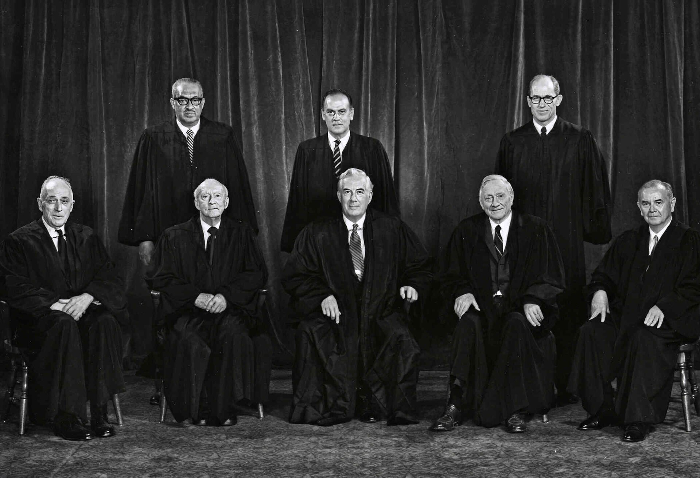
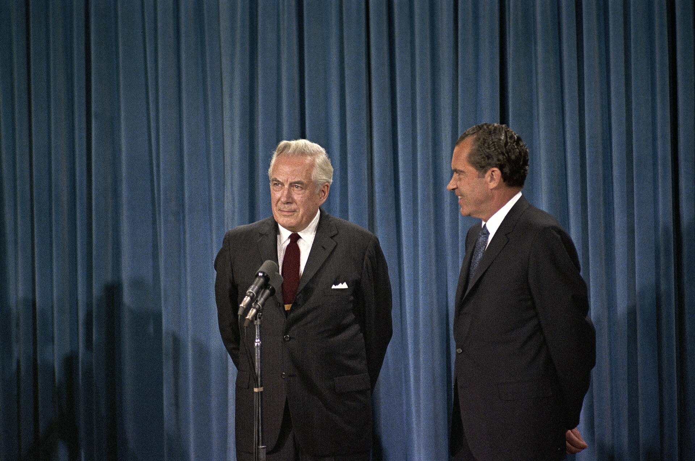
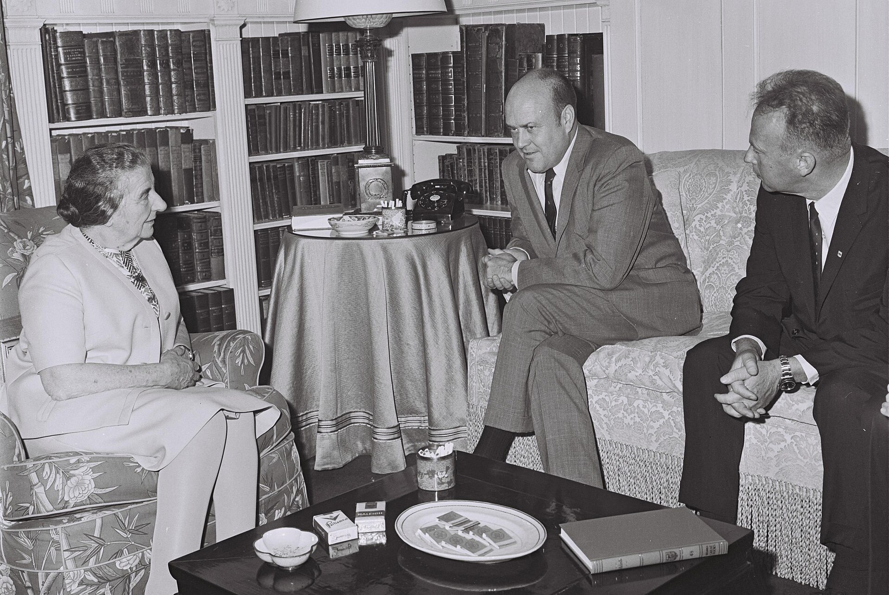

56 years ago today, November 9, 1970, the Supreme Court of the United States voted 6 to 3 against hearing a landmark legal challenge over the Vietnam War. The Commonwealth of Massachusetts had stepped forward to contest whether young Americans could be drafted into overseas combat without an explicit declaration of war by Congress.

## The Escalating Conflict and the Question of Authority

Direct United States military involvement in Southeast Asia escalated dramatically starting in 1965. Following the Gulf of Tonkin incident in 1964, Congress passed a resolution granting President Lyndon B. Johnson broad authority to deploy armed forces and expand military operations without an official declaration of war. By 1966, troop deployments climbed to 184,000, and by 1969, American deployment reached an all-time peak of 536,000 soldiers. As search-and-destroy missions and bombing campaigns intensified, American casualties rose toward a tragic toll that ultimately totaled 58,220 military service members.

## A State Law Defying Overseas Conscription

Mounting opposition across the country soon took legal form inside state legislatures. The Commonwealth of Massachusetts enacted an extraordinary law designed to shield its citizens from conscription into foreign hostilities that lacked constitutional approval. The statute provided that no resident of Massachusetts 'shall be required to serve' in the armed forces abroad if Congress had not formally declared war. By passing this statute, the state government aimed to bring the war's legality directly into the federal courts, testing the boundaries between legislative war powers and executive command.

*NOT FROM THE EVENT · 1969 — Photo: Supreme Court Official Photo. / Public domain*

## Massachusetts v. Laird Reaches the Nation's Apex Court

Acting on this new state legislation, the attorney general of Massachusetts took the fight straight to Washington, filing Massachusetts v. Laird in the Supreme Court. Under Article Three of the United States Constitution, the Supreme Court possesses original jurisdiction in cases where a state is a party. The commonwealth asked the nine justices to test the constitutionality of the ongoing military campaign and confirm the right of local residents to resist compulsory overseas deployment in undeclared hostilities.

*NOT FROM THE EVENT · 1969 — Photo: President (1969-1974 : Nixon). White House Photo Office. 196 / Public domain*

## The 6–3 Ruling on November 9, 1970

On November 9, 1970, the Supreme Court delivered its answer. By a 6 to 3 majority, the justices declined to hear the case, citing a lack of jurisdiction. The court routinely receives thousands of petitions each term while granting only a fraction for full argument, and the majority chose not to intervene in the execution of the war. Three justices dissented from the decision not to hear the suit, but the majority order stood, turning aside the commonwealth's bid to halt conscription under state authority.

*D701-120 (41092187251) — Photo: Moshe Milner / Public domain*

## The Path to Withdrawal and Ongoing Constitutional Questions

The dismissal meant that federal conscription policies continued unchanged. While President Richard Nixon pursued a strategy of Vietnamization—withdrawing American ground forces while shifting fighting duties to South Vietnamese troops—US forces did not complete their total withdrawal until 1973 following the Paris Peace Accords. Decades later, the fundamental question raised by Massachusetts on that November morning—the constitutional line between presidential authority and congressional declarations of war—remains one of the most enduring debates in American legal history.

### Sources

- <https://en.wikipedia.org/wiki/Vietnam_War>
- <https://commons.wikimedia.org/wiki/File:Burger_Court_from_1970-1971.jpg>
- <https://commons.wikimedia.org/wiki/File:Burger_Court_from_1969-1970.jpg>
- <https://commons.wikimedia.org/wiki/File:President_Richard_Nixon_and_Judge_Warren_Burger_-_DPLA_-_d311bd18d14c011afc01d5747f7fce60.jpg>
- <https://commons.wikimedia.org/wiki/File:D701-120_(41092187251).jpg>
