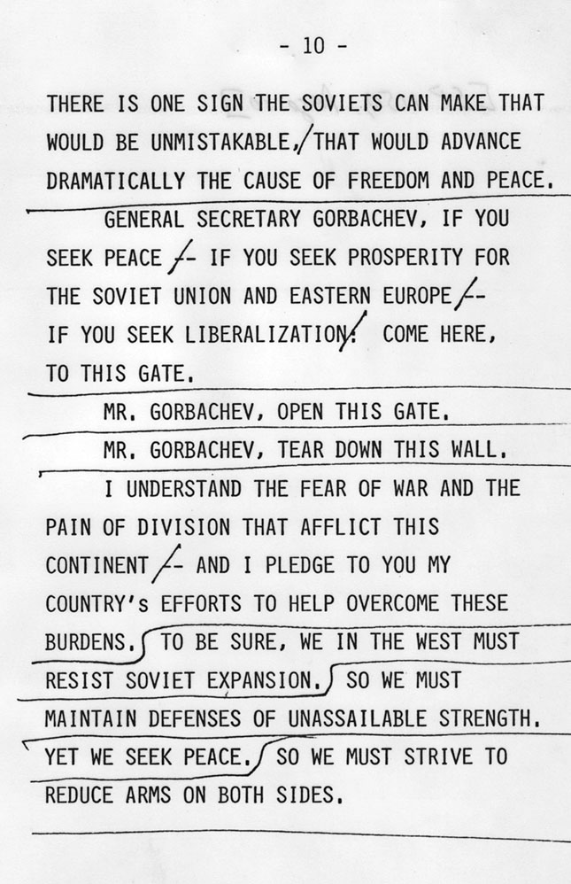
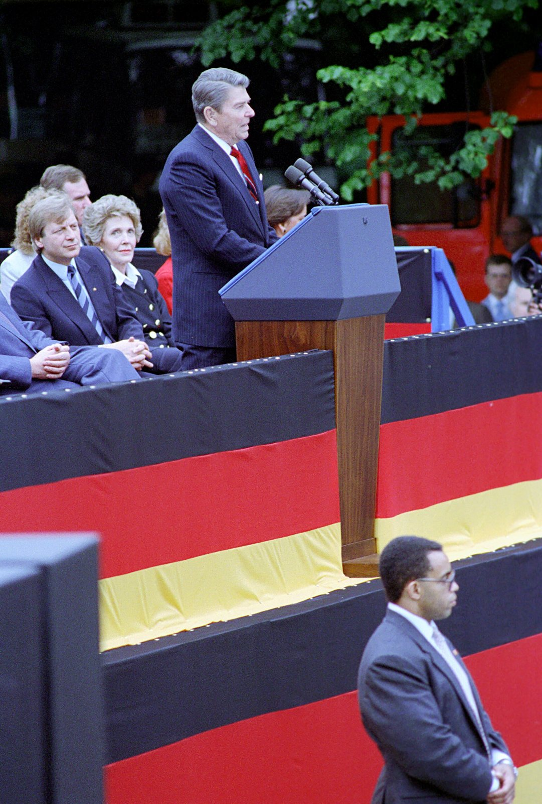
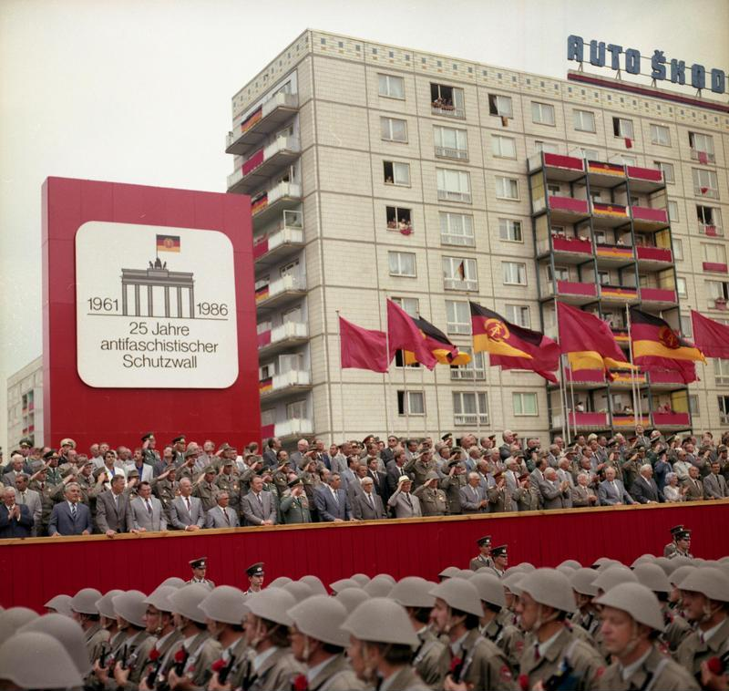

37 years ago today, November 10, 1989. Crowds of Germans began tearing down the Berlin Wall, chipping away at the concrete barrier that had divided their city for twenty-eight years. What began the night before as a chaotic border opening turned into a global celebration of freedom.

## A Divided City and the Rise of the Wall

Following the defeat of Nazi Germany in World War II, the country west of the Oder-Neisse line was split into four occupation zones controlled by the United States, the United Kingdom, France, and the Soviet Union. Berlin, situated entirely within the Soviet zone, was similarly divided into four sectors. As Cold War tensions mounted, the Western powers united their sectors and launched reconstruction under the Marshall Plan, while the Soviet Union installed a communist regime in the East, establishing the German Democratic Republic (GDR).

The stark difference in living standards soon spurred massive migration. Between 1949 and 1961, approximately 3.5 million East Germans, representing 20 percent of the GDR's population, circumvented Eastern Bloc restrictions and fled to the West through Berlin. Deprived of skilled workers and educated professionals, the East German government moved to shut the escape hatch. On August 13, 1961, East German authorities began constructing a guarded barrier encircling West Berlin.

## Fortifications of the "Death Strip"

The Berlin Wall was not a single barrier, but a complex security system designed to prevent citizens from leaving. It consisted of an outer wall facing West Berlin, an inner wall facing East Berlin, and a heavily fortified space in between known as the death strip. This zone featured guard towers, anti-vehicle trenches, trace-control strips of smoothed sand to detect footprints, and beds of nails.

While communist authorities officially labeled the structure the "Anti-Fascist Protection Rampart" and claimed it protected citizens from outside aggression, West Berlin Mayor Willy Brandt called it the "Wall of Shame." Despite the extreme dangers, more than 100,000 people attempted to escape between 1961 and 1989. Over 5,000 succeeded, but between 136 and more than 200 people were killed by East German border guards while attempting to reach freedom.

*Archive, 1987 — Photo: The White House / Public domain*

## The Iron Curtain Begins to Fracture

By 1989, the foundations of the Eastern Bloc were trembling. Revolutions in Poland and Hungary applied mounting pressure on hardline regimes. In May 1989, Hungary began removing its border fence, and in August, the Pan-European Picnic allowed hundreds of East Germans to escape into Austria. When thousands more sought refuge in the West German embassy in Prague, West German Foreign Minister Hans-Dietrich Genscher announced on September 30 that they were permitted to leave for the West.

Faced with continuing mass defections and widespread civil unrest across East German cities, long-term GDR leader Erich Honecker was ousted in October. The new communist leadership attempted to draft travel regulations to relieve public pressure, but events moved faster than the regime could manage.

*Archive, 1987 — Photo: President (1981-1989 : Reagan). White House Photographic Off / Public domain*

## The Press Conference That Opened the Gates

On the evening of November 9, 1989, an East German Politburo press conference was broadcast live on television. A spokesman prematurely announced that East German citizens could travel without restrictions, effective immediately. The news flashed across television screens in both East and West Germany, prompting thousands of residents to march toward Berlin's border checkpoints.

Puzzled and overwhelmed border guards had received no explicit orders from high-ranking commanders. Refusing to open fire on the massive, peaceful crowds, guards at the Bornholmer Strasse checkpoint and other crossings stepped aside in the late evening hours and opened the gates. Tens of thousands of East Berliners streamed into West Berlin, greeted with tears, champagne, and cheers from West Germans waiting on the other side.

*Archive, 1986 — Photo: Klaus Franke / CC BY-SA 3.0 de*

## Chiseling Away the Concrete Monster

By the morning of November 10, 1989, the euphoria had transformed into active dismantling. Armed with sledgehammers, household hammers, and chisels, ordinary citizens climbed atop the wall near the Brandenburg Gate and began chipping away at the concrete slabs. Live television broadcasts beamed these historic images across the globe, including to American living rooms where millions watched the Cold War's most hated symbol crumble.

Souvenir hunters collected pieces of the barrier, while crowds gathered along both sides to assist in widening openings. Border guards who had once patrolled the death strip with loaded rifles stood by helplessly as sections of concrete were broken down before their eyes. The psychological and physical barrier that had split families for nearly three decades was broken forever.

## The Road to Reunification and Legacy

The opening of the wall set off an irreversible chain of political changes. On December 22, 1989, the crossing at the Brandenburg Gate was officially reopened. Free elections held in East Germany in early 1990 paved the way for unification. Systematic demolition of the wall began on June 13, 1990, and was finalized in 1994, with salvaged L-shaped concrete segments later distributed to museums and memorials worldwide.

On October 3, 1990, less than a year after the wall fell, East Germany was dissolved and five reconstituted states joined the Federal Republic of Germany. Today, small preserved sections of the Berlin Wall stand as enduring reminders of the cost of division and the triumph of human freedom.

### Sources

- <https://en.wikipedia.org/wiki/Berlin_Wall>
- <https://commons.wikimedia.org/wiki/File:Berlin-Memorial_to_the_Victims_of_the_Wall-1982.jpg>
- <https://commons.wikimedia.org/wiki/File:Tear_Down_This_Wall_p10.jpg>
- <https://commons.wikimedia.org/wiki/File:President_Ronald_Reagan_and_Nancy_Reagan_During_His_Trip_to_West_Berlin_and_His_Remarks_at_The_Berlin_Wall,_Brandenburg_Gate_with_Eberhard_Diepgen_-_DPLA_-_1fab90c4bd51284803dceaa594c2caa4.jpg>
- <https://commons.wikimedia.org/wiki/File:Bundesarchiv_Bild_183-1986-0813-460,_Berlin,_Parade_von_Kampfgruppen_zum_Mauerbau.jpg>
