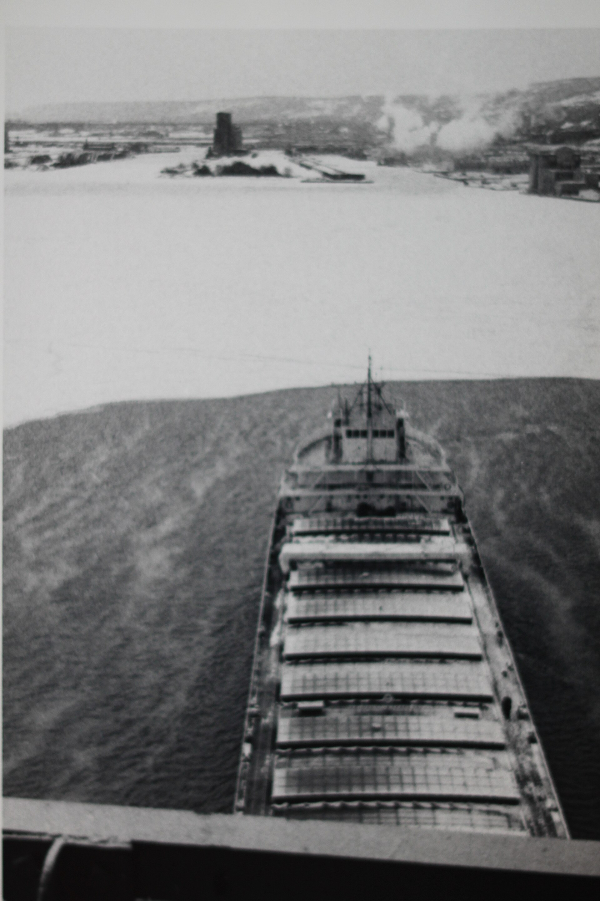
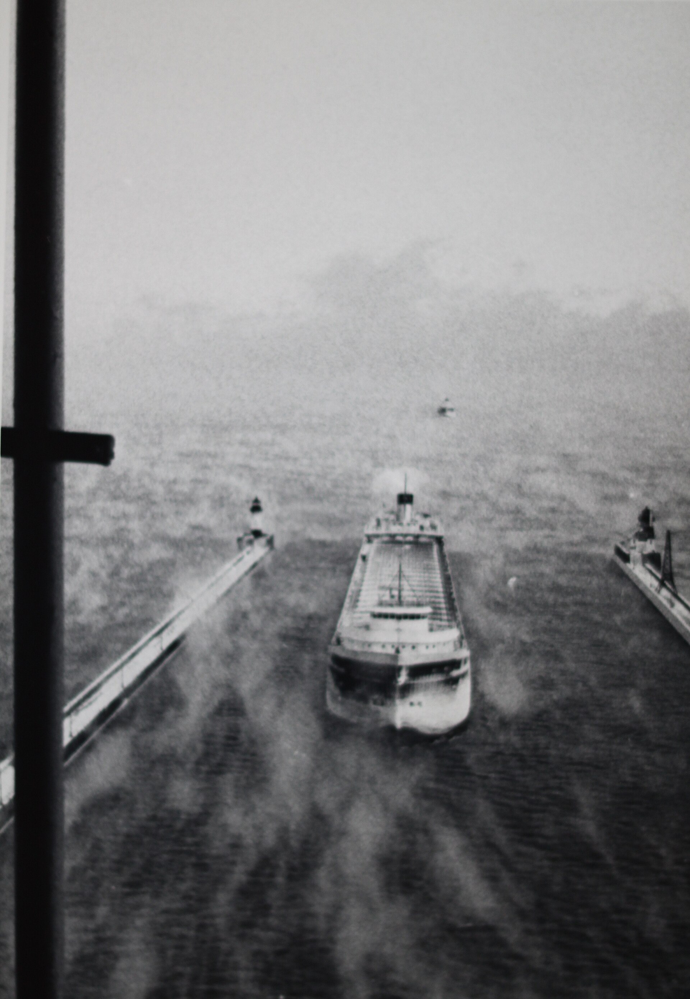
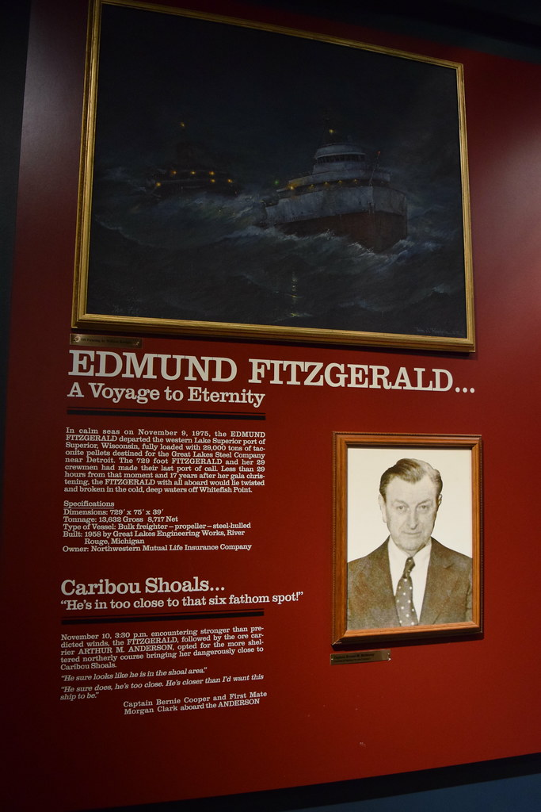

51 years ago today, November 10, 1975, the American ore freighter SS Edmund Fitzgerald sank in Lake Superior during a monstrous storm, losing all 29 crewmen on board. It remains the most famous and devastating shipwreck in modern Great Lakes history.

## Queen of the Great Lakes

When the SS Edmund Fitzgerald was launched on June 7, 1958, she was the largest vessel navigating North America's Great Lakes. Measuring 729 feet in length and built to the maximum dimensions allowed for passage through the St. Lawrence Seaway, she represented a major $7 million investment by the Northwestern Mutual Life Insurance Company. For 17 years, the Fitzgerald was a reliable workhorse of American industry, carrying taconite iron ore pellets from mines along Minnesota's Iron Range near Duluth to steel mills in Detroit and Toledo.

She was not just large; she was remarkably popular among maritime enthusiasts. The ship set seasonal cargo haul records six times, routinely outdoing herself. Boat watchers along the St. Clair and Detroit rivers frequently gathered to see her pass, especially when Captain Peter Pulcer entertained spectators by piping music over the public address system and providing lively commentary through the Soo Locks.

## Voyage into a November Gale

On the afternoon of November 9, 1975, the Fitzgerald departed Superior, Wisconsin, heavily laden with taconite pellets under the command of seasoned Master Captain Ernest M. McSorley. What began as a standard late-season run soon collided with an immense autumn storm sweeping across the upper Midwest. By the afternoon of November 10, conditions on Lake Superior had deteriorated into a deadly tempest.

Near-hurricane-force winds whipped across the open freshwater sea, generating massive waves measured at up to 35 feet high. As blinding spray and pounding waves battered the carrier, Captain McSorley reported structural damage, listing, and failing radar systems. Despite taking on water, the ship pressed southeast toward Whitefish Bay, seeking the natural shelter offered by Michigan's Upper Peninsula.

*ARTHUR M. ANDERSON - 3 — Photo: Gary Todd / CC0*

## Final Words: 'We Are Holding Our Own'

Shortly after 5:30 p.m. on November 10, Captain McSorley contacted another vessel navigating nearby, confirming that his ship was in difficulty and taking heavy seas over the deck. However, his crew continued their battle against the elements without transmitting a formal distress signal. At 7:10 p.m., McSorley sent his final known radio message to the trailing freighter SS Arthur M. Anderson: 'We are holding our own.'

Barely minutes later, the Edmund Fitzgerald abruptly vanished from radar screens. There was no final cry for help, no emergency flare, and no time to launch lifeboats. She sank in Canadian waters 530 feet below the surface, just 17 miles from the relative safety of Whitefish Point—a short distance the ship could have crossed in just over an hour under normal conditions.

*ARTHUR M. ANDERSON - 1 — Photo: Gary Todd / CC0*

## The Search and the Haunting Discovery

A frantic search followed through the howling blizzard, but rescuers found only empty life rafts and scattered debris. None of the 29 crewmen survived, and not a single body was ever recovered from the frigid depths of Lake Superior. On November 14, 1975, a U.S. Navy aircraft utilizing magnetic anomaly detection located the wreckage.

Subsequent underwater surveys revealed that the massive 729-foot hull had broken into two primary pieces on the lake bed. To this day, maritime historians and engineers debate the exact sequence of events that brought the leviathan down, ranging from massive water intrusion through topside hatches, catastrophic structural failure, or bottoming out on an uncharted shoal during the gale.

*NOT FROM THE EVENT — Photo: Tatiana12 / CC BY 2.0*

## How the Tragedy Transformed Maritime Safety

The loss of the Edmund Fitzgerald stunned the nation and forced sweeping overhauls in commercial shipping regulations. Marine investigators determined that existing safety measures had left crews with virtually no chance of survival in freezing northern waters. The tragedy directly resulted in new federal mandates requiring cold-water survival suits for all Great Lakes sailors, onboard fathometers and depth finders, and modern electronic satellite positioning systems.

In addition, regulators mandated increased freeboard requirements to keep loaded ships higher above the waterline and instituted much stricter, more frequent inspections of vessel hatch covers and hull integrity. The tragedy ensured that future generations of lake sailors faced dangerous seasonal gales with dramatically improved equipment and protections.

## An Enduring American Legend

The Fitzgerald's story became immortalized in popular culture when Canadian singer-songwriter Gordon Lightfoot composed his legendary 1976 ballad, 'The Wreck of the Edmund Fitzgerald,' after reading coverage of the disaster in Newsweek. The haunting song ensured that the names and memory of the 29 lost men would never fade from the American consciousness.

Today, at the Great Lakes Shipwreck Museum at Whitefish Point, Michigan, the recovered bronze bell of the Edmund Fitzgerald is rung every November 10 in solemn remembrance. Each chime honors one of the men lost on Lake Superior, echoing across the waters that claimed North America's most famous lake freighter.

### Sources

- <https://en.wikipedia.org/wiki/November%2010>
- <https://commons.wikimedia.org/wiki/File:ARTHUR_M._ANDERSON_-_2.jpg>
- <https://commons.wikimedia.org/wiki/File:ARTHUR_M._ANDERSON_-_3.jpg>
- <https://commons.wikimedia.org/wiki/File:ARTHUR_M._ANDERSON_-_1.jpg>
- <https://www.flickr.com/photos/98826299@N00/36919929682>
