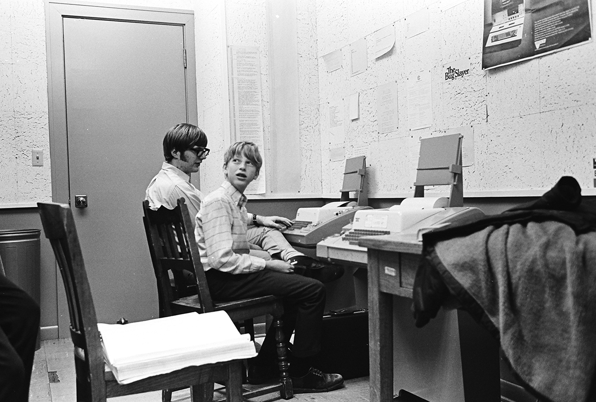
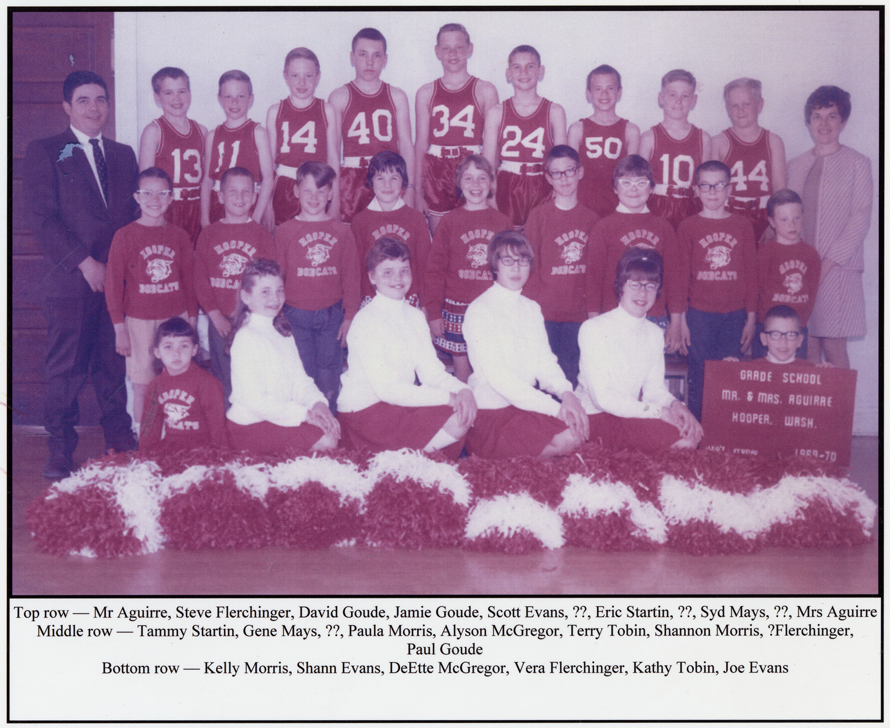
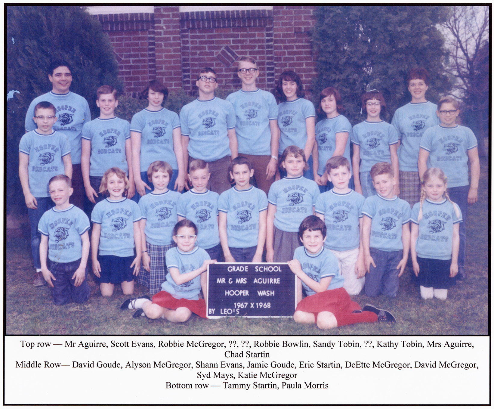

43 years ago today, November 10, 1983, Microsoft co-founder Bill Gates stepped forward to introduce Windows 1.0. At a time when personal computing meant typing strict command strings into an MS-DOS prompt, Microsoft offered a radically accessible alternative built around a mouse, tiled windows, and intuitive graphics.

## The Blinking Cursor Era of MS-DOS

In the early 1980s, owning a personal computer was an intimidating hobby. IBM PC compatible systems relied heavily on MS-DOS, where every single action required exact keyboard commands. If a user forgot a directory name or mistyped a file extension, the computer simply spat back an error. Bill Gates and his childhood friend Paul Allen, who had co-founded Microsoft in 1975, knew that personal computing could never become a truly universal tool if machines remained this difficult to operate.

## The Spark of Inspiration at COMDEX

Microsoft began looking seriously into graphical user interfaces as early as 1981. The real turning point came when Gates attended COMDEX in 1982 and witnessed a demonstration of VisiCorp's Visi On, an early graphical suite for IBM PC compatibles. Around the same time, Microsoft discovered that Apple was developing its own advanced bit-mapped interface, which drew heavily from research done at Xerox PARC. Realizing that the future was visual, Gates decided Microsoft had to build its own graphical environment. In August 1983, he recruited Scott A. McGregor, a prominent engineer from Xerox PARC, to lead the Windows development team.

*Paul Allen and Bill Gates at Lakeside School in 1970 — Photo: Bruce Burgess / Public domain*

## The Big Debut in November 1983

After private press previews in September, Microsoft officially unveiled the redesigned environment at Fall COMDEX in November 1983 under the name Windows. Microsoft pitched the software as an extension for MS-DOS 2.0 that required just 192 kilobytes of RAM and two floppy disk drives. Rather than forcing developers to adopt complicated systems like Unix, Windows allowed existing DOS programs to run alongside new graphical software. Leading computer makers such as Compaq, Zenith, and DEC immediately pledged hardware support, while major software publishers like Lotus and Ashton-Tate announced their backing. In December 1983, BYTE magazine praised Windows for its modest hardware requirements, openness, and sensible pricing.

*Hooper school students, Hooper, Washington, 1969 - DPLA - 9f9517dd172731d1ff1fb243e733eb04 — Photo: Leo's Studio / Public domain*

## Tiled Windows, Built-in Tools, and Endless Delays

Unlike modern desktop systems, the earliest version of Windows did not allow application windows to overlap; instead, windows neatly tiled across the screen. The interface included a menu bar positioned beneath each window's title bar and came packaged with essential utility programs such as Calculator, Paint, and Notepad. Microsoft initially promised that Windows would hit store shelves by April or May of 1984. However, engineering hurdles and interface redesigns forced repeated delays. McGregor left the team in January 1985 and was replaced by Steve Ballmer, who oversaw the final push to get the product out the door.

*Hooper school students, Hooper, Washington, 1967 - DPLA - 15f664a32863e9595821d6b8a37e7cb8 — Photo: Leo's Studio / Public domain*

## A Rocky Launch and an Enduring Legacy

Windows 1.01 finally shipped to consumers on November 20, 1985, carrying a retail price of US$99. Initial reviews were lukewarm, with critics citing performance bottlenecks and a shortage of native software. Yet Gates stood firmly behind the platform, declaring that Microsoft was totally committed to Windows as the core of its corporate future. The software saw subsequent revisions, including European version 1.02 in May 1986, international version 1.03 in August 1986, and version 1.04 in April 1987, which supported IBM PS/2 machines. Even after Windows evolved into the dominant PC platform across the world, Microsoft maintained support for Windows 1.0 until December 31, 2001. That sixteen-year span made it the longest-supported operating environment in Microsoft history, tracing all the way back to the bold vision Bill Gates first presented in November 1983.

### Sources

- <https://en.wikipedia.org/wiki/Bill_Gates>
- <https://commons.wikimedia.org/wiki/File:Bella_Abzug_%C2%A9Lynn_Gilbert.jpg>
- <https://commons.wikimedia.org/wiki/File:Paul_Allen_and_Bill_Gates_at_Lakeside_School_in_1970.jpg>
- <https://commons.wikimedia.org/wiki/File:Hooper_school_students,_Hooper,_Washington,_1969_-_DPLA_-_9f9517dd172731d1ff1fb243e733eb04.jpg>
- <https://commons.wikimedia.org/wiki/File:Hooper_school_students,_Hooper,_Washington,_1967_-_DPLA_-_15f664a32863e9595821d6b8a37e7cb8.jpg>
