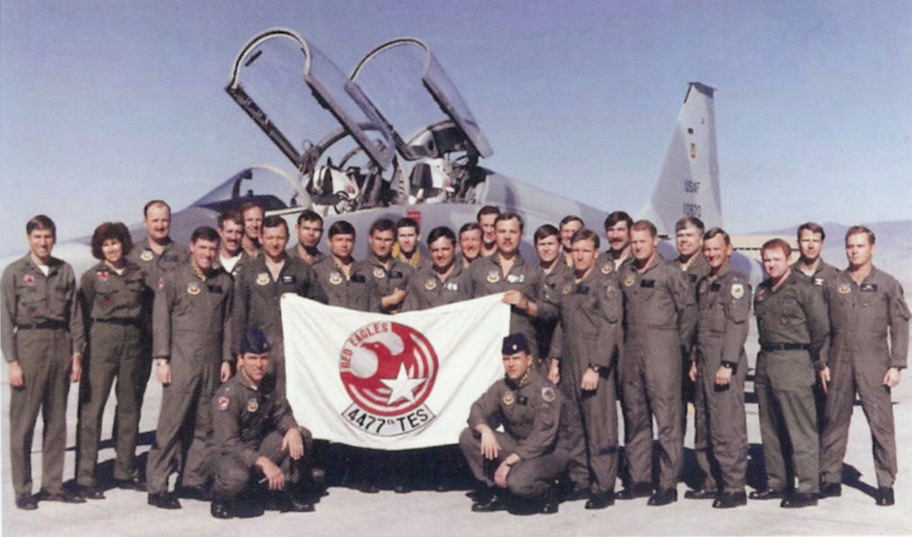
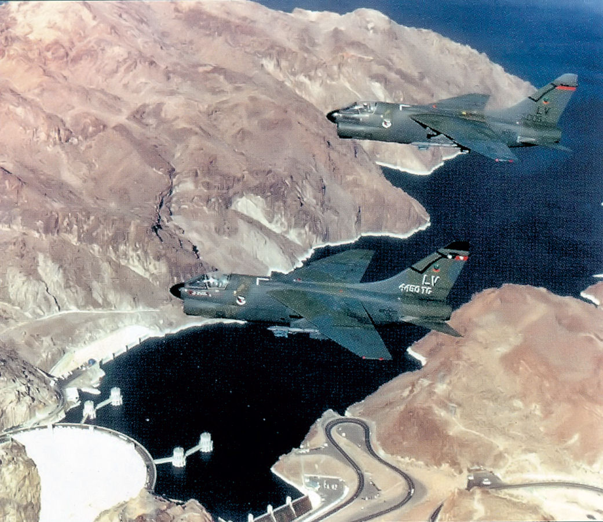
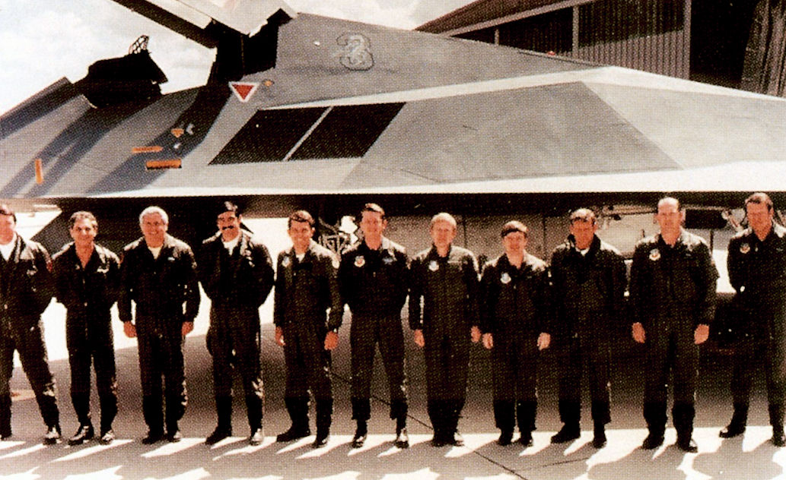

38 years ago today, November 10, 1988. At a press conference inside the Pentagon, the United States Air Force officially acknowledged the existence of the Lockheed F-117 Nighthawk. For nearly a decade, the revolutionary stealth aircraft had existed only as classified whispers and denied rumors, flying entirely under the cover of darkness.

## The Wall of Cold War Secrecy

During the height of the Cold War, the challenge of penetrating heavily defended airspace became urgent. Soviet surface-to-air missile networks were growing increasingly sophisticated, threatening conventional aircraft and bombers.

In response, American defense planners realized that speed and altitude alone were no longer enough to guarantee survival. The Pentagon required an aircraft that could defeat enemy detection entirely by evading radar.

## Skunk Works and the Faceted Breakthrough

Work began in earnest during the 1970s when the Defense Advanced Research Projects Agency awarded Lockheed a contract for the Have Blue technology demonstrator. Lockheed's Skunk Works division applied theoretical principles showing that an aircraft's radar return was determined by its edge configuration rather than its physical size.

On November 1, 1978, Lockheed officially decided to develop the production jet, designated the F-117 Nighthawk. To minimize its radar cross-section to an astonishing 0.001 square meters, designers built the airframe out of flat, faceted panels. This sharp exterior deflected radar energy away from opposing receivers, creating a silhouette that barely registered on radar screens.

*4477th Test and Evaluation Squadron - Final Group Photograph — Photo: United States Air Force photo / Public domain*

## Hidden at Tonopah and Groom Lake

The aircraft's extreme design came with major engineering obstacles. Because the faceted exterior was aerodynamically unstable across all three principal axes, human hands could not fly it alone. Engineers installed an advanced quadruple fly-by-wire flight control system that made continuous micro-adjustments to keep the aircraft airborne.

The prototype completed its maiden flight at Groom Lake, Nevada, in 1981, and the first production model arrived in 1982. By October 1983, the F-117 achieved initial operational capability, operating strictly out of Tonopah Test Range Airport under complete radio and daylight blackout.

*4451st Tactical Squadron A-7D Corsair IIs over Hoover Dam — Photo: United States Air Force / Public domain*

## The Historic Pentagon Admission

Rumors of an American 'stealth fighter' repeatedly made headlines throughout the mid-1980s, but Department of Defense officials routinely denied its existence. The program was classified as a deep black project, hidden within secret defense budgets.

That policy abruptly shifted on November 10, 1988. Standing before reporters at the Pentagon in Arlington County, Virginia, Air Force officials formally acknowledged the F-117 Nighthawk, releasing a single grainy, retouched photograph that confirmed the jet was real and already flying active missions.

*4450th Tactical Group - F-117 Test Pilots — Photo: United States Air Force / Public domain*

## From Secrecy to Desert Storm

The public acknowledgment opened the door for the Nighthawk to step into the theater of war. The aircraft flew its first combat sorties during the invasion of Panama in 1989, but its decisive proving ground came during the Gulf War in 1991.

In Iraq, F-117 pilots flew approximately 1,300 combat sorties, striking roughly 1,600 high-value targets protected by dense air defenses without losing a single aircraft to enemy fire during the campaign. The stealth jet dropped precision-guided munitions with lethal accuracy, cementing its place in military history.

## The Legacy of the Nighthawk

Lockheed delivered the final production F-117 on July 3, 1990, bringing the total operational fleet to 59 aircraft. The Nighthawk later served in Yugoslavia, Afghanistan during Operation Enduring Freedom in 2001, and Iraq during Operation Iraqi Freedom in 2003.

The Air Force officially retired the fleet in 2008, clearing the skies for advanced fifth-generation fighters like the F-22 Raptor. Yet decades after that fateful November morning at the Pentagon, the dark, faceted silhouette of the Nighthawk remains the definitive pioneering symbol of modern stealth aviation.

### Sources

- <https://en.wikipedia.org/wiki/United_States_Air_Force>
- <https://commons.wikimedia.org/wiki/File:1985_US_Air_Force_UFO_Fact_Sheet_page_1_of_3.png>
- <https://commons.wikimedia.org/wiki/File:4477th_Test_and_Evaluation_Squadron_-_Final_Group_Photograph.jpg>
- <https://commons.wikimedia.org/wiki/File:4451st_Tactical_Squadron_A-7D_Corsair_IIs_over_Hoover_Dam.jpg>
- <https://commons.wikimedia.org/wiki/File:4450th_Tactical_Group_-_F-117_Test_Pilots.jpg>
