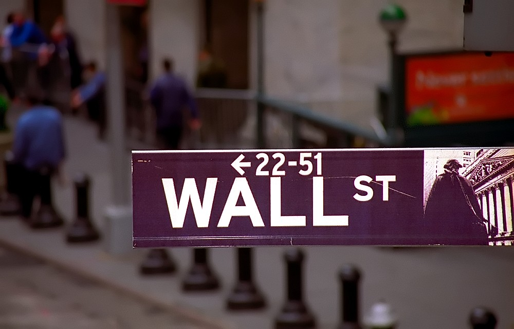

29 years ago today, November 10, 1997, telecommunications company WorldCom and long-distance provider MCI Communications announced an agreement to merge in a thirty-seven billion dollar deal. The transaction formed MCI WorldCom and stood as the largest corporate merger in United States history. For Wall Street and millions of telephone customers, the union signaled a dramatic reshaping of modern communications.

## A Monumental Corporate Alliance

The thirty-seven billion dollar announcement caught the global financial markets by storm. At the time of the announcement, corporate buyouts of this magnitude had never occurred on American soil. The deal brought together MCI, a dominant long-distance provider based in Washington, D.C., and WorldCom, an aggressive newcomer headquartered in Clinton, Mississippi. By joining forces, the combined entity vaulted to the position of the second-largest long-distance carrier in the United States, trailing only AT&T.

To make the merger possible, both companies had to clear significant regulatory hurdles. The United States Department of Justice scrutinized the market power of the combined networks, particularly over data infrastructure. To gain antitrust approval, MCI agreed to divest its "internetMCI" business. On September 15, 1998, the transaction was officially consummated, formalizing the arrival of MCI WorldCom.

## From a Coffee Shop to Wall Street Stardom

WorldCom's ascent was one of the most improbable corporate stories of the late twentieth century. In 1983, four investors, including Bernard Ebbers, met in a coffee shop in Hattiesburg, Mississippi, to form Long Distance Discount Services, Inc. Ebbers took over as chief executive officer in 1985. Operating out of Jackson and later Clinton, the small firm began expanding rapidly across the telecommunications map.

Under Ebbers's leadership, the company pursued growth through relentless acquisitions, eventually buying out more than sixty telecom firms. In 1992, it outbid major rivals like Sprint and AT&T to acquire Advanced Telecommunications Corporation for $720 million. Renamed WorldCom in 1995, the firm swallowed Metromedia Communications, Resurgens, IDB, Williams Technology, and MFS Communications, bringing valuable internet backbone assets like UUNET under its corporate umbrella.

*Hattiesburg, Mississippi Station — Photo: Paul Lowry / CC BY 2.0*

## MCI's Legacy as an Industry Rebel

Before WorldCom entered the picture, MCI Communications had established its own legendary reputation in American industry. Founded in 1963 as Microwave Communications, Inc. by John D. Goeken, the company originally built microwave radio relay stations between Chicago and St. Louis for trucking radio systems. Backed by venture financing arranged by William G. McGowan in 1968, MCI mounted fierce legal battles against AT&T's telephone monopoly.

MCI's regulatory challenges before the Federal Communications Commission transformed the American telecom landscape, establishing the right of private equipment to connect to telephone grids. The company began selling data transmission services in 1972, launched MCI Mail in 1983 as one of the country's first commercial email platforms, and built MCI.net into an indispensable pillar of the nation's early internet infrastructure.

*New York - Lower Manhattan 'Wall Street Bull' — Photo: David Paul Ohmer / CC BY 2.0*

## Ambition Meets Regulatory Limits

The creation of MCI WorldCom did not slow Bernard Ebbers's appetite for expansion. In February 1998, the company purchased CompuServe from H&R Block, retaining its network division while trading the consumer service to America Online. In October 1999, MCI WorldCom made an even more audacious move, announcing plans to merge with Sprint Corporation in a proposed $129 billion mega-deal.

Had the Sprint acquisition succeeded, the merged firm would have surpassed AT&T to become the largest communications carrier in the United States. However, antitrust officials at the Department of Justice and the European Union stepped in, raising severe concerns that the consolidation would create an unassailable monopoly. Facing insurmountable opposition, the boards of directors of both companies terminated the merger agreement on July 13, 2000.

*New York - 'Wall Street' — Photo: David Paul Ohmer / CC BY 2.0*

## The Dot-Com Crash and the Accounting Cover-Up

The collapse of the Sprint deal coincided with the sharp puncture of the dot-com bubble. As telecom stock values plummeted, WorldCom's actual business revenues suffered steep declines. To protect the share price, executive leaders engaged in systematic financial deception. Between mid-1999 and May 2002, the company masked declining operating revenues by improperly booking routine network "line costs" as long-term capital expenditures and generating fictitious revenue from unallocated corporate accounts.

The board of directors initially granted hundreds of millions of dollars in personal loans and guarantees to Ebbers to prevent him from selling his stock. By April 2002, directors lost confidence in Ebbers's strategy and requested his resignation. Ebbers stepped down on April 30, 2002, leaving behind a consolidated promissory note of $408.2 million that he later defaulted on in 2003.

## Whistleblowers and Historic Bankruptcy

WorldCom's true financial condition came to light through the clandestine work of its own employees. In June 2002, internal audit division vice president Cynthia Cooper and senior associate Eugene Morse worked late nights in secret to inspect the books. Cooper's team uncovered an initial $3.8 billion in fraudulent entries, which was immediately reported to the board of directors. The audit committee acted quickly, firing chief financial officer Scott Sullivan and accepting the resignation of controller David Myers.

Auditing firm Arthur Andersen promptly withdrew its 2001 opinion, and federal authorities, including the SEC and the FBI, launched wide investigations. By late 2003, investigators revealed that WorldCom had fraudulently inflated its assets by roughly $11 billion. On July 21, 2002, WorldCom filed for Chapter 11 bankruptcy protection, setting the record for the largest corporate bankruptcy filing in United States history at that time.

## The Final Chapter and What Remains Today

WorldCom navigated through bankruptcy proceedings under the direction of new chairman and chief executive Michael Capellas. The company stripped away the WorldCom brand, relocated from Clinton, Mississippi to Ashburn, Virginia, and adopted the historic MCI name. The reorganization cleared the path for a quiet corporate exit rather than renewed independence.

In January 2006, Verizon Communications finalized its purchase of MCI, absorbing its remaining assets into Verizon Business. Today, the physical fiber lines and data pathways once assembled during the frantic deal-making of 1997 remain active across North America, though the corporate name that spent thirty-seven billion dollars to claim them has vanished from the business registry.

### Sources

- <https://en.wikipedia.org/wiki/November%2010>
- <https://commons.wikimedia.org/wiki/File:Hattiesburgapt-ms-20jan1996.jpg>
- <https://www.flickr.com/photos/10039026@N03/54238766360>
- <https://www.flickr.com/photos/50965924@N00/2932154983>
- <https://www.flickr.com/photos/50965924@N00/2932154987>
