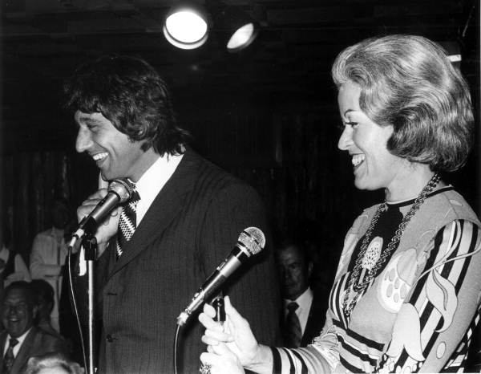
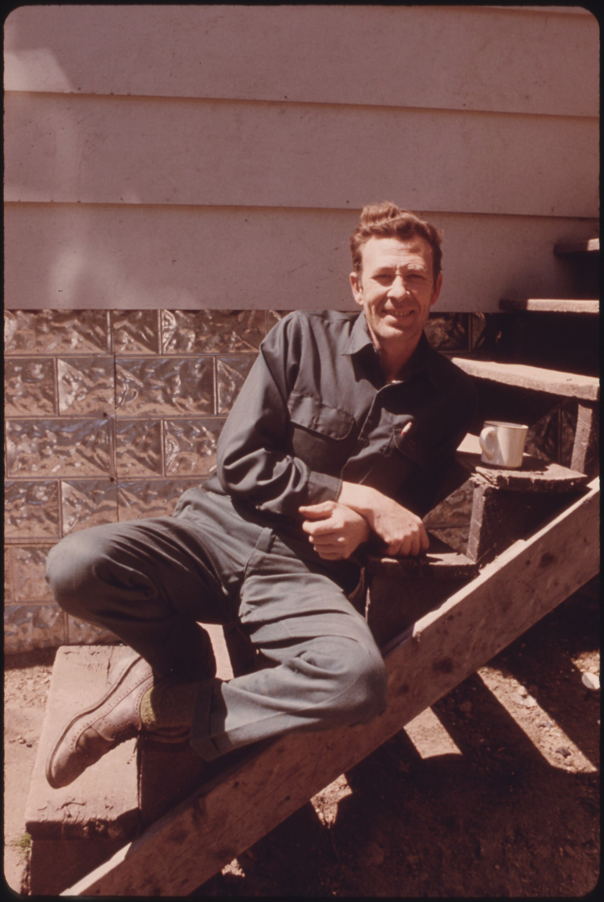

52 years ago today, November 10, 1974, Joe Namath delivered under fire in sudden-death overtime, throwing a five-yard touchdown pass to Emerson Boozer to lift the New York Jets to a 26-20 victory over the New York Giants. The game in New Haven offered another thrilling chapter in the storied career of one of football's most celebrated quarterbacks.

## Roots in Western Pennsylvania Steel Country

Joseph William Namath was born on May 31, 1943, in Beaver Falls, Pennsylvania, a town thirty miles northwest of Pittsburgh. He grew up in the Lower End neighborhood, the son of Hungarian Catholic parents, Rose Juhasz and John Andrew Namath, a local steelworker. His grandfather, Andras Nemeth, had arrived at Ellis Island aboard the steamer Pannonia in 1911 and worked in the coal and steel industries of the Pittsburgh area.

At Beaver Falls High School, Namath excelled across multiple sports. He was an outfielder in baseball, a guard in basketball who regularly dunked in games, and an exceptional quarterback under head coach Larry Bruno. In 1960, Bruno guided the football team to an undefeated 9-0 record and the WPIAL Class AA championship. When Namath graduated in 1961, several Major League Baseball franchises, including the Pittsburgh Pirates, Cincinnati Reds, and New York Yankees, sought to sign him, but he chose football after his mother encouraged him to pursue a college education.

## National Glory with Bear Bryant at Alabama

Namath chose the University of Alabama after being recruited heavily by legendary head coach Paul 'Bear' Bryant and offensive coordinator Howard Schnellenberger. Bryant later reflected that signing Namath was the single best coaching decision he ever made. Over three seasons from 1962 through 1964, Namath led the Crimson Tide to a 29-4 record.

His senior year in 1964 tested his endurance. Namath suffered a persistent knee injury in the fourth game of the regular season, but he limped through the schedule to lead Alabama to an undefeated regular season, an Orange Bowl berth, and the national championship. The severe cartilage damage in his right knee also led to a 4-F medical classification for the military draft during the Vietnam War. Namath finished eleventh in the voting for the 1964 Heisman Trophy.

*NOT FROM THE EVENT · 1972 — Photo: Florida Memory / Public domain*

## A Record-Breaking Contract and the Birth of Broadway Joe

In late 1964, the National Football League and the upstart American Football League engaged in an intense bidding war. The St. Louis Cardinals selected Namath twelfth overall in the NFL draft, while the New York Jets made him the first overall pick in the AFL draft. The Cardinals balked at his request to sign after the Orange Bowl, opening the door for the Jets and team owner Sonny Werblin.

Werblin signed Namath to a three-year contract worth 427,000 dollars, an unprecedented sum in professional football at the time. Offensive tackle Sherman Plunkett dubbed him 'Broadway Joe' in 1965 after Namath appeared on the cover of Sports Illustrated, an honor he would receive twenty-two times. Although the Jets struggled through their first six games in 1965 while Namath split playing time with quarterback Mike Taliaferro, he took over as full-time starter and led New York to five wins in their final eight contests, earning AFL Rookie of the Year honors.

*NOT FROM THE EVENT · 1974 — Photo: Roger W from Sarasota, Florida, U.S.A. / CC BY-SA 2.0*

## The Super Bowl Guarantee That Changed Pro Football

Namath rapidly established himself as the AFL's most electrifying passer, leading the league twice in passing yards and winning two MVP awards. In January 1969, he cemented his place in sports history before Super Bowl III. Facing the heavily favored Baltimore Colts of the NFL, Namath publicly guaranteed an upset victory for the Jets.

Namath backed up his bold words, directing New York to a stunning 16-7 victory and earning Super Bowl MVP honors. The win was the first Super Bowl title for an AFL franchise, proving that the newer league could compete on equal footing with the NFL ahead of the 1970 merger. Namath became the first quarterback in football history to win both a college national championship and a major professional title, and the victory remains the only Super Bowl championship in Jets franchise history.

*PAUL BRYANT, 39, A NEIGHBOR OF PAUL DAVIS IN NEWTON, WEST VIRGINIA, NEAR CHARLESTON. BRYANT HAS A COMBINATION OF... - NARA - 556458 — Photo: Jack Corn / Public domain*

## Sudden-Death Drama in New Haven

On November 10, 1974, the Jets traveled to New Haven for a rivalry showdown against the New York Giants. The two teams battled through four intense quarters, ending regulation tied at 20-20. Under the sudden-death overtime format, a single score would end the contest immediately.

Facing intense defensive pressure, Namath took charge of the Jets' overtime drive. Moving his offense within striking distance, he delivered a five-yard touchdown pass to running back Emerson Boozer. The score clinched a 26-20 victory for the Jets, providing their supporters with an unforgettable overtime finish.

## An Enduring Hall of Fame Legacy

Namath continued to perform at an elite level after the AFL-NFL merger, earning Pro Bowl and second-team All-Pro honors in 1972 while leading the NFL in both passing yards and passing touchdowns. He spent twelve seasons with the Jets before closing out his thirteen-year professional career with the Los Angeles Rams.

In 1985, Namath was inducted into the Pro Football Hall of Fame in Canton, Ohio, presented by his high school coach, Larry Bruno. During his induction speech, Namath was moved to tears when speaking of Bear Bryant, who had passed away two years earlier. Decades after his historic guarantees and thrilling overtime passes, Broadway Joe's bold style and unforgettable clutch moments continue to define a golden era of football.

### Sources

- <https://www.nytimes.com/1974/11/11/archives/jets-down-giants-on-namoths-pass-in-overtime2620.html>
- <https://commons.wikimedia.org/wiki/File:Joe_Namath_Mike_Lookinland_Brady_Bunch_1973.JPG>
- <https://commons.wikimedia.org/wiki/File:N.Y._Jets_football_team_quarterback_Joe_Namath_speaking_at_the_microphone-_Fort_Lauderdale,_Florida_(3881419884).jpg>
- <https://commons.wikimedia.org/wiki/File:Chicago_-_Downtown_from_Air_(1)_(4286916802).jpg>
- <https://commons.wikimedia.org/wiki/File:PAUL_BRYANT,_39,_A_NEIGHBOR_OF_PAUL_DAVIS_IN_NEWTON,_WEST_VIRGINIA,_NEAR_CHARLESTON._BRYANT_HAS_A_COMBINATION_OF..._-_NARA_-_556458.jpg>
