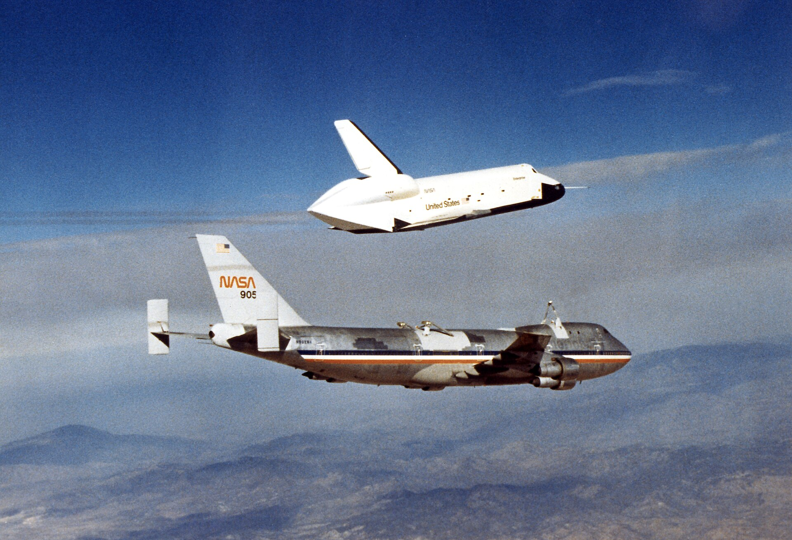
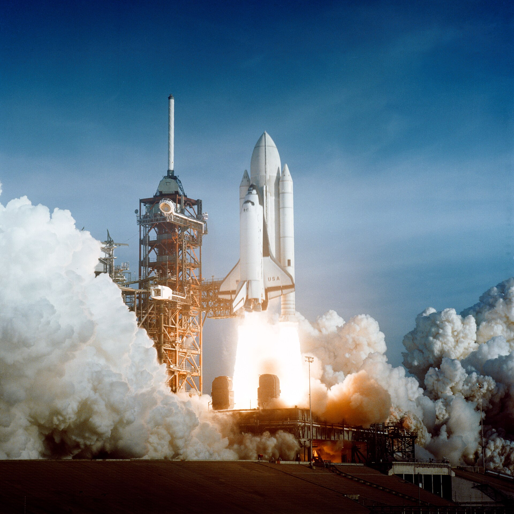
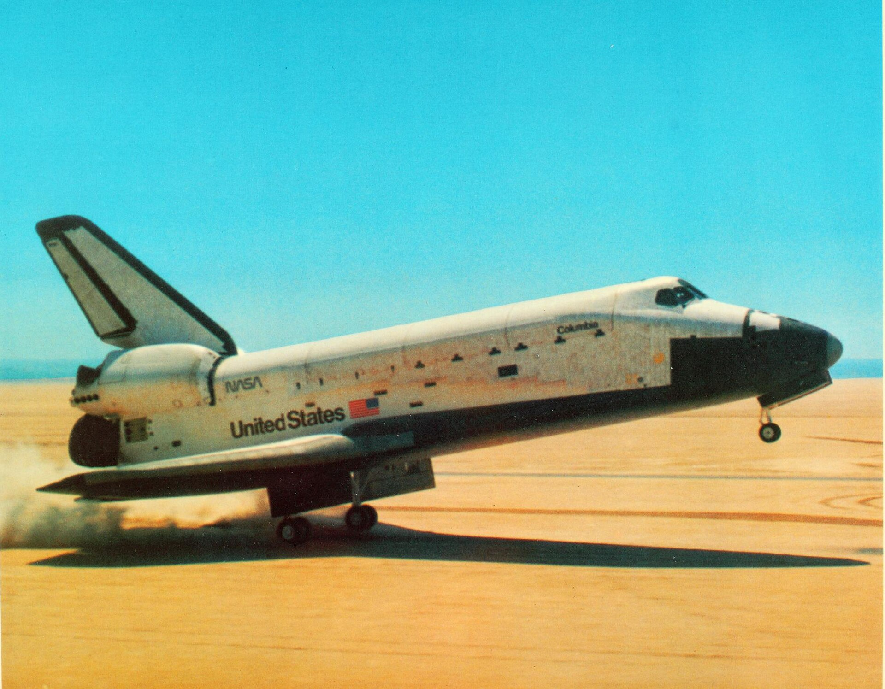

44 years ago today, November 11, 1982. Space Shuttle Columbia lifted off from Kennedy Space Center on STS-5, marking the very first operational flight of America's Space Shuttle program. It was the moment NASA turned a revolutionary experimental vehicle into an active orbital workhorse.

## From Test Flights to Working Operations

Before STS-5, the Space Shuttle had flown four times, beginning with its maiden orbital flight on April 12, 1981. Those initial four missions were research and test flights, designed to evaluate the orbiter's aerodynamics, heat shield tiles, main engines, and landing characteristics. Flown by two-man crews with ejection seats installed for emergency escape, the early flights proved that a reusable winged spacecraft could reach orbit and glide safely back to a runway.

Following the completion of STS-4 in July 1982, NASA officially declared the Space Shuttle operational. Columbia, designated OV-102, was Rockwell International's flagship orbiter. Although later reviews by the Columbia Accident Investigation Board would note that the complex shuttle remained experimental throughout its lifespan, STS-5 was designed to demonstrate that the shuttle could now carry regular paying payloads and larger crews.

## A Record Four-Man Crew Takes Flight

At 07:19:00 a.m. EST on November 11, 1982, Columbia launched on schedule from Launch Complex 39 at the Kennedy Space Center on Florida's Merritt Island. The mission carried a crew of four astronauts, making it the largest human crew ever flown aboard a single spacecraft up to that time.

Demonstrating confidence in the vehicle's operational maturity, the astronauts did not wear bulky pressure suits during the launch, reentry, and landing phases of the flight. Instead, they flew in standard flight suits, a decision reminiscent of earlier Soviet crew flights prior to 1971.

*Archive, 1977 — Photo: NASA/Dryden Flight Research Center / Public domain*

## Delivering Satellites into Orbit

The primary objective of STS-5 was to prove the shuttle's commercial utility by deploying communications satellites directly from its payload bay. Columbia carried two commercial communications satellites: SBS-3, owned by the American company Satellite Business Systems, and Anik-C3, operated by Telesat Canada.

Both Hughes-built HS-376 series satellites were deployed from the cargo bay on schedule. Following separation, McDonnell Douglas PAM-D kick motors ignited to propel each satellite into its intended operational geosynchronous orbit. In addition to the commercial satellites, Columbia carried a West German microgravity Getaway Special canister and three scientific experiments designed by students.

*Space Shuttle Columbia launching — Photo: NASA / Public domain*

## Suit Malfunctions Foil a Planned Spacewalk

STS-5 was also slated to host the first spacewalk of the Space Shuttle program. Crew members William Lenoir and Joseph Allen were scheduled to test newly designed space suits that had been developed as less complicated and less expensive alternatives to the Apollo era suits.

The spacewalk was initially postponed by one day after Lenoir experienced space motion sickness. When the astronauts prepared to perform the extravehicular activity on the following day, equipment problems emerged. Lenoir's suit suffered a malfunctioning oxygen regulator, while Allen's suit had a broken recirculation fan. With both suits compromised, mission managers cancelled the spacewalk entirely. It marked the first time in the history of the American space program that a planned spacewalk was called off due to spacesuit mechanical failures.

*Columbia landing — Photo: San Diego Air &amp; Space Museum / Public domain*

## Touching Down at Edwards Air Force Base

Despite the cancelled spacewalk, the core payload mission was an undisputed success. Columbia circled the Earth 81 times, traveling 2,110,849 miles (3,397,082 kilometers) across five days, two hours, 14 minutes, and 26 seconds in space.

On November 16, 1982, at 06:33:26 a.m. PST, Columbia touched down smoothly on Runway 22 at Edwards Air Force Base in California. Less than a week later, on November 22, the orbiter was ferried back to Kennedy Space Center to undergo modifications in preparation for future scientific flights.

## The Legacy of Columbia's Working Years

STS-5 opened the door to a new phase of human spaceflight. Over its 22-year operational lifetime, Columbia flew 28 missions, completed more than 4,000 orbits, and spent over 300 days in space. It deployed historic payloads, including the Chandra X-ray Observatory, and flew eleven Spacelab missions dedicated to microgravity and biomedical research.

Columbia's journey came to a tragic end during STS-107 in February 2003, when thermal protection damage sustained at liftoff caused the orbiter to break apart during reentry, claiming the lives of all seven crew members. Today, portions of Columbia are preserved at the Kennedy Space Center, honoring the groundbreaking spacecraft that first proved reusable orbiters could work in the harsh environment of space.

### Sources

- <https://en.wikipedia.org/wiki/Space_Shuttle_Columbia>
- <https://commons.wikimedia.org/wiki/File:Space_Shuttle_Columbia_launching_cropped_2.jpg>
- <https://commons.wikimedia.org/wiki/File:OV-101_first_flight.jpg>
- <https://commons.wikimedia.org/wiki/File:Space_Shuttle_Columbia_launching.jpg>
- <https://commons.wikimedia.org/wiki/File:Columbia_landing.jpg>
