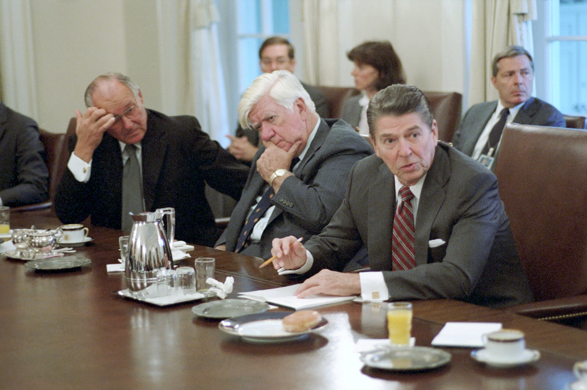
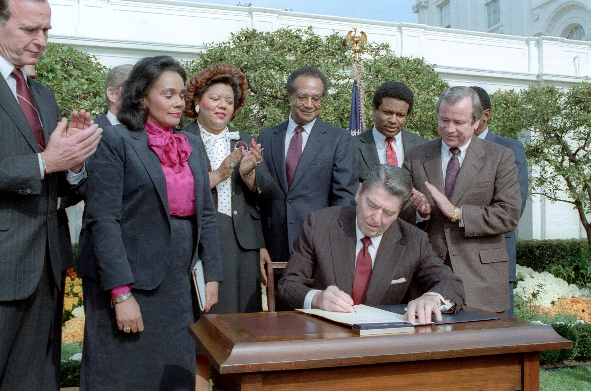
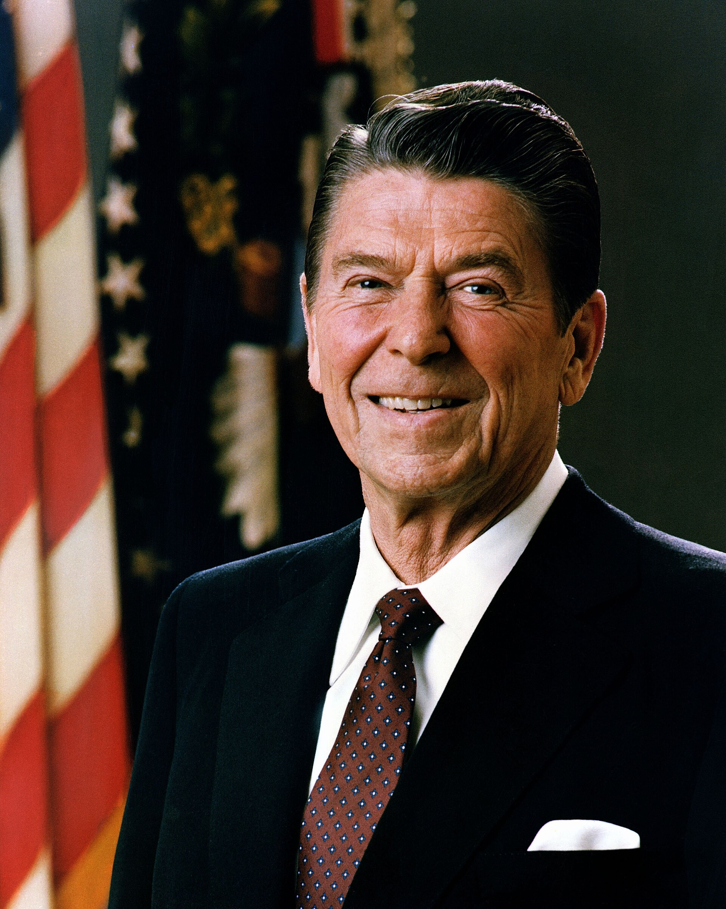

43 years ago today, on November 11, 1983, President Ronald Reagan made history in Tokyo by becoming the first sitting United States president to address the National Diet, Japan's national legislature. The address marked a significant milestone in relations between the United States and Japan, symbolizing how deeply the two nations had transformed their relationship in the decades following World War II. Speaking before both houses of the Diet, Reagan reinforced the bond between the two allies during a critical period of the Cold War.

## A Historic Address in Nagatachō

On that November morning in 1983, Ronald Reagan arrived at the National Diet Building located in Nagatachō, Chiyoda, Tokyo. The National Diet serves as the highest organ of state power and the sole law-making organ under Japan's post-war constitution. Composed of two legislative chambers—the House of Representatives and the Senate—the Diet gathers directly elected lawmakers who represent the nation's 47 administrative prefectures. By standing before both chambers to deliver an official address, Reagan set an unprecedented milestone as the very first American commander-in-chief to speak directly to Japan's elected representatives.

## From Imperial Assembly to Democratic Parliament

The legislative body that welcomed Reagan had undergone profound changes throughout its history. Originally established in 1890 as the Imperial Diet under the Meiji Constitution, the legislature took its modern democratic form in 1947 upon the adoption of Japan's post-war constitution. Following its defeat in the Pacific War in 1945, Japan was under Allied occupation until 1952. During the subsequent decades, Japan experienced rapid economic growth and emerged as a major non-NATO ally of the United States. Gathering inside the grand chamber in Chiyoda, the Diet stood as the centerpiece of a democratic society that had rebuilt itself into a global economic power.

*Archive, 1983 — Photo: President (1981-1989 : Reagan). White House Photographic Off / Public domain*

## Ronald Reagan's Path to the White House

Ronald Wilson Reagan's journey to the podium in Tokyo spanned decades of public life in entertainment and politics. Born on February 6, 1911, in Tampico, Illinois, Reagan grew up in Dixon, Illinois, attending Dixon High School and later Eureka College, where he graduated in 1932. He began his professional career as an Iowa sports broadcaster in 1933 before moving to California in 1937 to work as a film actor. In California, he served two separate stints as president of the Screen Actors Guild, from 1947 to 1952 and again from 1959 to 1960. His national political prominence surged after his 1964 'A Time for Choosing' speech, which paved the way for his election as governor of California in 1966. In 1980, Reagan obtained a landslide victory over incumbent President Jimmy Carter to become the 40th president of the United States.

*Archive, 1983 — Photo: President (1981-1989 : Reagan). White House Photographic Off / Public domain*

## Wartime Service and the Shifting Pacific

Reagan's appearance in Tokyo was particularly poignant given his own military service during the World War II era. In April 1937, Reagan had enlisted in the United States Army Reserve, serving in cavalry regiments before relations between the United States and Japan worsened in late 1941. Called to active duty in April 1942, Reagan reported with severe near-sightedness and transferred to the United States Army Air Forces. Assigned to the 18th AAF Base Unit in Culver City, Captain Reagan produced over 400 military training films before his discharge in December 1945. Decades after that conflict, the former Army Air Forces officer arrived in the Japanese capital not as an adversary, but as the leader of an allied superpower seeking deeper cooperation.

*Archive, 1981 — Photo: Michael Evans / Public domain*

## Bilateral Alliance in the Reagan Era

During his presidency, Reagan implemented major economic reforms known as 'Reaganomics,' emphasizing deregulation and tax cuts alongside reduced domestic spending. On the world stage, Reagan escalated military spending, shifted Cold War policy away from détente, and ordered the October 1983 invasion of Grenada just weeks prior to his journey to East Asia. In this geopolitical landscape, Japan's alliance with the United States served as a cornerstone of Pacific security. Japan had developed into a leading industrial power in automotive and electronics manufacturing. Reagan's speech before the Diet emphasized that shared democratic values and common security interests united the two nations despite past conflict and ongoing economic competition.

## A Lasting Precedent in Diplomatic History

Ronald Reagan went on to win re-election in 1984 against Walter Mondale in one of the largest landslide victories in American history, serving through January 1989. His administration's foreign policies reshaped the global landscape and contributed significantly to the eventual conclusion of the Cold War. Four decades after Reagan stood before the assembled lawmakers in Tokyo, his 1983 address remains a benchmark in trans-Pacific diplomacy, marking the first time an American president spoke directly to the legislature of post-war Japan.

### Sources

- <https://en.wikipedia.org/wiki/Ronald_Reagan>
- <https://commons.wikimedia.org/wiki/File:President_Ronald_Reagan_Meeting_with_President_Hosni_Mubarak_of_Egypt_in_The_Oval_Office_-_DPLA_-_079aff6e5e6220e49a81e9cc4fa740e8.jpg>
- <https://commons.wikimedia.org/wiki/File:Meeting_to_Discuss_The_Situation_in_Grenada_with_a_Group_of_Bipartisan_Members_of_Congress_with_Tip_O%27Neill_and_Bob_Michel_in_Cabinet_Room_-_DPLA_-_522462c995b6e7960861783636f81bd2.jpg>
- <https://commons.wikimedia.org/wiki/File:President_Reagan_at_Signing_Ceremony_for_Martin_Luther_King_Holiday_Legislation_in_the_Rose_Garden_with_Coretta_Scott_King,_George_Bush,_Howard_Baker,_Bob_Dole,_Jack_Kemp,_Samuel_Pi_-_DPLA_-_4e348270f5d83a7644e8b8182bfa6dd1.jpg>
- <https://commons.wikimedia.org/wiki/File:Official_Portrait_of_President_Reagan_1981.jpg>
