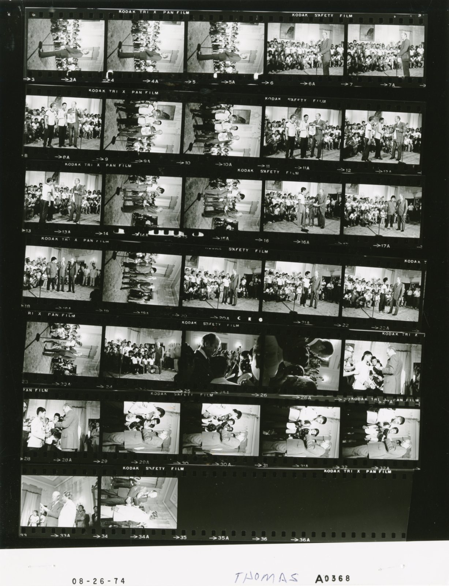
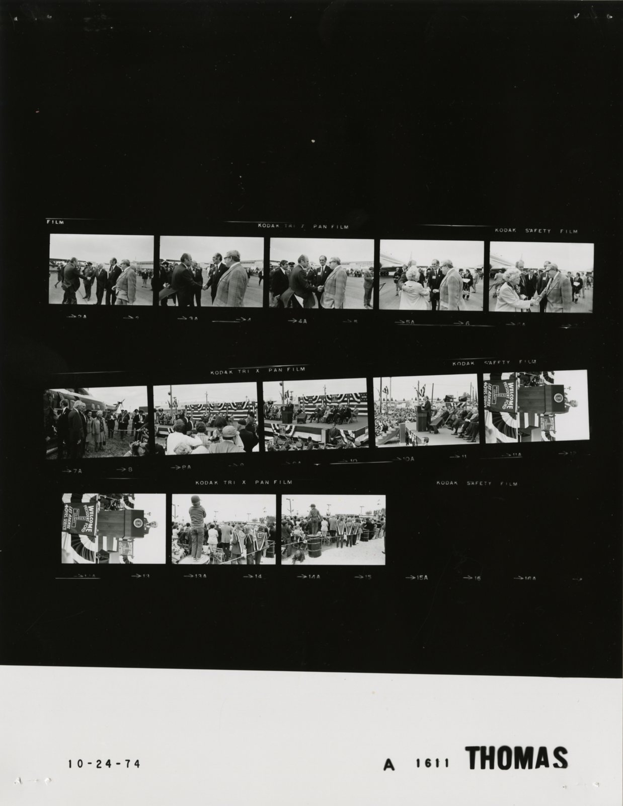
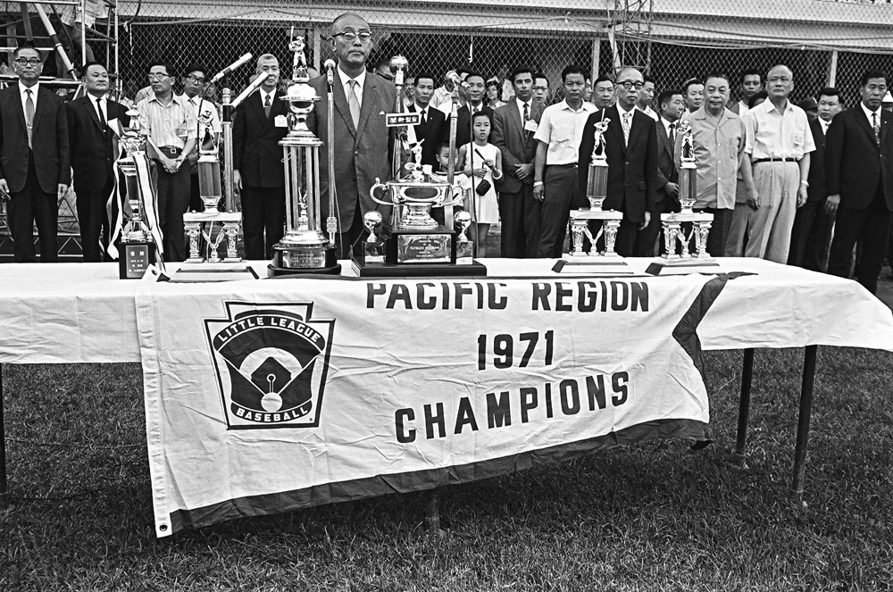

Fifty-two years ago today, on November 11, 1974, Little League baseball officials made an announcement that sent shockwaves through youth sports. The Little League World Series, an event celebrated across America as the pinnacle of summertime baseball, would no longer welcome teams from overseas. Moving forward, participation in the championship tournament would be restricted strictly to squads from the continental United States.

## A Shocking Announcement in Williamsport

On November 11, 1974, word came out of Williamsport, Pennsylvania, that stunned baseball fans and youth coaches across the globe. Little League headquarters officially declared that future Little League World Series tournaments would exclude all international contenders. For a tournament bearing the title of World Series, locking out teams from outside the continental United States seemed like a dramatic retreat from the organization's proud international growth. The sudden decision provoked immediate national attention and sparked fiery debates across sports pages nationwide.

## From Neighborhood Lot to Worldwide Sensation

To understand the weight of that decision, one must look at how Williamsport became synonymous with youth baseball. Carl Edwin Stotz founded Little League in 1939 after experimenting with field dimensions alongside his nephews, Jimmy and Major Gehron. Starting with three sponsored teams—Lycoming Dairy, Jumbo Pretzel, and Lundy Lumber Company—the first official league game was played on June 6, 1939. Stotz served as commissioner for eighteen years, guiding the organization into a beloved American institution.

The tournament quickly expanded beyond Pennsylvania. In 1947, the first Little League World Series was held, with Maynard League of Williamsport defeating Lock Haven for the title. By 1951, international leagues were established in British Columbia, Canada, and the Panama Canal Zone. In 1953, the games entered American living rooms through national broadcasts by commentators like Jim McKay on CBS and Howard Cosell on ABC radio. Little League had evolved from a local gathering into a worldwide phenomenon.

*NOT FROM THE EVENT · 1974 — Photo: White House Photographic Office (WHPO) - Thomas / Public domain*

## The Rise of Taiwan and Growing Frustration

By the late 1960s and early 1970s, international competition was no longer just an ornamental feature of the tournament; it was dominating it. Young ballplayers from Taiwan became an unstoppable powerhouse in Williamsport. Skilled, disciplined, and thoroughly prepared, Taiwanese teams captured four consecutive World Series crowns leading up to 1974.

While the boys from Taiwan thrilled spectators with textbook fundamentals and dominant pitching, their relentless success generated deep frustration among American organizers and coaches. Many argued that the training methods, selection processes, and calendar schedules of international squads differed fundamentally from local neighborhood leagues in the United States, creating what some critics labeled an unfair competitive advantage.

*NOT FROM THE EVENT · 1974 — Photo: White House Photographic Office (WHPO) - Thomas / Public domain*

## Drawing the Line at the Border

Little League officials responded to that mounting domestic pressure with decisive action on November 11, 1974. By barring teams outside the continental United States, the organization attempted to reset the tournament as an exclusively American affair. Critics, however, pointed out the contradiction of holding a World Series that prohibited the rest of the world from entering.

Supporters of the ban claimed it would restore the spotlight to domestic community leagues and give American children a realistic shot at raising the championship banner. Opponents saw it as an act of poor sportsmanship, arguing that youth sports should teach children how to compete with grace, whether winning or losing against superior competition from abroad.

*The Far East Regional Little League World Series, 1971 — Photo: Unknown authorUnknown author / Public domain*

## 1974: A Tumultuous Year of Change

The international ban was not the only historic disruption facing Little League in 1974. That same year marked the dismantling of another longstanding barrier: the exclusion of girls. Back in 1950, Kathryn 'Tubby' Johnston Massar had cut her hair and disguised herself as a boy to play for Kings Dairy in New York, prompting officials to create the infamous 'Tubby Rule' that officially banned girls from 1951 through 1973.

In 1974, a landmark lawsuit filed on behalf of Maria Pepe by the National Organization for Women led the New Jersey Superior Court to rule that girls must be permitted to play. In the final week of December 1974, President Gerald Ford signed a bill amending Little League's congressional charter to formally open baseball to girls. The year 1974 stood as a pivotal turning point where the boundaries of who could step onto the diamond were radically tested and reshaped.

## The Enduring Legacy of Williamsport

The exclusion of foreign teams proved to be a temporary chapter in Little League's history, but the debate it provoked underscored the delicate balance between competitive youth sports and true sportsmanship. In time, international teams returned to Williamsport, restoring the World Series to its proper global scale.

Today, Little League spans millions of boys and girls playing in tens of thousands of communities across more than eighty countries. Every August, young ballplayers still look toward the manicured fields of South Williamsport as a place where children from distant continents meet as equals across home plate.

### Sources

- <https://www.nytimes.com/1974/11/12/archives/little-league-series-bars-foreigners-ban-set-by-little-league.html>
- <https://commons.wikimedia.org/wiki/File:Ford_A0365_NLGRF_photo_contact_sheet_(1974-08-26)(Gerald_Ford_Library).jpg>
- <https://commons.wikimedia.org/wiki/File:Ford_A0368_NLGRF_photo_contact_sheet_(1974-08-26)(Gerald_Ford_Library).jpg>
- <https://commons.wikimedia.org/wiki/File:Ford_A1611_NLGRF_photo_contact_sheet_(1974-10-24)(Gerald_Ford_Library).jpg>
- <https://commons.wikimedia.org/wiki/File:The_Far_East_Regional_Little_League_World_Series,_1971.jpg>
