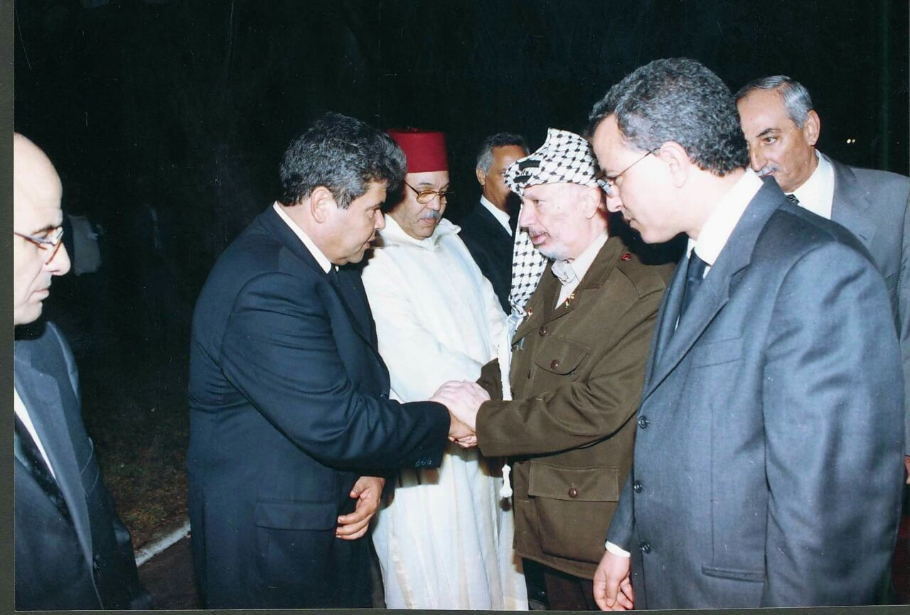
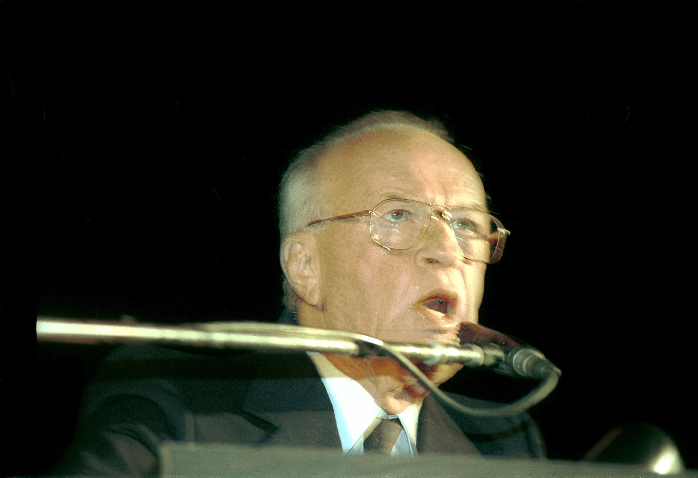
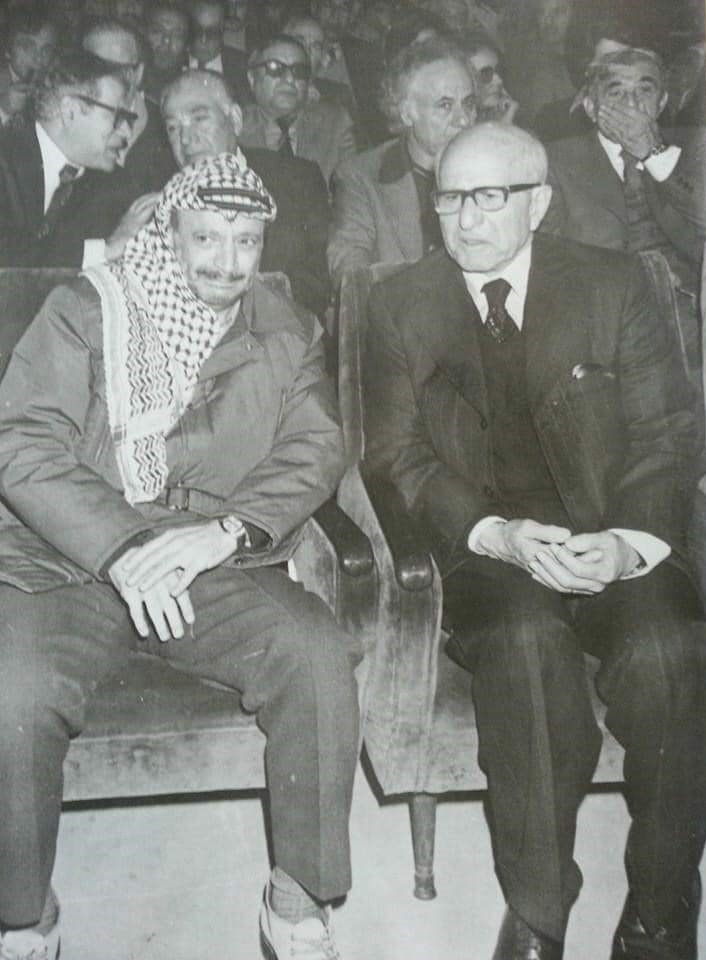

Twenty-two years ago today, on November 11, 2004, the Palestine Liberation Organization confirmed the death of its longtime chairman, Yasser Arafat, at the age of 75. The veteran Palestinian leader passed away at the Percy military hospital in Clamart, a suburb of Paris, following a sudden and unexplained illness. Minutes after the official announcement, the PLO executive elected Mahmoud Abbas as its new chairman, marking a historic transition for the Palestinian Authority and the broader Middle East.

## The Rise of a Guerrilla Leader and Statesman

Arafat was born in Cairo, Egypt, in August 1929 and studied at the University of King Fuad I. After fighting alongside the Muslim Brotherhood during the 1948 Arab-Israeli War, he served as president of the General Union of Palestinian Students from 1952 to 1956. In the late 1950s, he co-founded Fatah, a paramilitary movement that launched armed attacks against Israeli targets.

By 1967, Arafat brought Fatah into the Palestine Liberation Organization, which had been founded in 1964 following a summit of the Arab League. In 1969, Arafat was elected chairman of the PLO, a post he would hold until his death in 2004. Under his leadership, the PLO operated from Jordan until being expelled in July 1971, after which it relocated to Lebanon. Arafat became the internationally recognized symbol of Palestinian national aspirations, securing United Nations observer status for the PLO in 1974.

## Confinement in Ramallah and Sudden Illness

In 1988, Arafat made a major diplomatic shift by acknowledging Israel's right to exist and endorsing a two-state settlement. This led to direct negotiations and the signing of the 1993 Oslo Accords, followed by Arafat receiving the Nobel Peace Prize in 1994 alongside Israeli leaders Yitzhak Rabin and Shimon Peres. That same year, Arafat returned to Palestinian territory to head the newly established Palestinian National Authority.

However, the peace process broke down, and the Second Intifada erupted in 2000. During the violence, the Israeli military laid siege to Arafat's presidential compound in Ramallah, effectively confining him there for over 2 years. On October 12, 2004, Arafat suddenly fell ill with acute nausea, vomiting, abdominal pain, and diarrhea. Medical teams from Tunisia, Jordan, and Egypt arrived at the compound, but his condition showed no improvement.

*Archive, 2004 — Photo: Yassine2018 / CC BY-SA 4.0*

## The Final Days in a Paris Military Hospital

With his health deteriorating, Arafat was evacuated on a French government jet on October 29, 2004, and admitted to the Percy military training hospital in Clamart, near Paris. Doctors diagnosed him with disseminated intravascular coagulation, along with liver and kidney dysfunction. On November 3, Arafat slipped into a gradually deepening coma as his kidneys failed.

A bitter dispute soon erupted between Palestinian Authority officials and Arafat's wife, Suha Arafat. Under French privacy law, physicians could only share medical information with immediate family, meaning updates were strictly filtered through his wife. Chief surgeon Christian Estripeau reported his condition was grave, but religious authority Sheikh Taissir Tamimi held a bedside vigil and insisted that taking him off life support was forbidden under Islamic law.

*Assassination of Prime Minister Yitzhak Rabin, 1995 I Dan Hadani Archive — Photo: Israel Press and Photo Agency (I.P.P.A.) photographer / CC BY 4.0*

## The Mystery Blood Disorder and Unanswered Questions

At 03:30 UTC on November 11, 2004, Arafat was pronounced dead at age 75. French doctors cited a massive hemorrhagic stroke as the proximate cause, but the underlying illness was described only as an unknown infection and a mystery blood disorder. French media, including Le Monde and Canard Enchaîné, cited hospital sources reporting severe liver damage and abnormal blood composition, while firmly ruling out leukemia.

Following his death, the French Ministry of Defence released a 558-page medical file to Arafat's nephew and UN envoy, Nasser al-Qudwa. The lack of a conclusive medical explanation fueled widespread theories about what caused his rapid decline. Subsequent investigations by French and Russian teams concluded there was no evidence of foul play, while a separate Swiss team later reported findings suggesting radiological poisoning.

*Abd al-Karim al-Karmi — Photo: Unknown authorUnknown author / Public domain*

## The American Relationship and International Diplomacy

Arafat's death closed a complex chapter in United States diplomacy. In 1987, the United States had officially designated the PLO as a terrorist group, reflecting years of militant attacks and plane hijackings by member factions. However, starting in 1988, a presidential waiver allowed American officials to maintain direct contact with the organization.

The United States subsequently hosted the signing of the 1993 Oslo Accords on the White House lawn and mediated the 2000 Camp David Summit. While American policy required the PLO to accept United Nations Security Council Resolution 242 and renounce violence, relations grew strained during the Second Intifada. When Arafat died, Washington quickly looked to Mahmoud Abbas, who was chosen as PLO chairman minutes after Arafat's passing, to lead a new round of diplomacy.

## An Enduring Legacy and Debated History

More than two decades after his passing, Arafat remains one of the modern era's most polarizing figures. To millions of Palestinians, he was Abu Ammar, the tireless founding father who elevated their struggle onto the world stage. Conversely, many Israelis remembered him as the architect of violent operations against civilians, refusing to view him as a genuine partner for peace.

His successor, Mahmoud Abbas, took charge of a fractured political landscape, facing domestic challenges from Islamist rivals such as Hamas. The unresolved questions surrounding Arafat's medical crisis in Paris continue to symbolize the contentious, unfinished narrative of the Israeli-Palestinian conflict.

### Sources

- <https://en.wikipedia.org/wiki/November%2011>
- <https://commons.wikimedia.org/wiki/File:Arafat_Tomb.JPG>
- <https://commons.wikimedia.org/wiki/File:Ahmed_Iraqi_%26_Arafat.jpg>
- <https://commons.wikimedia.org/wiki/File:Assassination_of_Prime_Minister_Yitzhak_Rabin,_1995_I_Dan_Hadani_Archive.jpg>
- <https://commons.wikimedia.org/wiki/File:Abd_al-Karim_al-Karmi.jpg>
