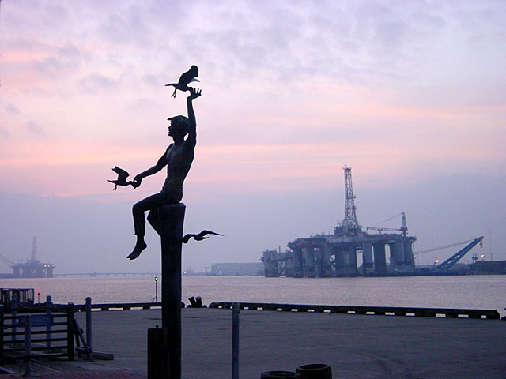
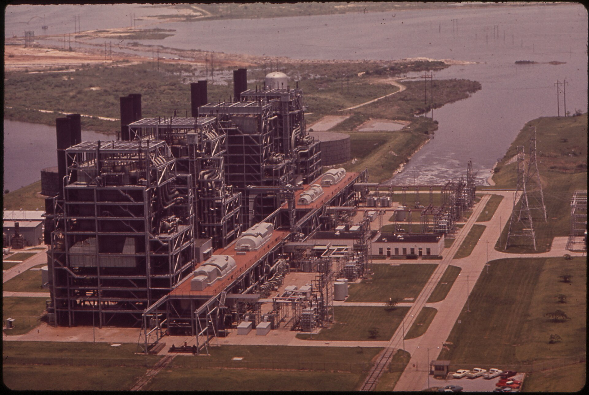
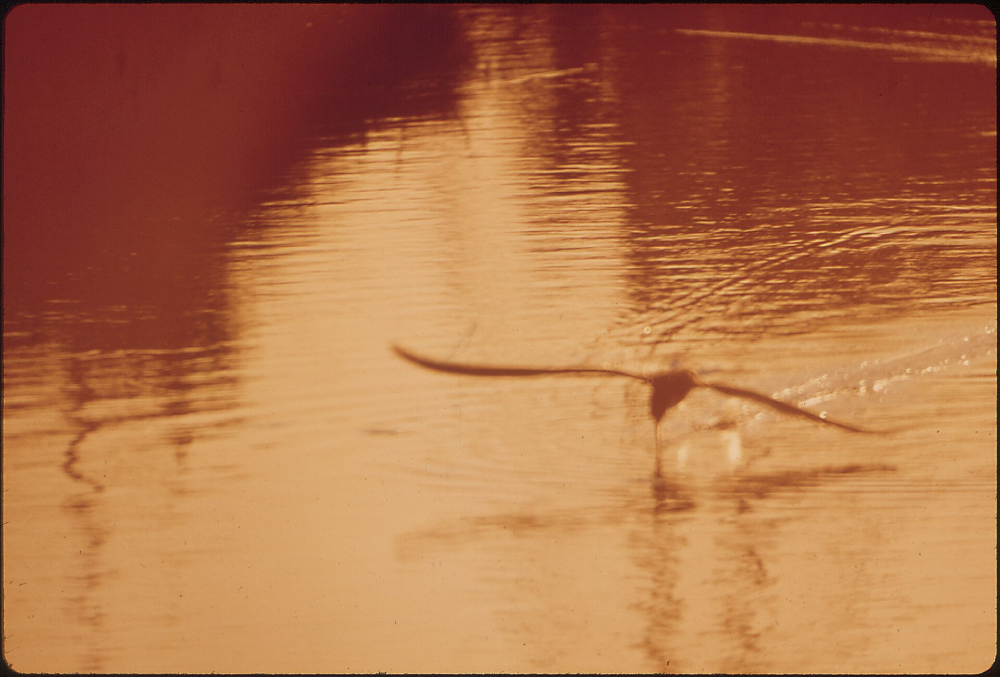

23 years ago today, on November 11, 2003, a Texas jury delivered one of the most astonishing verdicts in modern American courtroom history. Robert Durst, the eccentric heir to a vast New York City real estate fortune, was acquitted of murder in the death of his 71-year-old neighbor Morris Black. The decision stunned observers nationwide, particularly because Durst had openly admitted to dismembering Black's body and dumping the remains into Galveston Bay.

## A Verdict That Stunned the Courtroom

Inside the Galveston, Texas courthouse, the atmosphere was tense as the jury returned after days of deliberation. Prosecutors had presented what they believed was an open-and-shut case of intentional murder against the wealthy Manhattan heir. Robert Durst had confessed on the witness stand to cutting up Morris Black's body with a bow saw and packing the parts into garbage bags.

Yet when the jury foreman read the verdict, Durst was cleared of murder. Spectators in the courtroom gasped, while legal analysts struggled to comprehend how a man who admitted to butchering his neighbor could walk away acquitted. The defense had successfully argued that the killing itself was an act of justifiable self-defense.

## Heir to a Manhattan Real Estate Dynasty

Robert Alan Durst was born into immense wealth and influence in New York City. His grandfather, Joseph Durst, an immigrant tailor, had founded the Durst Organization in 1927, which grew into one of the most powerful commercial real estate developers in Manhattan. As the eldest son of Seymour Durst, Robert was originally expected to take over the family firm.

However, Robert's erratic behavior and troubled psychological history created deep friction within the family. In 1992, Seymour Durst broke family tradition and appointed Robert's younger brother Douglas to lead the multibillion-dollar company. Enraged and alienated, Robert cut ties with his family and later launched lawsuits that eventually resulted in a 65 million dollar buyout of his share in the family trust in 2006.

*NOT FROM THE EVENT · 2003 — Photo: Martin Burns / CC BY 2.0*

## The Disappearance of Kathleen McCormack

Long before the trial in Texas, Durst lived beneath a cloud of suspicion dating back to January 1982. His first wife, Kathleen McCormack Durst, a fourth-year medical student just months away from earning her degree, vanished without a trace after a dinner party in Connecticut.

Durst gave conflicting accounts to police about her disappearance, initially claiming he put her on a commuter train to Manhattan and later admitting he had simply gone to bed. Friends revealed that Durst had subjected McCormack to physical abuse, and she had sought a 250,000 dollar divorce settlement shortly before she disappeared. The case remained unsolved, casting an inescapable shadow over Durst for the rest of his life.

*HOUSTON LIGHTING AND POWER COMPANY ON GALVESTON BAY - NARA - 545841 — Photo: Blair Pittman / Public domain*

## A Secret Life and a Grisly Finding in Galveston

In 2000, New York authorities reopened the investigation into Kathleen's disappearance, and that December, Durst's close longtime friend Susan Berman was shot dead in her Los Angeles home before police could interview her. Seeking to escape the mounting scrutiny, Durst fled to Galveston, Texas, where he rented a cheap boarding house apartment while disguising himself as a mute woman.

His elderly neighbor across the hall was Morris Black. In late 2001, local fishermen spotted trash bags floating in Galveston Bay containing human limbs and a torso, quickly identified as Black's remains. The victim's head was never recovered, a critical piece of missing evidence that would ultimately shape the outcome of the murder trial.

*MARSH LAND - NARA - 543922 — Photo: Jim Olive / Public domain*

## The High-Stakes Defense Strategy

Durst assembled a formidable legal defense team led by prominent Texas attorneys. Rather than denying the gruesome aftermath, Durst took the stand in his own defense and detailed what he claimed happened inside his boarding house room. He testified that he walked in to find Black armed with his target pistol.

According to Durst, a desperate physical struggle ensued, during which the weapon discharged accidentally, striking Black in the face. Durst claimed he did not call police because he panicked, fearing authorities would never believe him given the renewed investigation into his missing wife. He argued that dismembering the body was a frantic attempt to conceal the death, not proof of murder. Because Black's head was missing, prosecutors could not conclusively demonstrate the bullet's trajectory, leaving the jury with reasonable doubt.

## The Final Reckoning Decades Later

Although acquitted of murder in Texas, Durst's freedom did not last forever. In 2015, his participation in the documentary miniseries The Jinx exposed damaging new evidence and unguarded remarks that reignited criminal investigations against him.

Durst was subsequently arrested and prosecuted in California for the 2000 murder of Susan Berman. In September 2021, a jury convicted him of first-degree murder, and he was sentenced to life imprisonment without parole. He was also formally charged with McCormack's murder shortly afterward, but passed away in custody in January 2022 before that final trial could take place.

### Sources

- <https://www.nytimes.com/2003/11/12/nyregion/new-york-city-real-estate-heir-is-acquitted-of-murder-in-texas.html>
- <https://commons.wikimedia.org/wiki/File:USCGC_Heron_on_fishery_patrol.jpg>
- <https://commons.wikimedia.org/wiki/File:Galveston_Sunset_-_Flickr_-_Martin_Burns.jpg>
- <https://commons.wikimedia.org/wiki/File:HOUSTON_LIGHTING_AND_POWER_COMPANY_ON_GALVESTON_BAY_-_NARA_-_545841.jpg>
- <https://commons.wikimedia.org/wiki/File:MARSH_LAND_-_NARA_-_543922.jpg>
