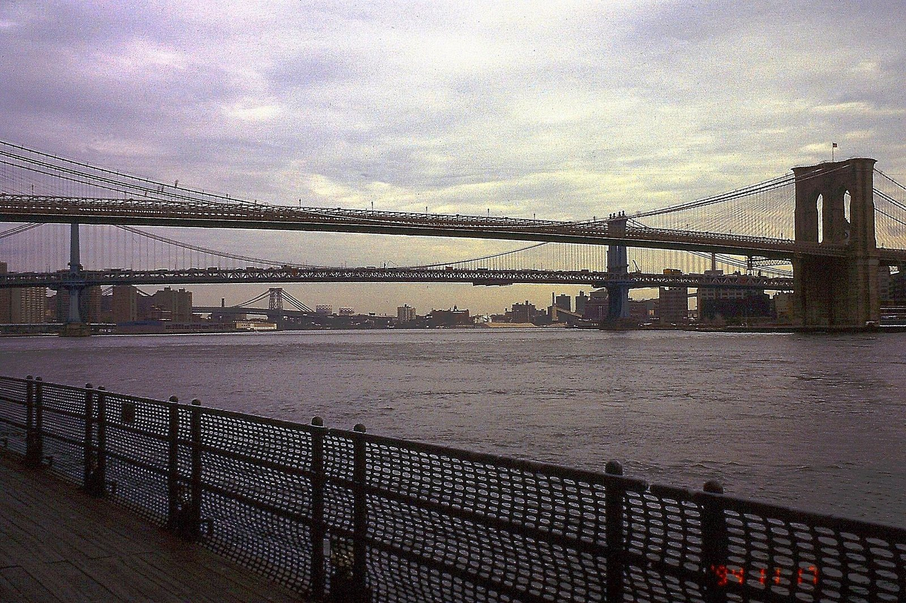
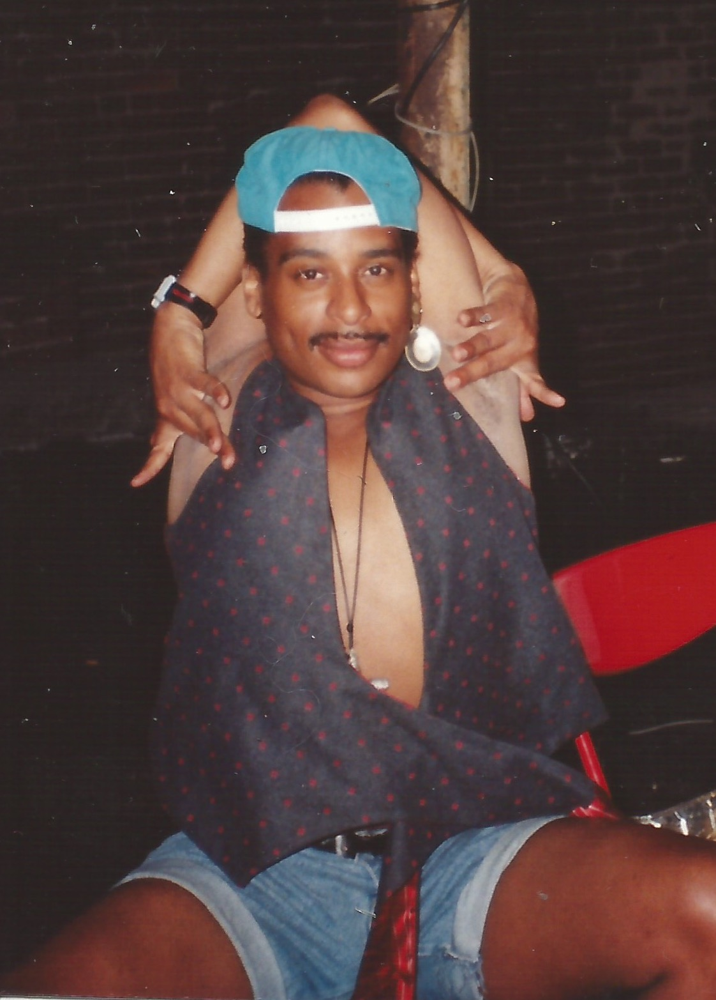
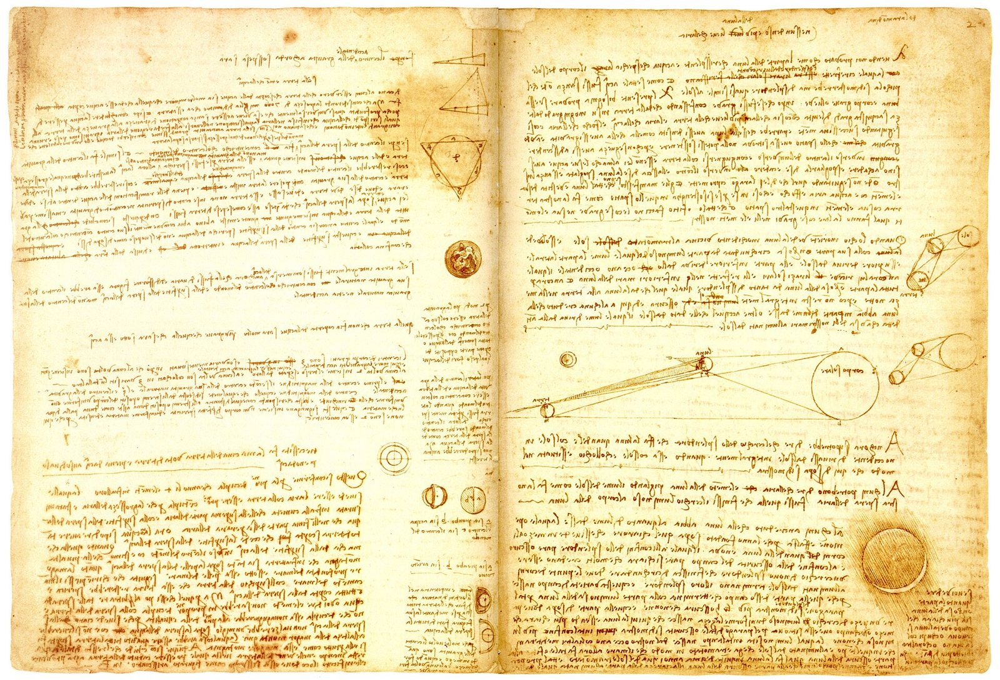

On November 11, 1994, an extraordinary piece of Renaissance history crossed the auction block at Christie's in New York. A rare notebook handwritten and illustrated by Leonardo da Vinci was sold for $30.8 million, setting the all-time world record for any manuscript sold at auction. The front page of The New York Times reported the milestone the following morning, celebrating a price that stunned the international cultural community.

## The Florentine Workshop and the Making of a Polymath

Leonardo di ser Piero da Vinci was born on April 15, 1452, near the Tuscan hill town of Vinci, roughly 35 kilometers from Florence. Born out of wedlock to a peasant woman named Caterina and a legal notary named Ser Piero da Vinci, he received only basic informal schooling in reading, writing, and mathematics. In the mid-1460s, his family moved to Florence, then the bustling center of Christian humanist thought and culture. Around the age of 14, Leonardo entered the workshop of Andrea del Verrocchio, who was the leading painter and sculptor of his era.

Verrocchio's studio provided an intensive education that went far beyond traditional painting. Alongside fellow apprentices such as Botticelli, Perugino, and Ghirlandaio, Leonardo was trained in drafting, chemistry, metallurgy, plaster casting, mechanics, and woodworking. By the age of 17, he was a formal apprentice, remaining with Verrocchio for seven years. This broad technical grounding shaped Leonardo into a polymath whose interests bridged the visual arts and empirical sciences.

## Inside the Notebook: 300 Drawings of the Natural World

While Leonardo's fame initially rested on his mastery as a painter, his notebooks have since become legendary in their own right. Throughout his career, working in Milan for Ludovico Sforza, in Florence, in Rome, and eventually in France, Leonardo kept running notes filled with empirical observations. The manuscript sold at Christie's in 1994 contained more than 300 illustrations and scientific treatises penned directly in the artist's hand.

These pages captured Leonardo's restless intellect at work. Rather than accepting medieval scholastic dogma, he investigated natural phenomena through direct observation and measurement. His drawings and notes examined hydrodynamics, civil engineering, optics, astronomy, geology, botany, and palaeontology. Every sketch served as a tool for thinking through how water flowed, how celestial bodies moved, and how the physical forces of the earth operated.

*New York East River Brooklyn Manhattan Bridge e PICT0026 19941117 — Photo: Karlunun / CC BY-SA 4.0*

## The 1994 Christie's Auction Sets a Global Record

Because Leonardo never formally published his scientific findings during his lifetime, his original writings had little direct influence on the subsequent scientific revolution. Instead, his surviving papers were scattered into private collections and institutional libraries, making them among the rarest historical documents in existence. When this rare scientific notebook was offered at Christie's on November 11, 1994, collectors and institutions around the world took notice.

Anticipation ran exceptionally high as bidding opened. Bids mounted swiftly, driven by the realization that a comparable manuscript from the Renaissance genius might never appear on the public market again. By the time the final gavel struck, the price had reached $30.8 million. The transaction immediately entered the record books as the highest price ever paid for a manuscript at public auction.

*Willi Ninga NYC — Photo: Isabelle B83 / CC BY-SA 4.0*

## A Visionary Engineer Centuries Ahead of His Time

The record-setting price reflected a growing modern appreciation for Leonardo's technological ingenuity. In his extensive notes, Leonardo conceptualized visionary machines that anticipated modern engineering by centuries. He drew schematics for flying machines, an armored fighting vehicle, concentrated solar power, a double hull for vessels, and an early ratio machine that could assist in mechanical addition.

Modern scientific approaches to metallurgy and engineering were only in their infancy during the 15th and 16th centuries, meaning that few of his larger conceptual designs could feasibly be constructed during his lifetime. However, some of his smaller mechanical innovations quietly entered manufacturing unheralded, including an automated bobbin winder and a specialized machine for testing the tensile strength of wire. His notebooks demonstrated a mind constantly seeking to harness mechanical forces.

*Vinci - Hammer 2A — Photo: Leonardo da Vinci (1452-1519) / Public domain*

## The Enduring Market for Leonardo's Genius

The $30.8 million auction in 1994 was a harbinger of how the modern world would continue to value Leonardo's scarce output. With fewer than 25 major paintings surviving—several of them unfinished—any work attributed to his hand commands unparalleled prestige. In 2017, the painting Salvator Mundi, attributed in whole or part to Leonardo, was sold at auction for $450.3 million, setting the all-time world record for the most expensive painting ever sold at public auction.

From cultural touchstones like the Mona Lisa, The Last Supper, and the Vitruvian Man drawing to his private scientific treatises, Leonardo remains the ultimate symbol of human curiosity. More than 500 years after his death at Amboise in France on May 2, 1519, the sale of his scientific notebook on November 11, 1994, stands as a defining moment when the world paid historic tribute to his inquiring mind.

### Sources

- <https://www.nytimes.com/1994/11/12/us/leonardo-notebook-sells-for-30.8-million.html>
- <https://commons.wikimedia.org/wiki/File:Louise_Bourgeois_and_Tetsuo_Harada.jpg>
- <https://commons.wikimedia.org/wiki/File:New_York_East_River_Brooklyn_Manhattan_Bridge_e_PICT0026_19941117.jpg>
- <https://commons.wikimedia.org/wiki/File:Willi_Ninga_NYC.jpg>
- <https://commons.wikimedia.org/wiki/File:Vinci_-_Hammer_2A.jpg>
