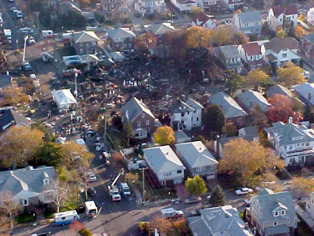
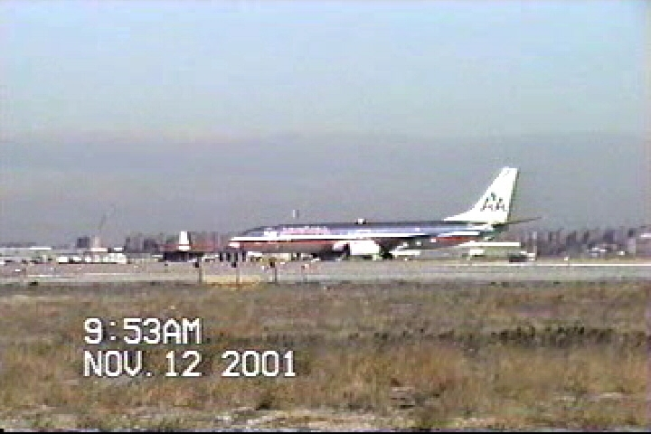
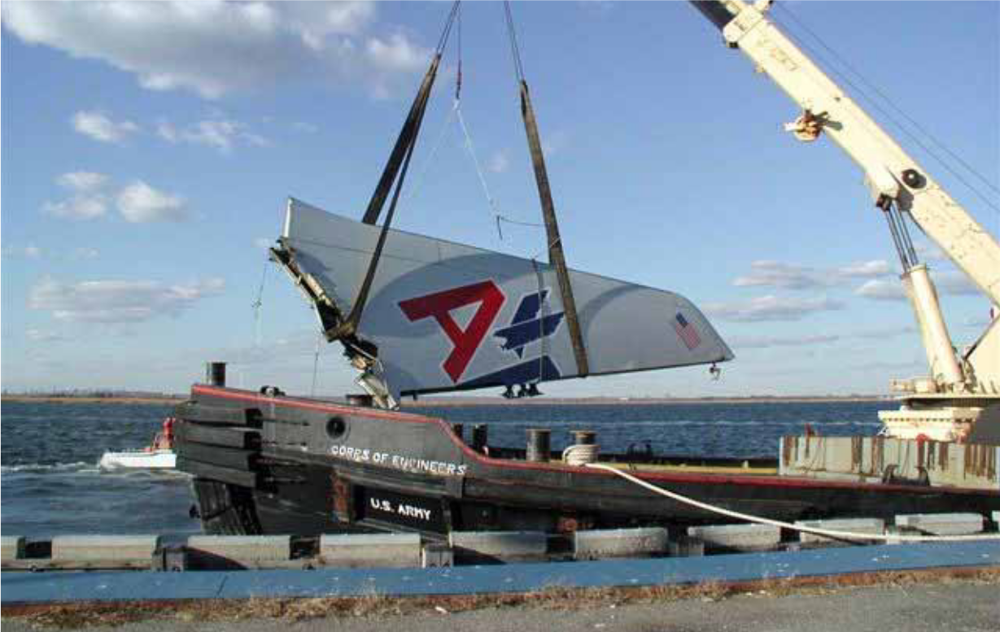

25 years ago today, on November 12, 2001, American Airlines Flight 587 crashed into the residential neighborhood of Belle Harbor on the Rockaway Peninsula in Queens, New York. All 251 passengers and nine crew members on board lost their lives, along with five people on the ground.

## A City Already on Edge

The disaster struck exactly two months and one day after hijacked airliners brought down the Twin Towers of the World Trade Center in lower Manhattan. When a heavy column of black smoke rose over Queens on that Monday morning, residents across New York feared the worst. Because it was Veterans Day, commuter traffic was lighter than usual, but the city plunged into immediate crisis. Authorities evacuated prominent landmarks, including the Empire State Building and the headquarters of the United Nations. The Port Authority closed all bridges and tunnels connecting Manhattan and New Jersey and suspended PATH train service. The metropolitan area's three major airports—JFK, LaGuardia, and Newark—shut down for much of the day. In the sky above, Air National Guard fighter jets scrambled to patrol American airspace.

## Departure from Runway 31L

Flight 587 was a regularly scheduled passenger flight from John F. Kennedy International Airport to Las Américas International Airport in Santo Domingo, the capital of the Dominican Republic. The aircraft was an Airbus A300-600, powered by two General Electric engines and carrying a full manifest of 251 passengers, along with nine crew members. In the cockpit were 42-year-old Captain Edward States, who was handling radio communications, and 34-year-old First Officer Sten Molin, who was flying the aircraft. The airliner taxied to Runway 31L directly behind a Japan Airlines Boeing 747-400 bound for Tokyo. The Japanese jet took off at 9:11 a.m., and the JFK tower controller specifically cautioned the crew of Flight 587 about potential wake turbulence generated by the heavy Boeing ahead of them.

*Archive, 2001 — Photo: NOAA / Public domain*

## Minutes of Chaos in the Sky

Flight 587 was cleared for takeoff at 9:13 a.m. and lifted off roughly one minute and 40 seconds behind the Boeing 747. The Airbus climbed through 500 feet and began a left turn, receiving instructions from departure control to climb toward 13,000 feet. At 9:15:36 a.m., the flight data recorder registered the first impact of wake turbulence swirling off the preceding jet. In response to the turbulence, First Officer Molin made rapid, full pedal inputs, sweeping the rudder from left to right and back again. The violent side-to-side forces created immense aerodynamic stress on the tail assembly. At 9:15:58 a.m., the composite attachment lugs failed completely, and the entire vertical stabilizer snapped off the aircraft, plummeting into Jamaica Bay, about a mile north of the main crash site.

*Archive, 2001 — Photo: NTSB / Public domain*

## The Final Seconds in Belle Harbor

Without its vertical fin, the Airbus pitched downward violently and fell into an uncontrollable flat spin. The extreme aerodynamic forces tore both General Electric engines off their wing mounts. One engine landed several blocks away, damaging a local boat and a residence, while the other fell near a neighborhood gas station. Inside the cockpit, the voice recorder captured the crew's desperate fight for survival. First Officer Molin cried out, 'What the hell are we into, we're stuck in it,' to which Captain States replied, 'Get out of it, get out of it.' Seconds later, at 9:16 a.m., the aircraft slammed into the intersection of Newport Avenue and Beach 131st Street in Belle Harbor, destroying several homes and killing five people on the ground.

*Archive, 2001 — Photo: NTSB / Public domain*

## Investigating Rumors of Sabotage

In the months following the disaster, persistent rumors linked the crash to al-Qaeda. A detained operative later claimed during interrogations that a shoe bomber named Abderraouf Jdey had brought down Flight 587 using a Canadian passport. However, investigators scrutinized American Airlines' passenger manifest and found no travelers using Canadian documentation, nor any evidence of an explosion or disturbance inside the passenger cabin. NTSB spokesman Ted Lopatkiewicz confirmed that physical evidence showed the vertical fin separated from exterior structural failure rather than any explosive event. Federal investigators formally dismissed the terrorism theory after exhaustive forensic analysis.

## Findings That Reshaped Aviation

The National Transportation Safety Board conducted 349 interviews and reconstructed the shattered aircraft wreckage. The final investigation concluded that First Officer Molin's aggressive and alternating rudder pedal inputs had overstressed the composite vertical stabilizer beyond its ultimate design limits. The NTSB attributed this reaction to a flawed pilot training curriculum that had exaggerated the dangers of wake turbulence and encouraged rapid rudder usage to counter upset conditions. The tragic crash of Flight 587 stands as the second-deadliest aviation accident on United States soil, behind only the 1979 crash of American Airlines Flight 191 in Chicago. The disaster prompted widespread revisions to pilot upset recovery training across the global airline industry, ensuring pilots understand the structural limits of modern airliner rudders.

### Sources

- <https://en.wikipedia.org/wiki/Airbus_A300>
- <https://commons.wikimedia.org/wiki/File:AA587_Tollbooth_Video.JPG>
- <https://commons.wikimedia.org/wiki/File:Flight_587_NOAA_Photo_of_Crash_Site.jpg>
- <https://commons.wikimedia.org/wiki/File:American_Airlines_587_before_takeoff.jpg>
- <https://commons.wikimedia.org/wiki/File:American_Airlines_Flight_587_vertical_stabilizer.png>
