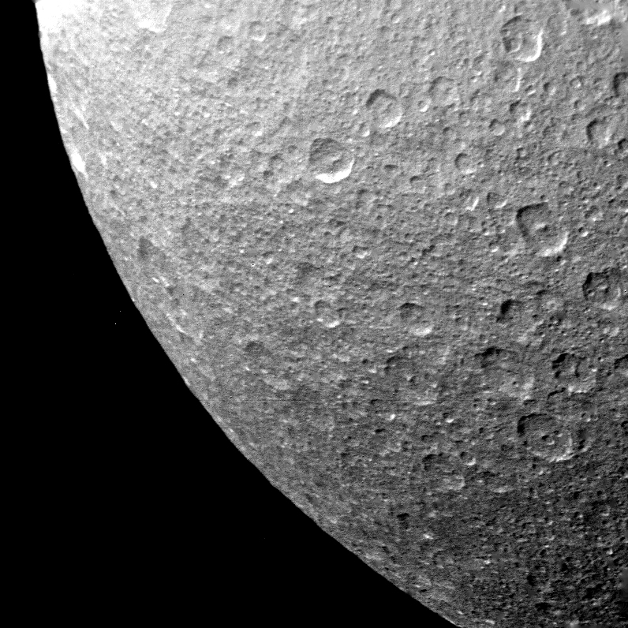
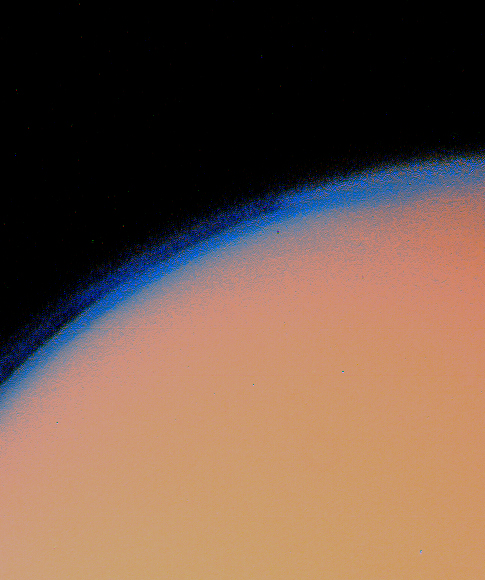
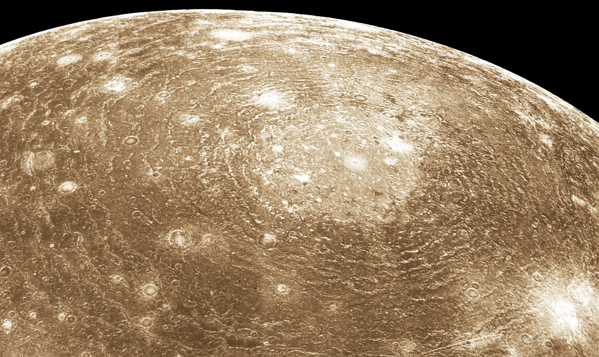

46 years ago today, November 12, 1980, the NASA space probe Voyager 1 made its closest approach to Saturn, capturing the first detailed images of the planet's brilliant rings and mysterious moons. The encounter transformed human understanding of the outer Solar System and set the American spacecraft on an unprecedented journey into interstellar space.

## The Ambition to Explore the Outer Solar System

During the 1960s, scientists proposed an ambitious Grand Tour mission to explore the outer planets of our Solar System. Initially envisioned within NASA's Mariner program as Mariner 11, the concept underwent significant revisions due to federal budget constraints. The mission was refocused specifically on flybys of Jupiter and Saturn under the name Mariner Jupiter-Saturn. As engineers introduced major architectural enhancements, the project evolved into the dedicated Voyager program, overseen by NASA and built by the Jet Propulsion Laboratory.

## Engineering the Deep Space Pioneer

Voyager 1 was designed to survive extreme environments and operate across vast interplanetary distances. The spacecraft bus was constructed as a decagonal prism housing sixteen hydrazine thrusters and three-axis stabilization gyroscopes to keep its instruments steady. It carried eleven specialized scientific instruments, including plasma wave subsystems and magnetometers, powered by radioisotope thermoelectric generators. Communication with Earth relied on a 3.7-meter Cassegrain antenna sending signals across the NASA Deep Space Network, supplemented by a 64-megabyte digital tape recorder to preserve findings during blackouts.

*Archive, 1980 — Photo: NASA/JPL / Public domain*

## The Choice Between Titan and Pluto

Voyager 1 launched from Cape Canaveral on September 5, 1977, departing sixteen days after its sister craft, Voyager 2. As mission planners mapped the spacecraft's trajectory through the Solar System, they faced a pivotal operational choice: send the probe onward toward Pluto, or target a close flyby of Saturn's largest moon, Titan. Exploration of Titan took priority because astronomers recognized that the massive moon possessed a substantial atmosphere, making it a primary target for planetary science.

*Archive, 1980 — Photo: NASA/JPL / Public domain*

## November 12, 1980: Revealing Saturn's Rings

On November 12, 1980, Voyager 1 reached its point of closest approach to Saturn, orbiting nearly 9.6 astronomical units from the Sun. The gas giant, boasting an average radius nine times that of Earth and over ninety-five times its mass, presented an awe-inspiring view. Voyager 1 beamed back the first clear, close-up images of Saturn's extensive ring system, showing that the rings consisted largely of countless particles of water ice, dust, and rocky debris. The probe also gathered critical measurements of Saturn's upper atmospheric winds, which can reach 1,800 kilometers per hour, and examined its intricate collection of orbiting moons.

*Archive, 1979 — Photo: NASA, Calvin J. Hamilton / Public domain*

## Into the Interstellar Void

The gravitational encounter with Titan and Saturn redirected Voyager 1 upward and out of the ecliptic plane, propelling it toward the frontier of our Solar System. Decades after completing its primary planetary objectives, the spacecraft continued transmitting engineering and scientific telemetry across billions of miles. On August 25, 2012, Voyager 1 officially crossed the heliopause and entered interstellar space, becoming the first human-made craft to leave the Sun's heliosphere. Even decades later, ground controllers successfully revived backup thrusters to extend its operational life.

## An Enduring American Achievement

Today, Voyager 1 stands as the most distant human-made object from Earth, traveling over 173 astronomical units away. Signals carrying its data take nearly a full day to reach the Deep Space Network's giant ground stations. The close-up images of Saturn returned on this day in 1980 demonstrated the reach of American civilian space exploration, forever expanding the horizons of what robotic science could achieve.

### Sources

- <https://en.wikipedia.org/wiki/NASA>
- <https://commons.wikimedia.org/wiki/File:Crescent_Saturn_as_seen_from_Voyager_1.jpg>
- <https://commons.wikimedia.org/wiki/File:Rhea_-_PIA02270.jpg>
- <https://commons.wikimedia.org/wiki/File:Titan%27s_thick_haze_layer-picture_from_voyager1.jpg>
- <https://commons.wikimedia.org/wiki/File:Valhalla_crater_on_Callisto.jpg>
