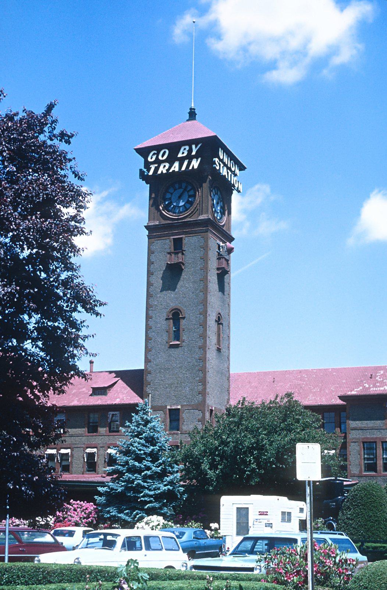
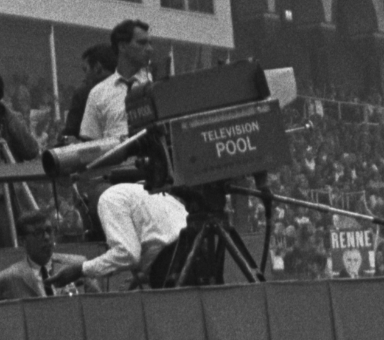
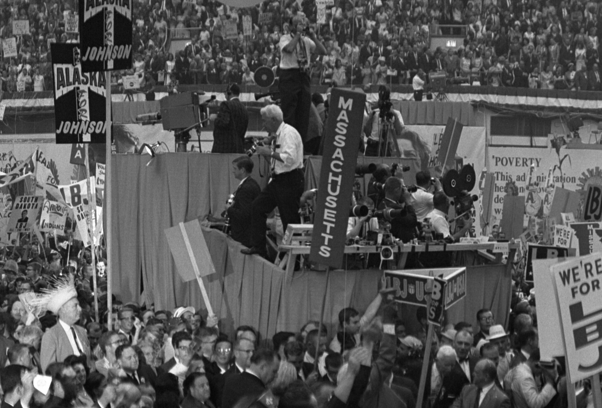

56 years ago today, November 12, 1970, the Oregon Highway Division attempted to resolve an unusual coastal crisis with half a ton of commercial explosives. A 45-foot sperm whale had stranded itself on the central Oregon coast, and the state agency tasked with roads decided to blast the rotting carcass to pieces.

## An Uninvited Giant on the Central Oregon Coast

On November 9, 1970, an enormous male sperm whale washed ashore on the sands near Florence, Oregon. The carcass measured 45 feet in length and was estimated to weigh approximately eight short tons, or 16,000 pounds. As the marine mammal began to decompose under the coastal weather, state authorities faced the urgent question of how to remove such an immense decaying body from a public recreation area.

## Highway Engineers Take the Lead

Under Oregon law at the time, the state's beaches fell under the jurisdiction of the Oregon Highway Division, an agency created back in 1913 that was far more accustomed to paving highways and constructing river bridges than handling marine biology. The division had expanded its duties significantly after completing U.S. Route 101 and bridges over coastal rivers by the 1930s, but disposing of a multi-ton cetacean was entirely uncharted territory.

Highway officials consulted with the United States Navy to evaluate possible disposal methods. Together, they concluded that burying the creature would be ineffective, as shifting tides might uncover the rotting remains. Instead, they decided that explosives would be the most efficient solution, assuming the blast would shred the whale into tiny fragments that scavenger birds and crabs could easily clean up.

*NOT FROM THE EVENT · 1970 — Photo: railfan 44 / Public domain*

## The Plan and the Unheeded Warning

George Thornton, a state highway engineer, was placed in charge of the unusual demolition operation. Thornton later explained to reporters that he had been assigned the responsibility simply because his district supervisor was away on a hunting trip. Thornton decided to use half a short ton of dynamite, packing twenty commercial cases under and around the stranded mammal.

However, not everyone on the beach supported the aggressive blasting strategy. A local military veteran with extensive professional training in explosives approached the work crew. He warned the highway team that twenty cases was an excessive and dangerous amount of explosive force, advising that a mere twenty sticks of dynamite would be sufficient to push the carcass seaward. His warning was dismissed, and the crew proceeded with the half-ton plan.

*Television pool camera at 1964 DNC (1) — Photo: Warren K. Leffler / Public domain*

## 3:45 p.m.: Detonation and Raining Blubber

At 3:45 p.m. on November 12, a crowd of spectators and local journalists gathered along the coastal dunes to witness the spectacle. Among them were reporter Paul Linnman and cameraman Doug Brazil of KATU-TV, the Portland television news station, who set up their camera equipment to document the demolition.

When the plunger was pressed, a massive wall of sand and black smoke erupted into the sky. Instead of vaporizing into harmless mist, dense chunks of rotting blubber were catapulted high into the air and hurled up to 800 feet away. Flying whale remnants rained down across the beach, over onlookers, into a nearby state park, and across an adjacent parking lot. One heavy slab of falling blubber smashed down onto a newly purchased automobile, severely damaging the roof and bodywork. In an ironic twist of fate, the car's owner had purchased the vehicle only days before during a local dealership promotion called 'Get a Whale of a Deal.'

*Television cameras at the 1964 DNC (1) — Photo: Warren K. Leffler / Public domain*

## The Lingering Aftermath on the Beach

The strategy to rely on scavenging wildlife failed almost immediately. In his television broadcast, Linnman pointed out that the gulls and other shorebirds, which officials had expected to devour the remains, never showed up because the deafening explosion had frightened them away entirely. Furthermore, the blast had failed to destroy the entire carcass, leaving a substantial portion of the rotting whale stranded right on the beach.

Workers from the Oregon Highway Division were forced to return to the site with heavy machinery, spending hours shoveling, scraping, and clearing the remaining whale blubber by hand. A putrid, pervasive odor clung to the surrounding beach and nearby structures for weeks.

## A Local Blunder Becomes Global Folklore

Linnman's news report aired on Portland television, but the story found an even larger audience decades later. In 1990, humorist Dave Barry wrote about the footage in his nationally syndicated newspaper column after viewing a tape of Linnman's broadcast. When the KATU video clip surfaced on the early internet, it spread across bulletin boards and websites worldwide, cementing the episode as what local publication Willamette Week described as one of Oregon's all-time most bizarre moments.

The incident was subsequently referenced in films such as Reno 911!: Miami in 2007, the Australian movie Swinging Safari in 2018, and an episode of The Simpsons in 2010. Decades after the blast, the event remains an indelible part of Oregon lore, even being honored by the Eugene Emeralds minor league baseball team in 2023.

### Sources

- <https://en.wikipedia.org/wiki/Oregon_Department_of_Transportation>
- <https://commons.wikimedia.org/wiki/File:Oriental_Theatre_west_elevation_-_Portland_Oregon.jpg>
- <https://commons.wikimedia.org/wiki/File:Portland,_OR_Union_Station_on_May_23,_1970_(27495920386).jpg>
- <https://commons.wikimedia.org/wiki/File:Television_pool_camera_at_1964_DNC_(1).jpg>
- <https://commons.wikimedia.org/wiki/File:Television_cameras_at_the_1964_DNC_(1).jpg>
