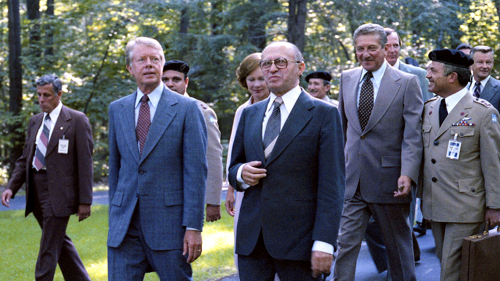
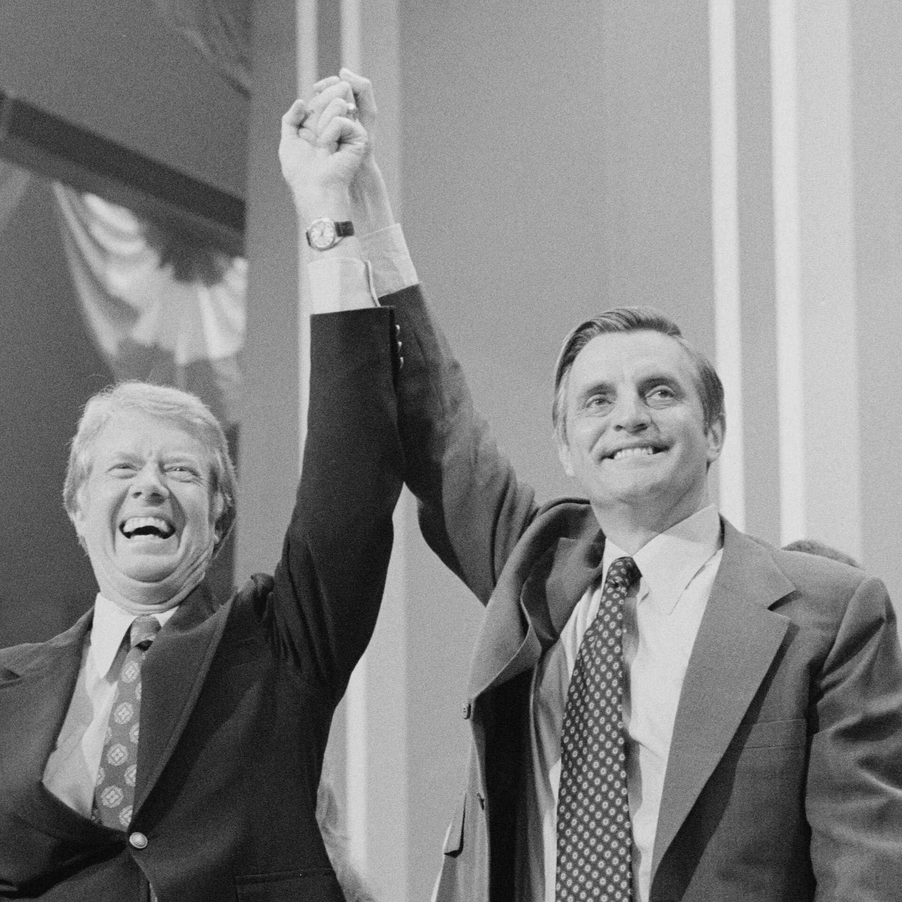
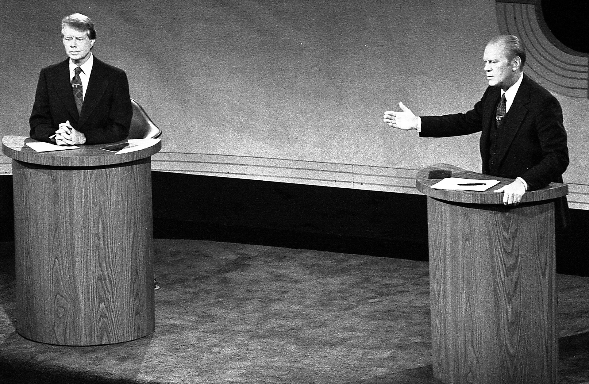

47 years ago today, November 12, 1979, President Jimmy Carter ordered an immediate ban on all petroleum imports from Iran into the United States. The dramatic executive order came just 8 days after Iranian militants overran the American embassy compound in Tehran, taking dozens of diplomats and staff members captive.

## The Seizure of the Tehran Embassy

The crisis erupted on November 4, 1979, when an Islamist student group named the Muslim Student Followers of the Imam's Line breached the gates of the United States Embassy in Tehran. A total of 66 Americans, including diplomats, military guards, and civilian personnel, were taken prisoner inside the diplomatic compound. The building had already faced unrest in February 1979, when staff numbers were sharply reduced from nearly 1,000 down to just over 60, and front-facing windows had been reinforced with bulletproof glass after earlier gunfire.

## Demands for the Deposed Monarch

The militants acted with the open endorsement of Ayatollah Ruhollah Khomeini, the revolutionary cleric who had returned from 15 years of exile to establish an Islamic republic. The captors demanded the immediate extradition of Mohammad Reza Pahlavi, the former monarch who had fled Iran during the revolution. On October 22, 1979, Carter had permitted Pahlavi to enter New York Hospital-Cornell Medical Center for lymphoma treatment following appeals from prominent foreign policy figures. Iranian revolutionaries viewed the medical asylum as a sign of American complicity and suspected Washington was plotting to restore the monarch to power.

*Archive, 1978 — Photo: Central Intelligence Agency from Washington, D.C. / Public domain*

## Washington Responds with an Oil Embargo

President Carter condemned the seizure of the embassy as an outrageous violation of international law and the Vienna Convention, describing the tactic as blackmail and the hostages as victims of terrorism and anarchy. On November 12, Carter took his first major retaliatory economic step by banning all petroleum shipments from Iran into American ports. The decision removed a major supplier of crude oil from the American market at a time when global energy supplies were already constrained, signaling that Washington would not trade oil for diplomatic compliance.

*Archive, 1976 — Photo: Warren K. Leffler / Public domain*

## A Rescue Attempt and Rising Toll

As diplomatic negotiations stalled, six American diplomats who managed to evade capture were smuggled out of the country in January 1980 through a covert operation aided by Canadian officials. In April 1980, Carter authorized a military rescue mission titled Operation Eagle Claw, but the mission ended in disaster in the Iranian desert, claiming the lives of eight American service members and one Iranian civilian. The tragic failure led directly to the resignation of Secretary of State Cyrus Vance and deepened the administration's political isolation.

*Archive, 1976 — Photo: David Hume Kennerly / Public domain*

## Impact on the American Presidency

The 444-day standoff dominated nightly news broadcasts across the United States throughout 1980, creating an enduring sense of national frustration. The prolonged crisis became a decisive factor in Carter's bid for reelection, contributing heavily to his landslide defeat against Republican challenger Ronald Reagan in November 1980. The former Shah died in Cairo, Egypt, on July 27, 1980, yet negotiations mediated by Algerian diplomats dragged on for several more months before a resolution could be reached.

## The Legacy of November 12

The remaining 52 hostages were formally released into American custody on January 20, 1981, following the signing of the Algiers Accords, just minutes after Ronald Reagan took the oath of office. The oil embargo initiated on November 12, 1979, became the cornerstone of a sweeping regime of international economic sanctions. More than 40 years later, the rupture sparked by the embassy takeover and Carter's oil ban remains one of the defining dividing lines in modern Middle Eastern geopolitics.

### Sources

- <https://en.wikipedia.org/wiki/Iran_hostage_crisis>
- <https://commons.wikimedia.org/wiki/File:Carter_leaving_Three_Mile_Island.jpg>
- <https://commons.wikimedia.org/wiki/File:Carter_and_Begin,_September_5,_1978_(10729514294).jpg>
- <https://commons.wikimedia.org/wiki/File:1976-07-15CarterMondaleDNC.jpg>
- <https://commons.wikimedia.org/wiki/File:Carter_and_Ford_in_a_debate,_September_23,_1976_(cropped).jpg>
