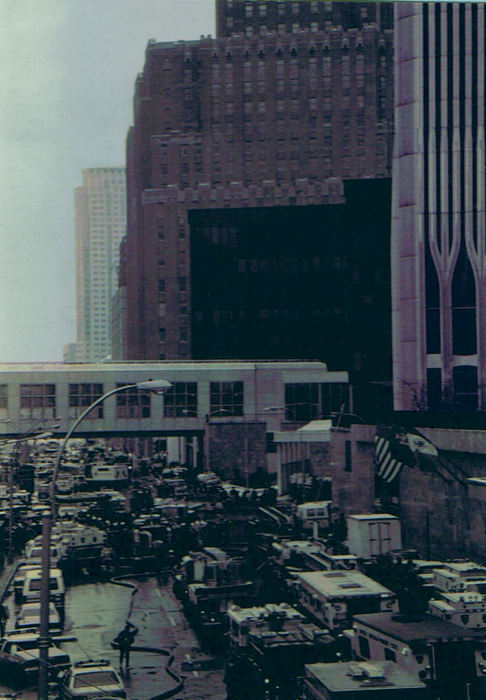
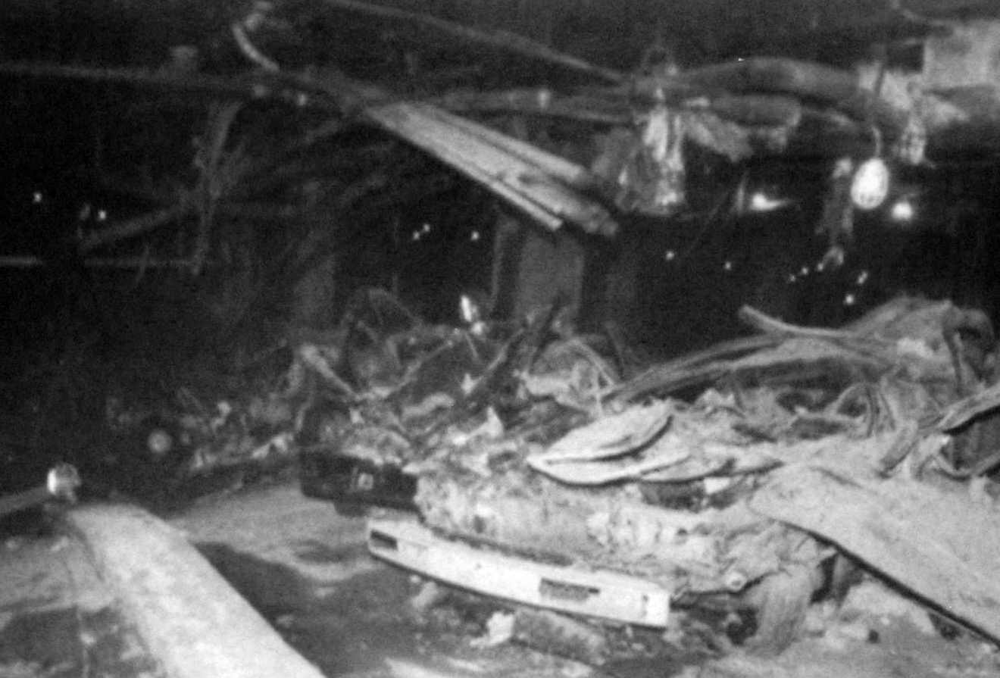
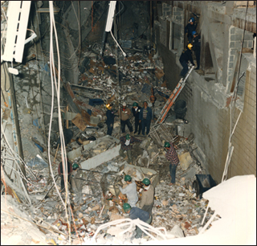

29 years ago today, November 12, 1997, a federal jury in New York City found Ramzi Yousef guilty of masterminding the 1993 World Trade Center bombing. The verdict concluded a landmark trial that held the elusive bomb maker accountable for an attack that had shaken the United States four years earlier.

## The Devastating 1993 Attack in Lower Manhattan

On February 26, 1993, a massive explosion shook the bedrock of Lower Manhattan. A van packed with an approximately 1,500-pound urea nitrate-hydrogen gas enhanced device detonated inside the underground parking garage beneath the North Tower of the World Trade Center.

The powerful blast ripped through multiple concrete subterranean levels, cutting off power and filling stairwells with thick smoke. The explosion killed 6 civilians, including a pregnant mother, and injured 1,042 people, including 919 civilians, 88 firefighters, and 35 police officers. Approximately 50,000 workers and visitors had to be evacuated from the Twin Towers during an hours-long rescue operation.

## A Chilling Goal to Collapse the Twin Towers

The scale of the destruction was horrific, but the mastermind had intended something far worse. According to trial evidence and testimony, Yousef aimed to knock Tower 1 into Tower 2, intending to bring down both 110-story skyscrapers.

Yousef estimated that toppling both towers could kill up to 250,000 people. Following the bombing, he sent a letter to The New York Times claiming responsibility on behalf of the Liberation Army. The letter demanded an end to all United States political, economic, and military aid to Israel, warning that American civilians would remain targets if their demands went unmet.

*NOT FROM THE EVENT · 1993 — Photo: Eric Ascalon******************** / CC BY-SA 3.0*

## Infiltration and Assembly in New Jersey

Yousef had entered the United States on September 1, 1992, using an Iraqi passport of disputed authenticity alongside a traveling companion, Ahmed Ajaj. Ajaj was detained at John F. Kennedy International Airport when inspectors found bomb-making manuals and videotapes in his luggage. Yousef claimed political asylum, received a hearing date, and was permitted to enter.

Living in an apartment on Pamrapo Avenue in Jersey City, Yousef began acquiring materials and assembling the bomb with associates Mohammed A. Salameh and Mahmud Abouhalima. He even ordered chemical ingredients from a hospital bed after suffering injuries in a car accident. The group loaded the explosive mixture into a rented van before driving it across the Hudson River into the garage.

*NOT FROM THE EVENT · 1993 — Photo: DSS Agent in commission of duties (acknowledged in photo cap / Public domain*

## A Global Manhunt and Capture in Islamabad

Yousef flew out of the United States on the evening of the attack, evading initial arrest while federal agents pieced together the evidence left at the bombsite. In March 1994, four of his co-conspirators—Ajaj, Abouhalima, Salameh, and Nidal Ayyad—were convicted in federal court for their roles in the attack.

Yousef continued his terrorist activities abroad, but investigators remained on his trail. In 1995, a joint operation between the U.S. Diplomatic Security Service and Pakistan's Inter-Services Intelligence located him at a guest house in Islamabad, Pakistan. Agents arrested Yousef as he was preparing explosives inside a doll, and he was quickly extradited to New York to face federal charges.

*NOT FROM THE EVENT · 1993 — Photo: Federal Bureau of Investigation / Public domain*

## The Verdict and Life Behind Bars

Yousef was tried in the U.S. District Court for the Southern District of New York. Alongside him was Eyad Ismoil, the operative who had driven the bomb-filled van into the World Trade Center garage. On November 12, 1997, the jury returned guilty verdicts on all counts against both men.

Yousef was sentenced to life imprisonment plus 240 years without parole. He was transferred to the federal supermax prison ADX Florence in Colorado, where he was placed in a high-security cell block alongside other convicted bombers.

## Remembering the Victims of 1993

The conviction of Ramzi Yousef closed a critical chapter in federal law enforcement's pursuit of international terrorism. While the attack failed to bring down the complex as Yousef had intended, it permanently altered security procedures across the country.

Today, the names of the 6 victims who died in the 1993 blast are permanently inscribed on the memorial panels at the World Trade Center site, ensuring that the lives lost that afternoon remain remembered.

### Sources

- <https://en.wikipedia.org/wiki/1993_World_Trade_Center_bombing>
- <https://commons.wikimedia.org/wiki/File:Ramzi_Yousef_(cropped).jpg>
- <https://commons.wikimedia.org/wiki/File:1993_World_Trade_Center_Bombing_by_Eric_Ascalon_WTC5.jpg>
- <https://commons.wikimedia.org/wiki/File:1993_Bombing_Aftermath_in_WTC_by_DSS_Agent.png>
- <https://commons.wikimedia.org/wiki/File:1993_World_Trade_Center_bombing_debris.jpg>
