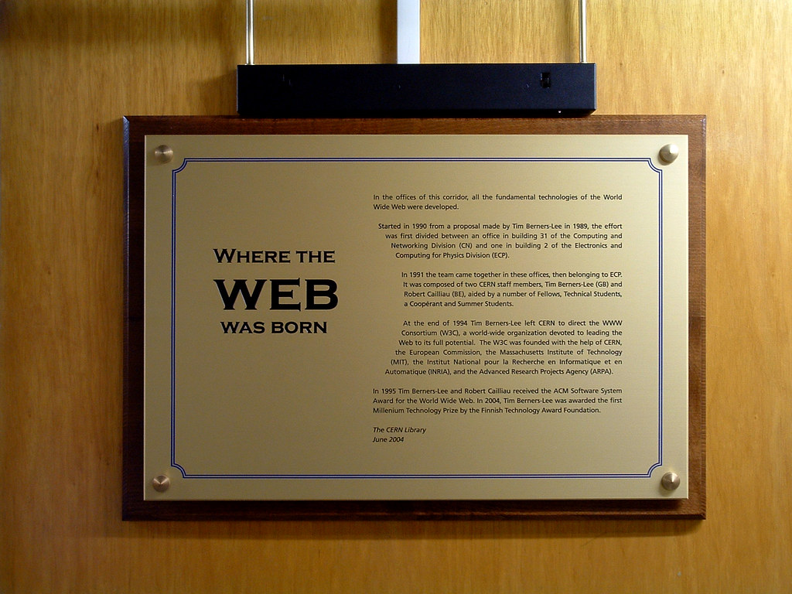
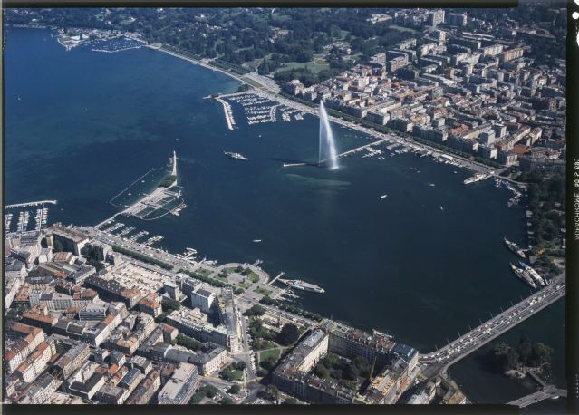
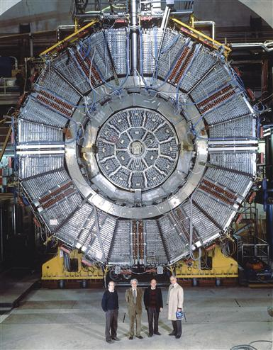

36 years ago today, November 12, 1990, English computer scientist Tim Berners-Lee published a formal proposal for a universal hypertext project called the World Wide Web. Working at CERN in Switzerland, Berners-Lee sought to solve an internal documentation headache, but ended up laying the technical foundations for the modern connected world.

## From Model Trains to Particle Accelerators

Tim Berners-Lee grew up surrounded by computing. Born in London in 1955, his parents Conway Berners-Lee and Mary Lee Woods were mathematicians who worked on the Ferranti Mark 1, the world's first commercially built computer. As a boy, he was a dedicated trainspotter who learned electronics by tinkering with model railways.

While studying physics at The Queen's College, Oxford, Berners-Lee constructed his own functioning computer using an old television set bought from a repair shop. After graduating with first-class honors in 1976, he worked as an engineer at Plessey and later D.G. Nash, developing typesetting software. In 1980, he joined CERN as an independent contractor, where he first experimented with hypertext by writing an internal notebook program called ENQUIRE.

## An Act of Desperation at CERN

Berners-Lee returned to CERN as a fellow in 1984. By 1989, the European nuclear research facility was home to thousands of researchers and was the largest Internet node in Europe. Yet, finding documents and tracking shared information across incompatible computer networks was an ongoing struggle.

Berners-Lee later noted that creating the web was really an act of desperation. Conventional documentation systems relied on rigid tree structures or keyword tagging, which made it difficult to cross-reference data. Inspired in part by Ted Nelson's earlier concept of hypertext, Berners-Lee recognized that the necessary technologies already existed. By merging hypertext with established Internet protocols like TCP and DNS, documents stored anywhere could link directly to one another.

*NOT FROM THE EVENT — Photo: Max Braun / CC BY-SA 2.0*

## "Vague, But Exciting"

In March 1989, Berners-Lee submitted his initial outline for an information management system. His supervisor at CERN, Mike Sendall, inscribed a famous reaction at the top of the proposal: vague, but exciting. Sendall allowed Berners-Lee to acquire a NeXTSTEP workstation to explore the concept further.

Systems engineer Robert Cailliau had independently advocated for a hypertext project at CERN and quickly joined Berners-Lee as a close collaborator. Together, they refined the technical plan. On November 12, 1990, Berners-Lee published a formal proposal that clearly outlined the architecture, terminology, and goals of what they termed the World Wide Web.

*Genf, Genève, Übersicht — Photo: Swissair photo AG / CC BY-SA 4.0*

## Building the First Browser and Server

Berners-Lee worked rapidly to turn the proposal into working code. By mid-November 1990, he had implemented the first successful communication between a Hypertext Transfer Protocol client and an HTTP server across the network. His software package included both an editor and a browser named WorldWideWeb, as well as the CERN httpd server.

On December 20, 1990, Berners-Lee published the world's first website on the CERN network. The page explained the Web's architecture, described how users could set up their own servers, and provided instructions for browsing. In August 1991, he extended an open invitation on Usenet for outside developers to collaborate, and CERN officially opened the Web to the public in 1993.

*ALEPH — Photo: CERN / CC BY-SA 4.0*

## Keeping the Web Royalty-Free

A crucial turning point occurred in 1994, when Berners-Lee founded the World Wide Web Consortium, or W3C, at the Massachusetts Institute of Technology. The consortium set global technical recommendations for HTML, URLs, and HTTP. Crucially, Berners-Lee insisted that all core web standards remain royalty-free and open to everyone without patent restrictions.

That decision ensured that no single corporation or government could claim ownership of the underlying mechanisms of the Web. For his transformative contribution, Berners-Lee was knighted by Queen Elizabeth II in 2004, elected to the National Academy of Sciences in 2009, and awarded the ACM Turing Award in 2016. What began as a formal proposal distributed at a physics lab remains the foundation of how billions of people interact with information every day.

### Sources

- <https://en.wikipedia.org/wiki/Tim_Berners-Lee>
- <https://www.flickr.com/photos/42121221@N07/16662336315>
- <https://www.flickr.com/photos/72645106@N00/58054501>
- <https://commons.wikimedia.org/wiki/File:Genf,_Gen%C3%A8ve,_%C3%9Cbersicht.jpg>
- <https://commons.wikimedia.org/wiki/File:ALEPH.png>
