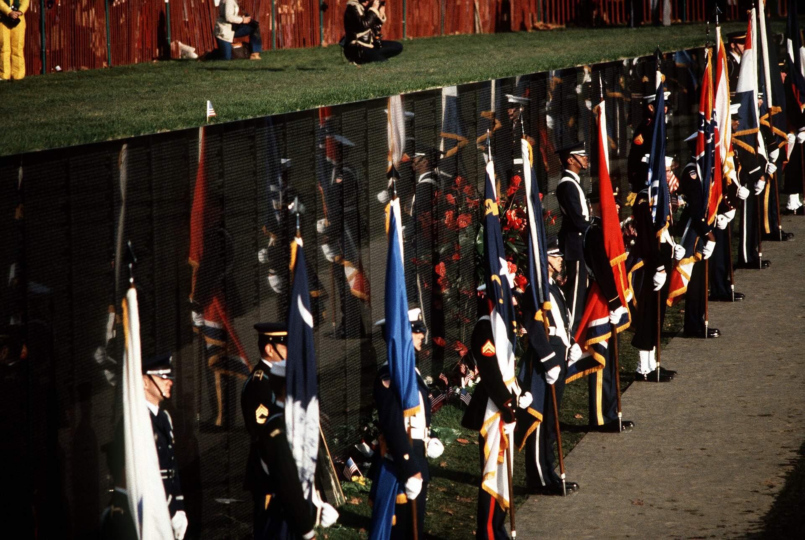
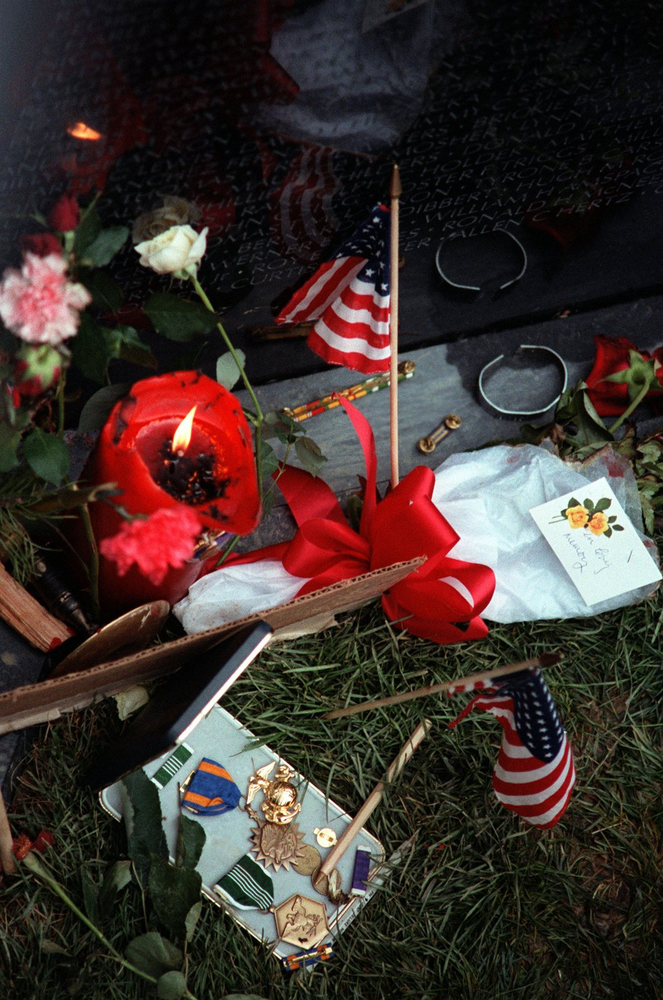
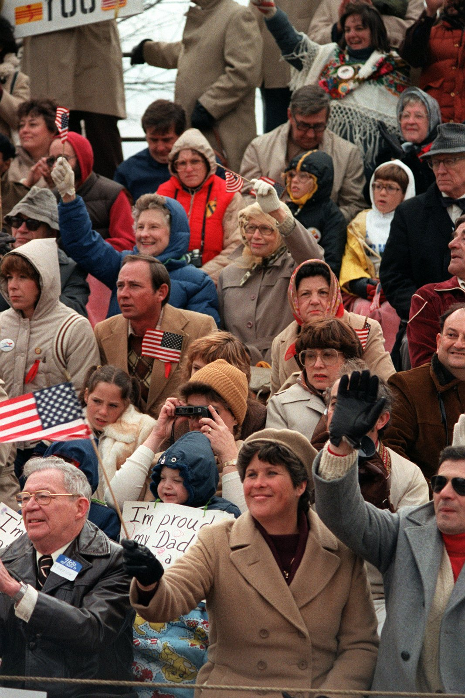

44 years ago today, November 13, 1982, the Vietnam Veterans Memorial was dedicated in Constitution Gardens in Washington, D.C. Thousands of Vietnam War veterans marched together to the site near the National Mall to witness the unveiling of two sunken black granite walls bearing the names of their fallen comrades.

## A Long-Awaited Homecoming

The end of American military involvement in Southeast Asia in 1975 left deep fractures across the United States. Unlike the generations before them who returned to brass bands and tickertape parades, Vietnam veterans often returned to silence, division, and neglect. Many struggled with physical injuries and post-traumatic stress disorder, which clinical studies in the 1980s estimated affected roughly 15.2 percent of Vietnam veterans. For years, service members felt their sacrifices were obscured by the political controversies surrounding the conflict.

## Maya Lin and the Unconventional Design

The drive to establish a national tribute culminated in an open national design competition, which was won by Maya Lin, an American architecture student. Her proposal eschewed towering columns, bronze figures, or triumphant inscriptions in favor of a minimalist concept: two polished black granite walls cutting gently into the sloping terrain of Constitution Gardens. Initially, the design stirred sharp controversy among critics and veteran groups who argued that the sunken black wall lacked traditional heroic iconography. However, Lin envisioned the monument as an open cut in the earth—a symbolic wound that was closed and healing.

*Dedication of Vietnam Veterans Memorial 1982 DF-ST-84-11922 — Photo: Mickey Sanborn / Public domain*

## The Wall of 57,939 Names

On November 13, 1982, the memorial was officially dedicated following a solemn procession of veterans through the capital. Each of the two adjoining walls measured 246 feet 9 inches in length, constructed from 72 panels of black granite quarried in Bangalore, India. At their meeting point, the walls formed an angle of 125 degrees and 12 minutes, with one arm pointing toward the Washington Monument and the other toward the Lincoln Memorial. At the dedication, 57,939 names were etched into the polished stone in Hermann Zapf's Optima typeface, arranged in strict chronological order by the date of casualty rather than by rank or alphabet.

*Mementos at the base of the Vietnam Veterans Memorial on the day before its official dedication - DPLA - bbf1a61c5b116e1 — Photo: Department of Defense. American Forces Information Service.  / Public domain*

## The Solemn Detail of Remembrance

The chronological sequence began at the center apex on panel 1E on July 8, 1959, stretched to the end of the eastern wall, picked up on the far western wall, and returned to panel 1W at the apex for casualties from the Mayaguez incident in May 1975. Next to each name, a diamond denoted confirmed deaths, while a cross indicated those missing or imprisoned. Among the thousands of names inscribed on the granite were eight women, all military nurses who lost their lives during the war, including Sharon Ann Lane and Eleanor Grace Alexander. The polished surface created a mirror effect, casting the reflection of visitors over the carved names of the dead.

*Spectators watch the dedication day parade for the Vietnam Veterans Memorial - DPLA - 6ac1fc35b4c383d88792b18067f9fca1 — Photo: Department of Defense. American Forces Information Service.  / Public domain*

## Additions and Preservation Over the Decades

To address early concerns regarding traditional figurative representation, sculptor Frederick E. Hart created the bronze statue 'Three Servicemen' (also known as 'Three Soldiers'), placed nearby in 1984. The statue portrayed European American, African American, and other ethnic minority soldiers gazing solemnly toward the Wall. Later, in 1993, the Vietnam Women's Memorial was added to honor the women who served. Over time, physical preservation became a priority; when cracks emerged from thermal cycling, the Vietnam Veterans Memorial Fund secured spare panels at Quantico Marine Base to safeguard the structure against future damage.

## A Lasting Place in American Memory

Decades after its controversial unveiling, the Vietnam Veterans Memorial has become one of the most visited and deeply revered landmarks in the United States. Maintained by the National Park Service, the two-acre site in Constitution Gardens receives around three million visitors annually and was ranked tenth on the American Institute of Architects' List of America's Favorite Architecture in 2007. By May 2018, additional fallen service members brought the total to 58,320 names, each one preserving the human cost of service etched forever in stone.

### Sources

- <https://en.wikipedia.org/wiki/Vietnam_veteran>
- <https://commons.wikimedia.org/wiki/File:World_War_I_veteran_Joseph_Ambrose,_86,_at_the_dedication_day_parade_for_the_Vietnam_Veterans_Memorial_in_1982.jpg>
- <https://commons.wikimedia.org/wiki/File:Dedication_of_Vietnam_Veterans_Memorial_1982_DF-ST-84-11922.JPEG>
- <https://commons.wikimedia.org/wiki/File:Mementos_at_the_base_of_the_Vietnam_Veterans_Memorial_on_the_day_before_its_official_dedication_-_DPLA_-_bbf1a61c5b116e1df9bd037367634d0a.jpeg>
- <https://commons.wikimedia.org/wiki/File:Spectators_watch_the_dedication_day_parade_for_the_Vietnam_Veterans_Memorial_-_DPLA_-_6ac1fc35b4c383d88792b18067f9fca1.jpeg>
