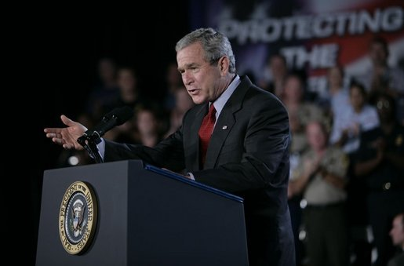
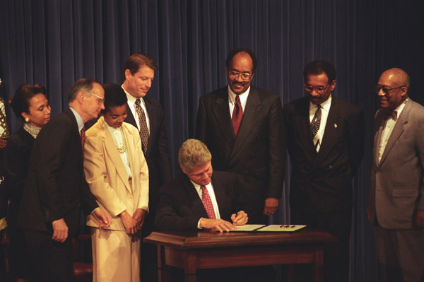
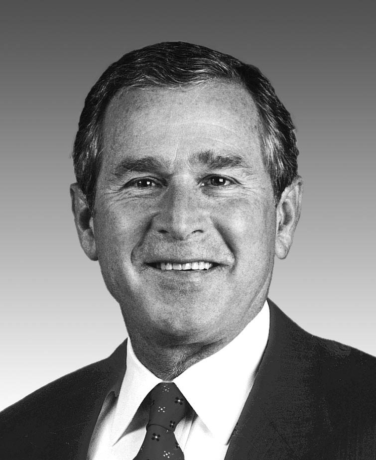

25 years ago today, November 13, 2001, President George W. Bush signed an executive order allowing military tribunals against foreigners suspected of connections to terrorist acts or planned acts against the United States. It marked the first time an American commander-in-chief had authorized military commissions since the end of World War II.

## A Nation in the Shadow of September 11

The executive order came barely two months after the catastrophic attacks of September 11, 2001, which fundamentally transformed the Bush presidency and American society. In the immediate aftermath, the administration embarked on a sweeping global campaign known officially as the Global War on Terrorism. President Bush first used the phrase 'war on terrorism' on September 16, 2001, at Camp David, urging the American public to be patient in facing what he called a new kind of evil.

Four days later, in a televised address before a joint session of Congress, Bush formalized the doctrine. He declared to the American people and the world that the campaign would begin with al-Qaeda, but would not end until every terrorist group of global reach had been found, stopped, and defeated. Public support for forceful government action was remarkably high in those early days, creating political momentum for expansive national security measures.

## The First Military Tribunals Since World War II

On November 13, 2001, Bush utilized his authority as president to sign the controversial executive order. The directive permitted military tribunals to try foreign nationals suspected of involvement in international terrorism against the United States. It was the first time such an executive mechanism had been invoked since World War II, breaking decades of standard reliance on federal civilian courts for criminal proceedings.

Under the provisions of the order, non-citizens suspected of membership in al-Qaeda or involvement in acts of terrorism could be detained and prosecuted under military rules rather than the civilian criminal justice system. The administration argued that the extraordinary threat posed by global terror networks required specialized military proceedings capable of handling classified intelligence and wartime enemies without compromising national security.

*Bush encourages renewal of Patriot Act 2005 — Photo: The original uploader was Ta bu shi da yu at English Wikiped / Public domain*

## The Legal Power of Executive Orders

Executive orders are directives issued by the president to manage the operations of the federal executive branch, deriving their authority from Article Two of the United States Constitution. Every American president except William Henry Harrison has issued executive orders, beginning with George Washington's first directive to department heads on June 8, 1789. In 1907, the State Department established a formal numbering system, retroactively designating Abraham Lincoln's directive from October 20, 1862, as Executive Order 1.

While executive orders grant presidents wide discretion, they remain subject to statutory law, congressional oversight, and judicial review. The Supreme Court has repeatedly examined the boundaries of presidential directives, famously overturning five of Franklin D. Roosevelt's executive orders in 1935 and invalidating Harry Truman's attempt to seize private steel mills during the Korean War. Bush's tribunal order entered this long-standing constitutional arena, sparking immediate scrutiny from legal experts regarding the balance of powers.

*Photograph of President William J. Clinton Signing Executive Order 12876 on November 1, 1993, regarding Historically Black Colleges and Universities - DPLA - 19adcbf881aa0b10c5d0dd8b136fa986 — Photo: President (1993-2001 : Clinton). White House Photograph Offi / Public domain*

## Expanding Powers and Deepening Controversy

The military tribunal directive was part of a broader transformation of federal authority in late 2001. Alongside the Patriot Act, which substantially expanded the surveillance powers of federal agencies, the tribunal order raised profound concerns among civil libertarians. Critics questioned whether bypassing traditional civilian courts infringed on international law, due process, and fundamental human rights.

While initial public backing for the administration's aggressive posture was strong, the policies surrounding the war on terror became deeply divisive over the following years. Debates intensified over government surveillance, detention standards, extraordinary rendition, and the legal status of foreign captives. The executive order highlighted the difficult tension between national security imperatives and constitutional protections during periods of national crisis.

*George W. Bush, in 108th Congressional Pictorial Directory — Photo: Unknown authorUnknown author / Public domain*

## The Enduring Legacy of the Order

The November 13 order set the legal foundation for wartime detention and prosecution policies that would occupy federal courtrooms, the Supreme Court, and presidential administrations for decades. The global campaign initiated in 2001 expanded into multi-theater operations, displacing an estimated 38 million people and costing over $8 trillion according to the Costs of War Project.

Today, the November 13, 2001 order stands as a defining milestone of post-9/11 America. It reshaped how the federal government defines wartime power and demonstrated how an executive directive can alter the legal landscape of the nation in an instant.

### Sources

- <https://en.wikipedia.org/wiki/November%2013>
- <https://commons.wikimedia.org/wiki/File:Audience_members_listen_to_President_George_W._Bush,_the_President_of_the_United_States;_speak_about_homeland_security,_the_Patriot_Act,_the_war_in_Iraq,_and_the_war_against_terrori_-_DPLA_-_fe6b7b5da06c16f00e4d7736b03c1e5c.jpeg>
- <https://commons.wikimedia.org/wiki/File:Bush_encourages_renewal_of_Patriot_Act_2005.jpg>
- <https://commons.wikimedia.org/wiki/File:Photograph_of_President_William_J._Clinton_Signing_Executive_Order_12876_on_November_1,_1993,_regarding_Historically_Black_Colleges_and_Universities_-_DPLA_-_19adcbf881aa0b10c5d0dd8b136fa986.jpg>
- <https://commons.wikimedia.org/wiki/File:George_W._Bush,_in_108th_Congressional_Pictorial_Directory.jpg>
