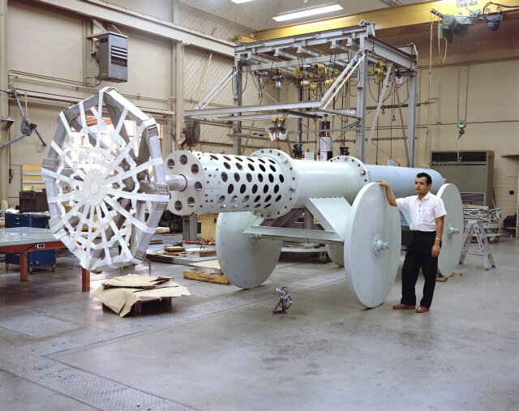
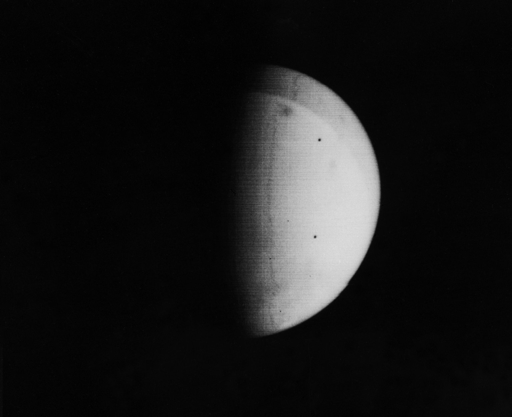

55 years ago today, November 13, 1971, NASA's Mariner 9 fired its onboard rocket engine and swung into orbit around Mars. It was the first time in human history that any artificial spacecraft had entered orbit around a celestial body other than Earth or the Moon.

## The Ambitious Mariner Program

The Mariner program was initiated in 1960 by NASA, with missions designed and built by the Jet Propulsion Laboratory (JPL) in Southern California. The goal was to conduct small-scale, frequent explorations of Earth's nearest planetary neighbors: Venus, Mars, and Mercury. At the suggestion of Edgar M. Cortright in May 1960, the probes were given nautical names to convey the feeling of long journeys to remote and distant lands.

Between 1962 and 1973, NASA built ten Mariner spacecraft at a total program cost of roughly $554 million. JPL engineers introduced groundbreaking three-axis stabilization, ensuring that the spacecraft did not spin and could keep their instruments locked on their planetary targets while solar panels faced the Sun and directional dish antennas stayed oriented toward Earth.

## A Rocky Path to Mars

Deep-space exploration carried enormous technical risks. To safeguard missions against rocket malfunctions, NASA designed each Mariner project with two identical spacecraft launched on separate rockets. History justified that caution. Mariner 1 was destroyed shortly after liftoff in 1962 when its rocket went off course, leaving Mariner 2 to complete the first successful flyby of Venus.

A similar split occurred during the 1971 Mars mission. Mariner 8 was lost during launch when its upper stage failed, dropping into the ocean. The entire scientific weight of the mission fell on its twin, Mariner 9. Launched on an Atlas-Centaur rocket, Mariner 9 carried television cameras, radiometers, and spectrometers mounted to an octagonal bus with four large solar panels.

*JPL Pneumatic cannon used in impact testing 355-1387bc — Photo: NASA / Public domain*

## Arrival at the Red Planet

When Mariner 9 completed its interplanetary cruise and arrived at Mars on November 13, 1971, flight controllers faced an unexpected drama. A planet-wide dust storm had swallowed Mars, kicking fine Martian dust high into the thin carbon dioxide atmosphere. Through the cameras, almost nothing on the surface was visible except for an orange-red haze.

Because Mariner 9 was an orbiter rather than a fast flyby craft, JPL engineers were able to hold off on primary imaging and wait out the storm from orbit. As the dust slowly settled over weeks and months, features of staggering scale began emerging from the gloom. The spacecraft spotted the peaks of towering extinct volcanoes, including Olympus Mons, which rises 13.6 miles above the Martian plains.

*P-335B Pickering — Photo: NASA/JPL-Caltech / Public domain*

## Mapping a Dynamic World

Mariner 9 transformed our understanding of Mars. Earlier flybys such as Mariner 4 in 1965 had shown heavily cratered terrain resembling the Moon. Mariner 9 revealed a geologically dynamic planet split between smooth northern plains and rugged southern highlands. It captured polar ice caps, frosty morning clouds, and deep drainage valleys indicating that liquid water had once flowed across the Martian surface.

Most breathtaking of all was a massive rift valley stretching 2,500 miles long and reaching depths of up to several miles. Scientists named the vast geological feature Valles Marineris—Mariner Valleys—in honor of the orbiter that discovered it.

*Nix Olympica Identified by Mariner 9 on Mars Approach (7651156590) — Photo: NASA on The Commons / Public domain*

## The American Legacy in Deep Space

The technical architecture of Mariner 9 served as the bedrock for decades of American planetary exploration. The Viking orbiters that mapped Mars in detail during the mid-1970s were enlarged versions of the Mariner 9 design. Planned Mariner outer-planet probes directly evolved into the legendary Voyager program that visited Jupiter, Saturn, Uranus, and Neptune, while the second-generation Mariner Mark II design helped produce the Cassini mission to Saturn.

Today, robotic probes have orbited and explored Mars continuously since 1997. The pioneering arrival of Mariner 9 on November 13, 1971, proved that human craft could navigate the interplanetary void, brake into orbit around another world, and unlock the secrets of our solar system.

### Sources

- <https://en.wikipedia.org/wiki/November%2013>
- <https://commons.wikimedia.org/wiki/File:Mariner_9_undergoes_final_checks.jpg>
- <https://commons.wikimedia.org/wiki/File:JPL_Pneumatic_cannon_used_in_impact_testing_355-1387bc.jpg>
- <https://commons.wikimedia.org/wiki/File:P-335B_Pickering.jpg>
- <https://commons.wikimedia.org/wiki/File:Nix_Olympica_Identified_by_Mariner_9_on_Mars_Approach_(7651156590).jpg>
