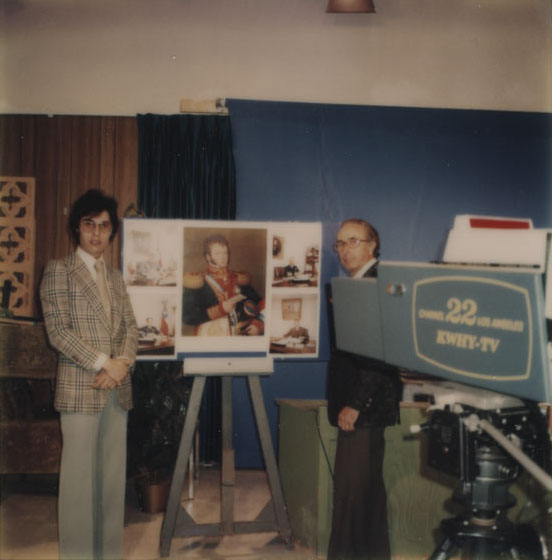

27 years ago today, November 13, 1999, network television witnessed a historic reversal of fortune. A genre that industry executives had considered hopelessly dead for forty years was suddenly the hottest ticket on American prime-time television as ABC struck it rich with Who Wants to Be a Millionaire.

## A Dead TV Format Returns to Life

For roughly four decades, major American networks had treated prime-time big-money quiz programs with deep skepticism. The genre had been cast aside, perceived as an outdated relic of early television. When ABC picked up an American adaptation of an overseas hit in 1999, network executives initially planned it as a modest two-week summer diversion to fill quiet broadcast hours. Nobody anticipated that an hour of general knowledge trivia would disrupt the entire television landscape.

## From 'Cash Mountain' to a British Phenomenon

The show originated in the United Kingdom, created by David Briggs, Mike Whitehill, and Steven Knight. The trio had previously crafted promotional radio games for host Chris Tarrant on Capital FM. During development, the concept carried the working title Cash Mountain before adopting its permanent name from a Cole Porter song featured in the 1956 film High Society, which starred Frank Sinatra and Celeste Holm. The British version debuted on the ITV network on September 4, 1998, with Chris Tarrant as host, instantly captivating British viewers.

*Not a photo of the event itself · NOT FROM THE EVENT · Stock image — Photo: StockSnap / Pixabay Content License*

## Paul Smith and the Power of Uniform Production

British television producer Paul Smith recognized the international potential of the program and devised an aggressive franchising strategy. To preserve the original's hypnotic intensity, Smith mandated strict standards across all foreign editions. Every international host was required to appear on camera dressed in an Armani suit, mirroring Tarrant. Foreign producers were barred from commissioning local music, having to rely strictly on the tense British soundtrack cues. Set architecture, futuristic plexiglass tables, and dramatic spotlighting all had to adhere faithfully to the British blueprint.

*Not a photo of the event itself · NOT FROM THE EVENT · Stock image — Photo: funnytools / Pixabay Content License*

## Regis Philbin and the American Sensation

The American version premiered on ABC in August 1999 with daytime television veteran Regis Philbin in the host chair. The gameplay departed from conventional game shows: only one contestant competed at a time, answering a ladder of fifteen multiple-choice questions without a countdown clock. Contestants could rely on three lifelines and safety nets, or walk away with their accrued cash. Philbin's measured delivery of the question "Is that your final answer?" instantly embedded itself into American popular culture, while his dark monochromatic shirts and ties sparked an immediate retail trend.

*KWHY-TV 1976 — Photo: Ministerio de Relaciones Exteriores de Chile. / CC BY 2.0 cl*

## The November Sweep and Regular Primetime

Following the roaring success of the August test run, ABC scheduled a second two-week special event in November 1999. Ratings surged as millions of viewers tuned in every night, prompting The New York Times to analyze the quiz show's sudden revival on its front page on November 13. Recognizing that the phenomenon was not a summer fluke, ABC greenlit a regular prime-time series that debuted in January 2000, airing multiple nights per week and dominating prime-time ratings.

## A Lasting Global Legacy

The success of Who Wants to Be a Millionaire transformed international television syndication. The format was eventually exported to around 100 countries worldwide, cementing its status as the best-selling television format in history. Original producer Celador later sold the rights, and the franchise was eventually acquired by Sony Pictures Entertainment for 137.5 million pounds. Decades later, the tension of the hot seat remains one of the most recognizable milestones in television history.

### Sources

- <https://www.nytimes.com/1999/11/14/business/a-million-reasons-the-tv-quiz-show-has-struck-it-rich.html>
- <https://pixabay.com/photos/tv-television-retro-classic-old-1844964/>
- <https://pixabay.com/photos/tv-television-vintage-oldschool-2619649/>
- <https://pixabay.com/photos/television-developing-countries-899265/>
- <https://commons.wikimedia.org/wiki/File:KWHY-TV_1976.jpg>
