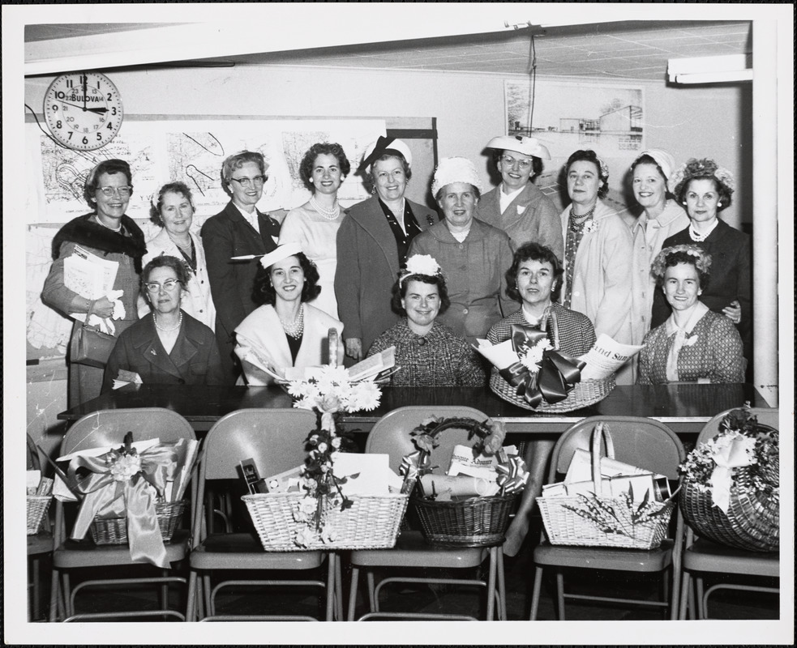
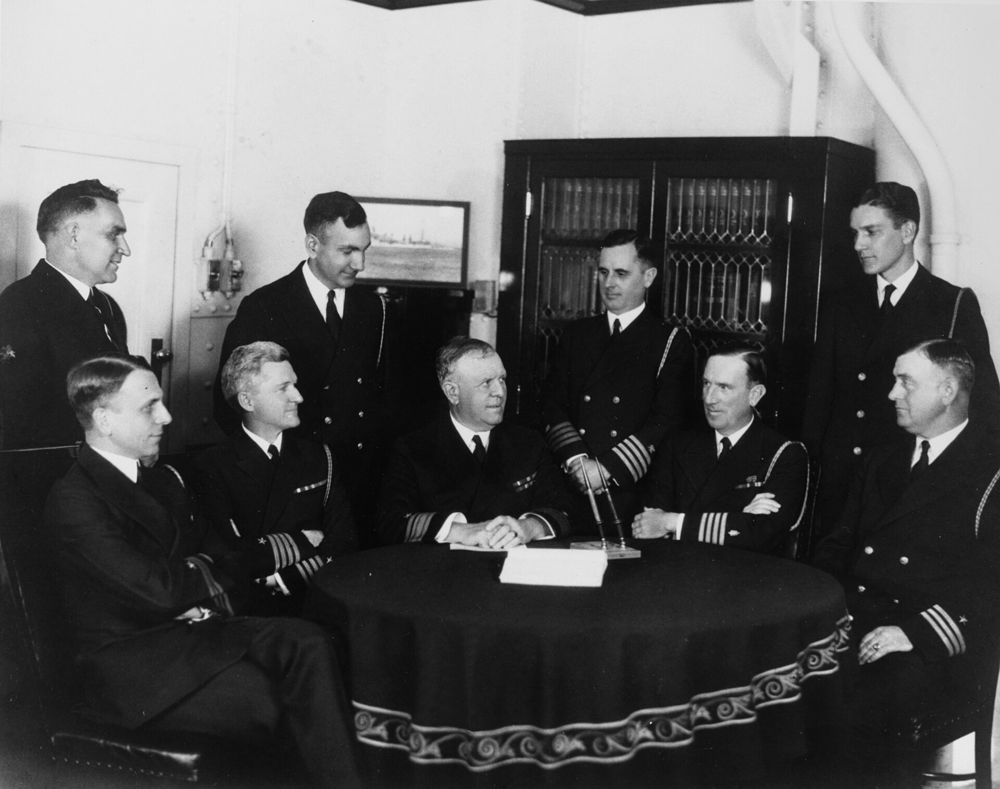
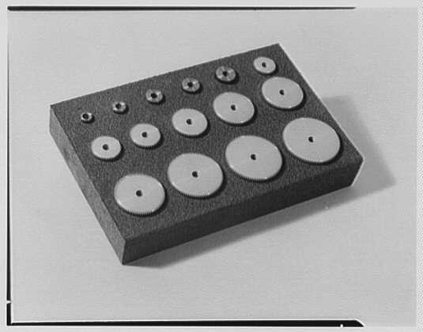

Fifty-two years ago today, November 13, 1974, six members of the DeFeo family were murdered in their beds in Amityville, New York. The crime shocked suburban Long Island, captivated national headlines, and later gave rise to the book and film series known around the world as The Amityville Horror.

## Panic at Henry's Bar

Around 6:30 p.m. on November 13, 1974, twenty-three-year-old Ronald DeFeo Jr., known to friends and neighbors as Butch, frantically pushed through the doors of Henry's Bar in Amityville. Desperate and visibly shaken, he shouted to the patrons inside: "You got to help me! I think my mother and father are shot!"

A small group of customers, including DeFeo's friend Joe Yeswit, rushed out of the bar and accompanied him down the street to the DeFeo residence at 112 Ocean Avenue. Upon stepping inside, they were met with silence and the grim reality that Ronald's parents were indeed dead. Yeswit immediately dialed the Amityville Police Department to report the discovery, bringing emergency responders to the tranquil South Shore neighborhood.

## The Chilling Discovery at 112 Ocean Avenue

Officers searching the three-story Dutch Colonial house uncovered a scene of staggering devastation. All six victims were found lying face down in their beds, with no visible signs of a physical struggle. The deceased were Ronald Jr.'s parents, Ronald DeFeo Sr., 43, and Louise DeFeo, 43, alongside his four younger siblings: Dawn, 18; Allison, 13; Marc, 12; and John, who was only 9 years old.

Forensic investigators determined that the victims had been shot around 3:00 a.m. that morning using a .35 caliber lever-action Marlin 336C rifle. The four children had each been killed by a single gunshot, while both parents had been struck twice. Evidence indicated that Louise DeFeo and thirteen-year-old Allison had been awake when the shots were fired. Despite the close quarters and the lack of a sound suppressor on the weapon, neighbors had heard nothing out of the ordinary, and toxicology tests found no traces of sedatives in the victims' bodies.

*Women's Activities and Conferences (1958-1960) - DPLA - 627f942ba7a6832a4ffa0dea8ec9a307 — Photo: Office of Civil and Defense Mobilization. Region 1. 1958-196 / Public domain*

## A Mob Hit Tale Quickly Unravels

As the sole surviving member of the immediate family, Ronald DeFeo Jr. was initially placed into protective custody by Suffolk County police. He told detectives that the slayings were an execution carried out by Louis Falini, whom DeFeo identified as an American Mafia hitman targeting his family. The DeFeo family had lived at the Ocean Avenue home since 1965 and possessed distant connections to organized crime figures, lending an early air of credibility to the claim.

However, investigators quickly dismantled the story during interrogations. Falini provided an airtight alibi showing he was out of state at the time of the killings. Faced with mounting inconsistencies, DeFeo broke down the following day and confessed to carrying out the massacre himself. "Once I started, I just couldn't stop. It went so fast," he told detectives. He admitted that after pulling the trigger, he bathed, changed his clothes, concealed the rifle and bloody garments, and went to work as if nothing had happened.

*Rear Admiral Thomas J. Senn with members of his staff aboard USS Omaha (CL-4), in the late 1920s (NH 93281) — Photo: Unknown authorUnknown author / Public domain*

## The 1975 Trial and Conviction

Ronald DeFeo Jr. went on trial on October 14, 1975. His defense attorney, William Weber, pursued an insanity defense, arguing that DeFeo suffered from severe mental illness and lacked awareness of his actions. Defense psychiatrist Dr. Daniel Schwartz supported the plea. However, prosecution psychiatrist Dr. Harold Zolan countered that while DeFeo was an active user of heroin and LSD, he suffered from antisocial personality disorder and was fully cognizant of his conduct during the murders. The prosecution also raised questions about whether DeFeo aimed to collect on his parents' life insurance policies.

On November 21, 1975, the jury rejected the insanity defense and convicted DeFeo on six counts of second-degree murder. On December 4, Judge Thomas Stark pronounced six concurrent sentences of 25 years to life, branding the slayings "the most heinous murders committed in Suffolk County since its founding." DeFeo was transferred to the Sullivan Correctional Facility in Fallsburg, New York, where every subsequent appeal and parole bid was denied until his death on March 12, 2021, at the age of 69.

*Dynamic Gear, Amityville, New York. LOC gsc.5a22849 — Photo: Gottscho-Schleisner Collection / Public domain*

## The Birth of an American Pop Culture Legend

In December 1975, shortly after DeFeo's sentencing, George and Kathy Lutz bought the Ocean Avenue house and moved in with their three children. Twenty-eight days later, the family fled, claiming that extreme paranormal phenomena and demonic entities plagued the residence. Their accounts formed the basis of Jay Anson's bestselling 1977 book, The Amityville Horror, which was adapted into a blockbuster film in 1979 and spawned numerous sequels.

While the fictionalized haunting captivated global moviegoers, the real-life tragedy remained anchored in cold facts. Investigators and historians found no factual basis for supernatural occurrences at the home, noting that the Lutz claims were heavily sensationalized. Meanwhile, the actual victims—Ronald Sr., Louise, Dawn, Allison, Marc, and John—were laid to rest together at Saint Charles Cemetery in nearby Farmingdale.

## The Village of Amityville Today

For the residents of Amityville, a historic community originally settled in the seventeenth century and incorporated in 1894, the sensational notoriety has long been an unwelcome burden. Local authorities and the Amityville Historical Society consistently decline to participate in media projects or discussions regarding the 1974 murders and the subsequent ghost stories.

The house at 112 Ocean Avenue still stands along the canal on Long Island's South Shore, though its distinct Dutch Colonial quarter-round windows were altered and its street address was officially changed to deter curiosity seekers. The property was placed on the market in 2010 and sold later that year for $950,000. Decades after the gunshots echoed through the dark house, the village prefers to remember the victims rather than the sensational lore that followed.

### Sources

- <https://en.wikipedia.org/wiki/November%2013>
- <https://commons.wikimedia.org/wiki/File:Ronald_defeo.jpg>
- <https://commons.wikimedia.org/wiki/File:Women%27s_Activities_and_Conferences_(1958-1960)_-_DPLA_-_627f942ba7a6832a4ffa0dea8ec9a307.jpg>
- <https://commons.wikimedia.org/wiki/File:Rear_Admiral_Thomas_J._Senn_with_members_of_his_staff_aboard_USS_Omaha_(CL-4),_in_the_late_1920s_(NH_93281).jpg>
- <https://commons.wikimedia.org/wiki/File:Dynamic_Gear,_Amityville,_New_York._LOC_gsc.5a22849.jpg>
