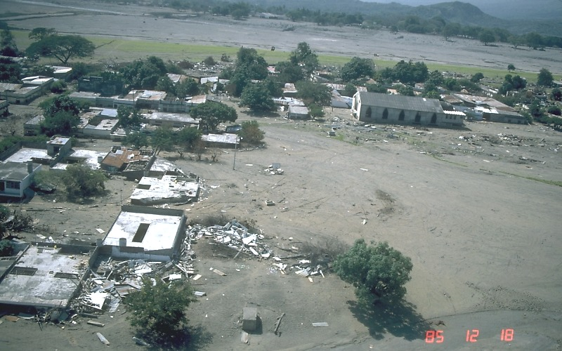
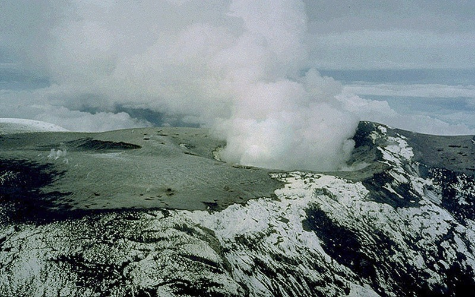
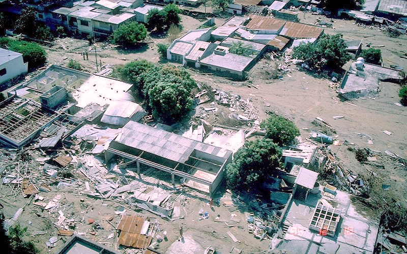

41 years ago today, November 13, 1985, an explosive eruption at the Colombian stratovolcano Nevado del Ruiz triggered one of the most catastrophic natural disasters of the twentieth century. Within hours, scorching volcanic material melted the mountain's glacier cap, sending a massive wall of mud and rock crashing into the sleeping town of Armero and killing approximately 23,000 residents.

## The Sleeping Giant of the Colombian Andes

Nevado del Ruiz sits along the border of the Caldas and Tolima departments in Colombia, roughly 80 miles west of the capital city of Bogotá. Rising as part of the Ruiz–Tolima volcanic massif in the Cordillera Central, the peak is one of several ice-capped volcanoes positioned along the active Pacific Ring of Fire, where the oceanic Nazca Plate slides beneath the South American continental plate. The mountain's broad summit features the Arenas crater, which measures about 1 kilometer across and drops 240 meters deep.

For generations, Nevado del Ruiz appeared to pose little immediate threat to nearby settlements, even though historical records documented deadly mudslides following eruptions in 1595 and 1845. Covered by extensive glaciers that averaged 50 meters in thickness—and reached depths of up to 190 meters beneath the southwestern slopes—the mountain was considered a permanent, snow-cloaked landmark by the communities living in the river valleys below.

## How Glacial Ice Became a Lethal Mudflow

The geography of Nevado del Ruiz made it uniquely hazardous. As a stratovolcano composed of alternating strata of hardened lava and pyroclastic deposits, its eruptions produce intense pulses of hot gas and rock known as pyroclastic flows. When these superheated flows erupted from the Arenas crater on November 13, they swept directly across the summit's ice cap, stripping away and melting approximately 10 percent of the mountain's total glacier cover in a matter of minutes.

This rapid melting unleashed enormous volumes of water that mixed violently with loose volcanic ash, fragmented rock, and surface soils. The resulting slurry formed what geologists call a lahar—a Javanese term for a violent volcanic debris flow. Lahars behave like wet concrete in motion: dense, heavy, and capable of traveling at tens of meters per second down steep mountain flanks, obliterating everything in their path.

*Armerodisaster — Photo: http://volcanoes.usgs.gov/Imgs/Jpg/Ruiz/30410135_070_large.j / Public domain*

## The Dark Night Armero Disappeared

As the meltwater gathered volume, it funneled through the narrow river canyons leading away from the volcano's eastern slopes. The lahar gained momentum and mass as it stripped trees, boulders, and soil from the hillsides. By the time the primary flow reached the plains of Tolima late that night, it had grown into a surging wall of mud and debris measuring up to 5 meters, or roughly 16 feet, deep.

Armero, a bustling agricultural town located along the flood path, was completely caught off guard in the darkness. The torrential wave of mud crashed into residential neighborhoods before residents could flee. Homes and public buildings were instantly flattened or inundated to their rooftops. Approximately 23,000 people—nearly three-quarters of the town's population—lost their lives that night, leaving the community buried under a hardened expanse of volcanic silt.

*Nevado del Ruiz summit 1985 - Marso — Photo: Jeffrey Marso, USGS geologist / Public domain*

## A Tragedy Broadcast Around the Globe

In the days following the disaster, international news networks broadcast horrific images of the disaster zone to living rooms across the United States and around the world. Television cameras showed rescue workers struggling through vast fields of thick, gray mud in desperate attempts to reach trapped survivors. The sight of a once-thriving town reduced to an ocean of sludge shocked the global public and exposed severe gaps in disaster preparedness.

The scale of the tragedy quickly made it recognized as the deadliest lahar in recorded history and the fourth-deadliest volcanic event since the eighteenth century. Emergency aid and rescue teams rushed to Colombia from across the Americas, but the quicksand-like consistency of the lahar and ruined transport infrastructure severely hampered relief efforts.

*Armero Mudflow and ruins — Photo: N. Banks (w:United States Geological Survey) / Public domain*

## Constant Monitoring and the Threat That Remains

The destruction of Armero fundamentally transformed how volcanologists and governments approach volcanic risk. In response to the catastrophe, Colombian authorities established the Volcanic and Seismic Observatory of Manizales, which operates under the Colombian Geological Survey to monitor Nevado del Ruiz around the clock using seismic networks, gas sensors, and satellite data.

Scientists estimate that up to 500,000 people currently live within zones vulnerable to future lahars should Nevado del Ruiz undergo another major eruption. Meanwhile, the summit glaciers have continued to shrink due to atmospheric warming, dropping from roughly 20 square kilometers after the 1985 eruption to around 10 square kilometers by 2003. Decades after the disaster, the buried ruins of Armero remain preserved as an open memorial ground, ensuring the world never forgets the terrible power hidden beneath the mountain's snow.

### Sources

- <https://en.wikipedia.org/wiki/November%2013>
- <https://commons.wikimedia.org/wiki/File:Nevado_del_Ruiz_1985.jpg>
- <https://commons.wikimedia.org/wiki/File:Armerodisaster.png>
- <https://commons.wikimedia.org/wiki/File:Nevado_del_Ruiz_summit_1985_-_Marso.jpg>
- <https://commons.wikimedia.org/wiki/File:Armero_Mudflow_and_ruins.jpg>
