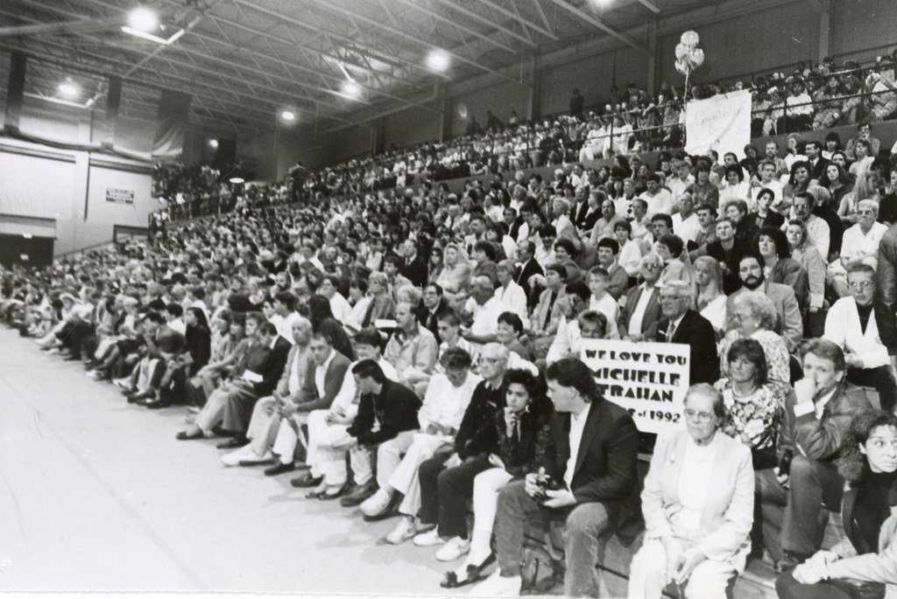
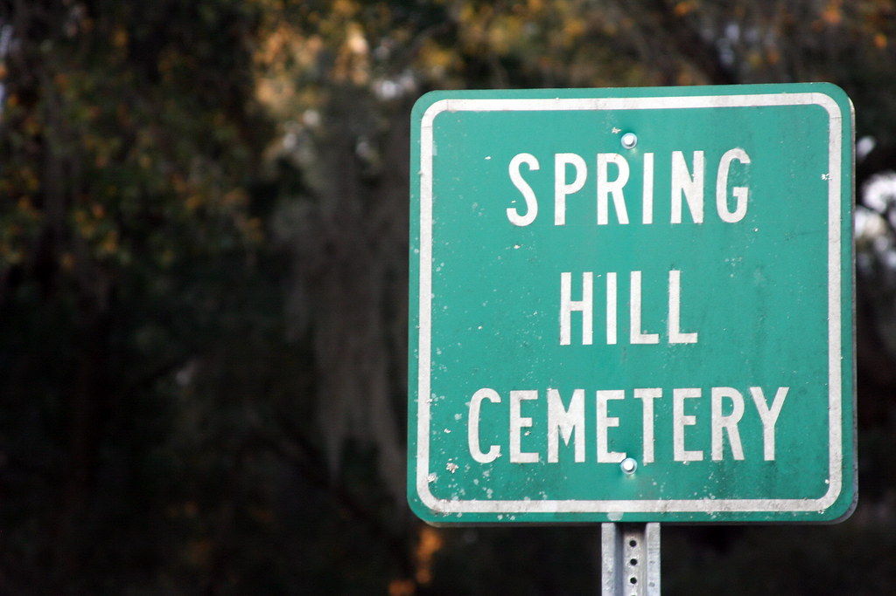
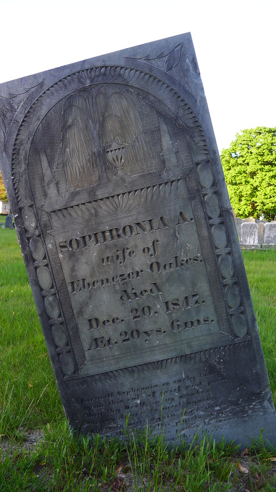

56 years ago today, on November 14, 1970, Southern Airways Flight 932 crashed into a wooded ridge just short of the Tri-State Airport near Huntington, West Virginia. All 75 people on board perished, devastating Marshall University and shocking the entire nation.

## A Routine Game Day Journey

Earlier that Saturday afternoon, the Marshall University football team played against the East Carolina Pirates at Ficklen Stadium in Greenville, North Carolina. Marshall lost a hard-fought battle by a score of 17 to 14. After the game, the team traveled to Stallings Field in Kinston, North Carolina, where their chartered flight awaited them.

At the time, Marshall's athletic programs rarely traveled by air, because the vast majority of their away opponents were within normal driving distance from Huntington. The chartered McDonnell Douglas DC-9-30 twin-engine jet, carrying tail registration N97S, represented the team's only scheduled charter flight of the entire 1970 season. School officials had initially weighed canceling the flight following a plane crash just over a month earlier on October 2, which claimed the lives of 14 Wichita State football players and head coach Ben Wilson in Colorado. Marshall ultimately opted to proceed with a different carrier and aircraft model, negotiating passenger and baggage weight to meet takeoff requirements.

## The 75 Souls on Board

The twin-jet airliner was staffed by Captain Frank Abbott, 47, First Officer Jerry Smith, 28, two flight attendants, and a charter coordinator. All members of the operating flight crew held appropriate qualifications for the domestic route.

Seated behind them in the 95-seat cabin were 70 passengers from Huntington. These included 37 student-athletes of the Marshall football squad, 5 coaches, 7 university athletic staff members, and 21 prominent boosters and local community leaders, including a city councilman. Together with the five crew members, a total of 75 people were on board as the plane took off from Kinston and climbed smoothly toward West Virginia.

*Veterans Memorial High School Graduation Crowd — Photo: Salem State University Archives and Special Collec / CC BY 2.0*

## Adverse Weather Over the Tri-State Hills

The DC-9 proceeded toward Huntington without incident until beginning its arrival phase. The flight crew established radio contact with Huntington air traffic control at 7:23 pm, receiving instructions to descend to 5,000 feet. Controllers warned the pilots that local surface conditions included rain, fog, smoke, and a ragged ceiling, making the landing approach challenging but operational.

At 7:34 pm, the crew reported passing the Tri-State Airport's outer marker and received clearance to land on Runway 11. Under the established instrument approach procedure, the flight was required to hold an altitude of 1,240 feet until visual contact with the runway environment was confirmed. However, the plane did not arrest its descent at that floor. Cockpit transcripts revealed that the pilots briefly discussed whether their autopilot had captured a glide slope, even though Tri-State Airport was not equipped with an instrument glide slope system. The plane continued descending into the darkness without either pilot sighting the runway lights.

*The OLD Spring Hill Cemetery — Photo: © Stranger / CC BY 2.0*

## The Final Seconds and Impact

As the jet flew past the nearby Catlettsburg Refinery, elevation discrepancies between the low refinery and the elevated airport hills may have created an optical illusion. The co-pilot monitored the altimeter, remarking that the ground was lightening up around 700 feet. The charter coordinator inside the cockpit remarked that it looked like a missed approach would be necessary.

Instead of climbing away, the flight recorder indicated the aircraft dropped another 220 feet in just 12 seconds. After the co-pilot called out 400 feet, he quickly called out 126 feet, followed immediately by 100 feet. At 7:36 pm, the airliner struck the tops of trees on a hillside 5,543 feet short of the runway threshold. The DC-9 rolled almost inverted and slammed nose-first into a hollow, bursting into flames. The impact carved a path of charred earth 95 feet wide and 279 feet long. The National Transportation Safety Board later classified the crash as completely unsurvivable.

*Headstone in Spring Hill Cemetery (1675) in Marlborough, Massachusetts — Photo: leewrightonflickr / CC BY-SA 2.0*

## The Investigation and Safety Recommendations

The National Transportation Safety Board issued its final accident report on April 14, 1972. Investigators determined the probable cause was descent below the Minimum Descent Altitude during a non-precision approach under adverse conditions without visual contact with the runway. The board noted that the excessive descent most likely stemmed from either altimetry system errors—such as water moisture affecting altitude instruments—or improper use of cockpit instrumentation data.

In response to the tragedy, the safety board issued three major safety recommendations. These included mandates and guidelines for heads-up displays, ground proximity warning devices, and enhanced surveillance of airline charter operations, helping transform domestic commercial aviation safety protocols.

## Mourning in Huntington and the Memorials

The catastrophe shattered Huntington, a historic city situated along the Ohio River with a population that depended heavily on its ties to Marshall University. Classes were suspended, upcoming athletic contests and public events were canceled, and local government offices shut their doors. On November 15, an indoor memorial service took place at the 8,500-seat Veterans Memorial Fieldhouse, followed by an outdoor memorial service the next Saturday at Fairfield Stadium.

A mass funeral was held to honor the victims. Because the intense fire melted much of the fuselage, the remains of six passengers could not be individually identified. They were laid to rest together at Huntington's Spring Hill Cemetery. Fifty-six years later, Southern Airways Flight 932 remains remembered as the deadliest disaster ever to befall a sports team on American soil.

### Sources

- <https://en.wikipedia.org/wiki/Southern_Airways_Flight_932>
- <https://commons.wikimedia.org/wiki/File:Wreckage_of_Southern_Airways_Flight_932.jpg>
- <https://www.flickr.com/photos/68317878@N04/53529140061>
- <https://www.flickr.com/photos/8994848@N05/6927362891>
- <https://www.flickr.com/photos/8256974@N05/7233666600>
