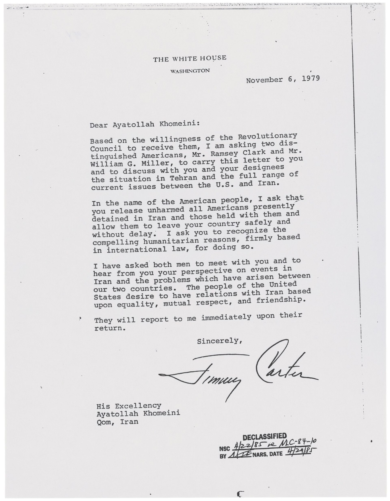
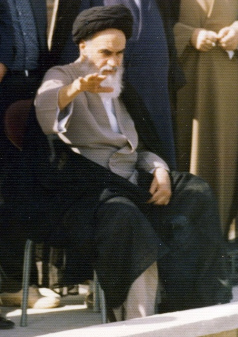
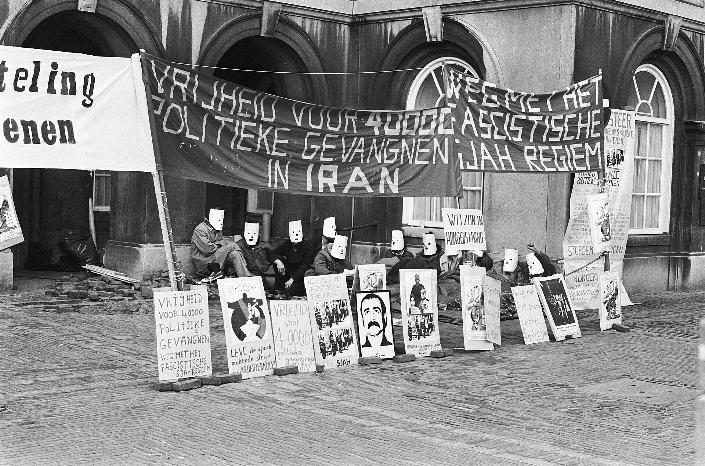

47 years ago today, November 14, 1979, President Jimmy Carter signed Executive Order 12170, freezing all Iranian government assets in the United States and American banks. The decisive economic strike came exactly ten days after Iranian militants seized the American Embassy in Tehran, taking dozens of diplomats and staff hostage.

## The Embassy Seizure in Tehran

The crisis began on the morning of November 4, 1979, when a group calling itself the Muslim Student Followers of the Imam's Line breached the compound of the Embassy of the United States in Tehran. Months after the Iranian Revolution overthrew the monarchy, the embassy had already reduced its staff to around 60 personnel and reinforced its exterior with bulletproof glass. The militants captured 66 Americans, including diplomatic officials and civilian staff.

The captors were supported by Ayatollah Ruhollah Khomeini, the revolutionary leader who would establish the modern Islamic Republic of Iran. Their central demand was the extradition of Iran's deposed monarch, Mohammad Reza Pahlavi. The Carter administration had admitted the Shah to New York Hospital-Cornell Medical Center on October 22, 1979, for lymphoma treatment, a humanitarian gesture that ignited outrage among Iranian revolutionaries.

## Executive Order 12170 and the Economic Freeze

Facing an international crisis that paralyzed American diplomacy, President Carter acted swiftly to deprive Tehran of its financial leverage. On November 14, 1979, Carter invoked the International Emergency Economic Powers Act to issue Executive Order 12170. The directive declared a national emergency regarding the situation in Iran and blocked all property and interests in property belonging to the Government of Iran, its agencies, and the Central Bank of Iran held within the United States or by American entities abroad.

Carter called the hostage-taking an act of blackmail and labeled the captives victims of terrorism and anarchy. The administration emphasized that the seizure violated fundamental tenets of international law, notably the Vienna Convention, which guarantees diplomatic immunity. By locking down Iranian assets, the White House established a critical bargaining chip for the agonizing months of negotiation that lay ahead.

*Letter from Jimmy Carter to Ayatollah Ruhollah Khomeini Regarding the Release of the Iranian Hostages — Photo: Jimmy Carter / Public domain*

## 444 Days of Standoff and Failed Rescue

The standoff quickly deepened into a grueling geopolitical trial for the United States. Six American diplomats who had escaped capture were covertly extracted from Tehran in January 1980 through a daring operation known as the Canadian Caper. However, diplomatic talks for the remaining captives stalled repeatedly.

In April 1980, Carter approved a covert military rescue attempt named Operation Eagle Claw. The mission ended in catastrophe in the Iranian desert when a helicopter collided with a transport aircraft, resulting in the deaths of eight American service members and one Iranian civilian. The disaster prompted the resignation of Secretary of State Cyrus Vance and deepened the public sense of helplessness across the nation.

*Ruhollah Khomeini on the roof of his residence, Qom (cropped-khomeini) — Photo: iichs.ir (Unknown photographer) / Public domain*

## The Algiers Accords and Final Release

The geopolitical landscape shifted in September 1980 when Iraq invaded Iran, forcing the regime in Tehran to reconsider its international isolation. With the Shah having died in Cairo on July 27, 1980, the Iranian government agreed to indirect negotiations mediated by Algerian diplomats.

The resulting Algiers Accords established terms for resolving financial claims, unfreezing portions of Iranian assets, and releasing the captives. After 444 days in captivity, the remaining 52 American hostages were formally released into American custody on January 20, 1981. The plane carrying them out of Iranian airspace took off just minutes after Ronald Reagan concluded his inaugural address, marking the end of Carter's presidency.

*Demonstraties, spandoeken, maskers, Bestanddeelnr 927-9155 — Photo: Hans Peters for Anefo / CC0*

## A Legacy of Sanctions That Lasts to This Day

The fallout from November 1979 fundamentally reshaped American foreign policy and severed formal diplomatic relations between Washington and Tehran. The crisis dealt a devastating blow to Jimmy Carter's political standing, contributing heavily to his defeat in the 1980 presidential election.

Executive Order 12170 proved to be far more than a temporary wartime measure. It became the legal cornerstone for decades of non-nuclear sanctions against Iran. Renewed annually by every successive president—including Barack Obama and Donald Trump—the declaration celebrated its 44th consecutive renewal in 2023, standing today as the oldest active national emergency in American history.

### Sources

- <https://en.wikipedia.org/wiki/Iran_hostage_crisis>
- <https://commons.wikimedia.org/wiki/File:Man_holding_sign_during_Iranian_hostage_crisis_protest,_1979.jpg>
- <https://commons.wikimedia.org/wiki/File:Letter_from_Jimmy_Carter_to_Ayatollah_Ruhollah_Khomeini_Regarding_the_Release_of_the_Iranian_Hostages.jpg>
- <https://commons.wikimedia.org/wiki/File:Ruhollah_Khomeini_on_the_roof_of_his_residence,_Qom_(cropped-khomeini).jpg>
- <https://commons.wikimedia.org/wiki/File:Demonstraties,_spandoeken,_maskers,_Bestanddeelnr_927-9155.jpg>
