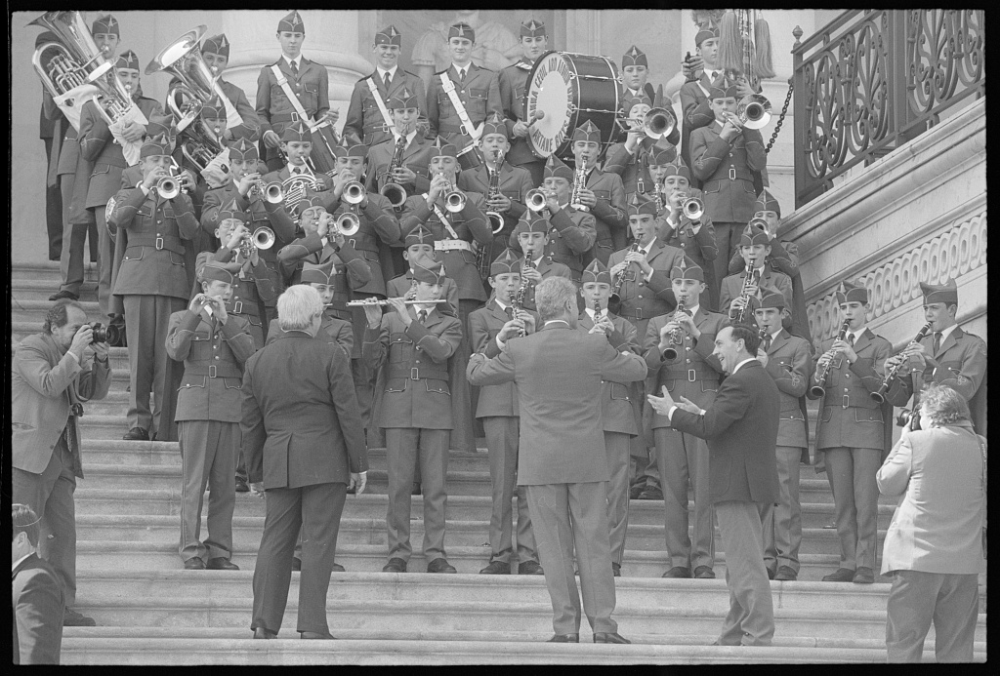
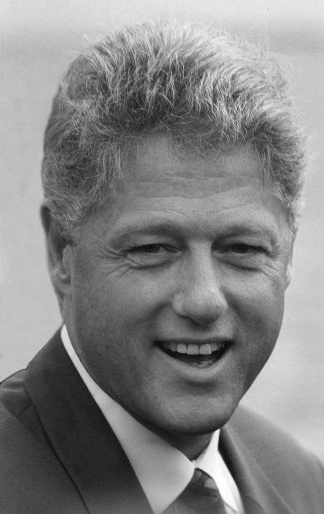
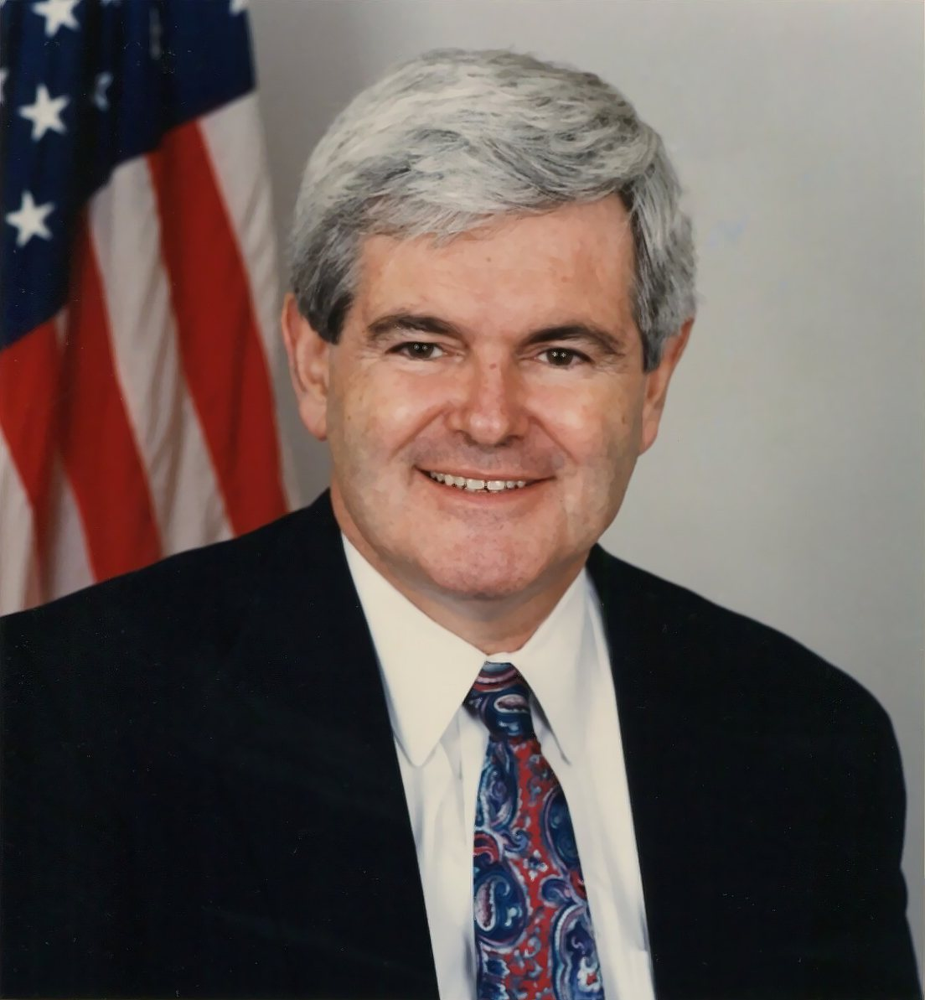

31 years ago today, November 14, 1995, major portions of the United States federal government suspended operations after Congress and the White House failed to agree on a budget. National parks bolted their gates, museums locked their doors, and hundreds of thousands of civil servants were instructed to stay home.

## The Deep Roots of the 1995 Budget Standoff

The confrontation had been building for months following the 1994 midterm elections, which brought a Republican majority to Congress. House Speaker Newt Gingrich and congressional leaders pledged to restrain the rate of federal spending, setting their sights on ambitious cuts across multiple domestic departments.

Democratic President Bill Clinton held competing priorities, insisting on protecting federal investments in education, environmental protection, Medicare, and public health. According to Clinton, the dispute arose from conflicting projections regarding economic growth, inflation, and anticipated federal revenues. When the fiscal year ended on September 30, 1995, no formal budget was in place.

## A High-Stakes Game of Political Brinkmanship

To keep federal departments running while negotiations continued, Congress passed a continuing resolution on October 1. However, that temporary funding measure was scheduled to expire at midnight on November 13.

Republicans added several controversial amendments to spending legislation. These measures sought to limit appeals by death-row inmates, curtail health and environmental regulations, and bind the White House to a rigid seven-year budget plan. House leaders also threatened to block increases to the national debt ceiling, which would have restricted the Treasury from managing federal debt obligations. Clinton rejected these conditions, vetoing the bills and condemning them as backdoor partisan maneuvers.

*Bill Clinton conducts a youth orchestra during a St. Patrick's Day celebration on the steps of the U.S. Capitol — Photo: Richard Ellis / Public domain*

## The Midnight Meeting and the November 14 Shutdown

On November 13, top negotiators gathered in a final attempt to avert a shutdown. The meeting brought together key leaders, including Vice President Al Gore, House Majority Leader Dick Armey, and Senate Majority Leader Bob Dole. Despite hours of discussions, neither camp yielded ground.

As the clock struck midnight, the continuing resolution officially expired. Federal law prohibited non-essential agencies from spending unappropriated taxpayer funds. On the morning of November 14, operations across the federal government ceased, and approximately 800,000 federal employees were placed on immediate furlough.

*Bill Clinton 1 (49488894398) — Photo: John Mathew Smith &amp; www.celebrity-photos.com from Laurel / CC BY-SA 2.0*

## Parks Closed and Services Halted Across America

The consequences of the shutdown were felt immediately by citizens across the country. Famous national parks and monuments turned away disappointed tourists, while the Smithsonian museums in Washington closed their galleries to the public.

Government agencies operated with skeleton staffing, handling only life-and-safety responsibilities. Routine administrative work, permit applications, and public inquiries were halted. The sudden disruption demonstrated the extensive reach of federal services into everyday American life.

*Newt Gingrich official portrait — Photo: United States Congress / Public domain*

## The Second Shutdown and the Final Resolution

The initial shutdown lasted 5 days, ending on November 19, 1995, after lawmakers agreed on a short-term continuing resolution. Yet the underlying budget disagreement remained unresolved. When that temporary measure expired, a second shutdown began on December 16, 1995.

This second shutdown lasted 21 days until January 6, 1996, furloughing roughly 284,000 workers. It stood as the longest government shutdown in American history for more than two decades, until it was surpassed in January 2019. The standoff finally concluded when congressional Republicans agreed to Clinton's budget framework.

## The Enduring Political Fallout

Public opinion during and after the crisis tilted decisively against congressional leadership. Polling consistently revealed that a majority of American voters held congressional Republicans responsible for the gridlock and disruption.

President Clinton's firm handling of the confrontation significantly strengthened his political standing heading into the 1996 presidential election, in which he secured a second term. The November 1995 shutdown remains an iconic chapter in modern American politics, illustrating the profound risks and consequences of budgetary warfare in a divided capital.

### Sources

- <https://en.wikipedia.org/wiki/Democratic_Party_(United_States)>
- <https://commons.wikimedia.org/wiki/File:Bill_Clinton_at_1995_AFA_graduation_1.JPG>
- <https://commons.wikimedia.org/wiki/File:Bill_Clinton_conducts_a_youth_orchestra_during_a_St._Patrick%27s_Day_celebration_on_the_steps_of_the_U.S._Capitol.jpg>
- <https://commons.wikimedia.org/wiki/File:Bill_Clinton_1_(49488894398).jpg>
- <https://commons.wikimedia.org/wiki/File:Newt_Gingrich_official_portrait.jpg>
