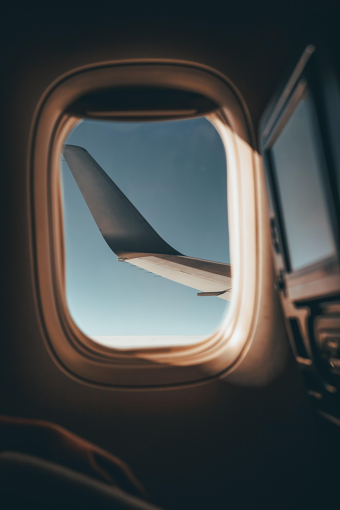
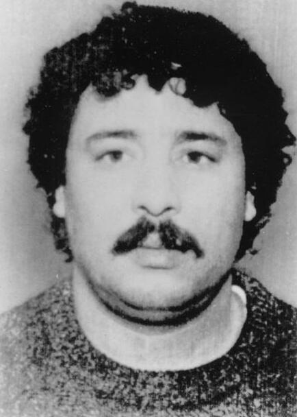
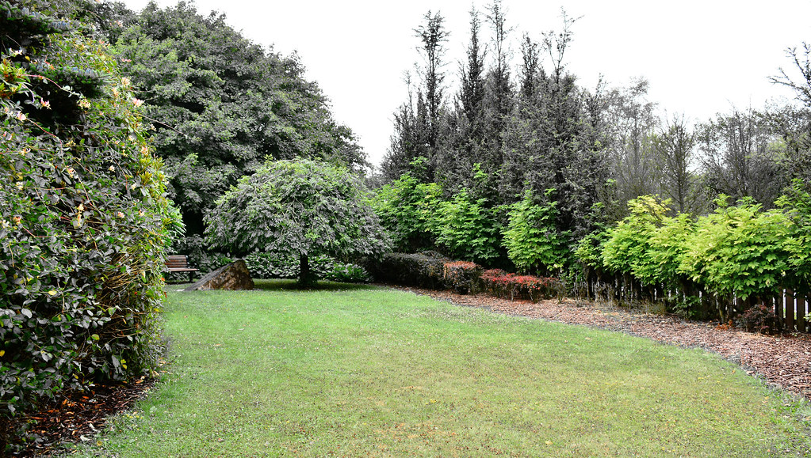

35 years ago today, November 14, 1991, American and British authorities jointly announced criminal indictments against two Libyan intelligence operatives for the downing of Pan Am Flight 103. The announcement represented the culmination of a three-year international manhunt and forensic investigation following one of the deadliest terrorist attacks in aviation history.

## The Tragedy Over Lockerbie

On December 21, 1988, Pan Am Flight 103 was operating a regularly scheduled service from Frankfurt to Detroit, featuring planned stopovers in London and New York City. The flight originated in West Germany with a Boeing 727 before passengers and luggage transferred to a Boeing 747-121, registered as N739PA and named Clipper Maid of the Seas, for the transatlantic crossing.

Shortly after 19:00 GMT, while cruising at altitude over the small Scottish town of Lockerbie, an explosive device detonated inside the aircraft. The explosion broke the jumbo jet apart, killing all 243 passengers and 16 crew members on board. Falling debris and burning wreckage ignited homes in Lockerbie, killing 11 local residents on the ground. With a total death toll of 270 people, it became the deadliest terrorist attack in the history of the United Kingdom and one of the deadliest in Europe.

## A Three-Year Joint Investigation

In the immediate aftermath of the explosion, authorities launched an unprecedented forensic operation across hundreds of square miles of Scottish countryside. The investigation was spearheaded jointly by the Dumfries and Galloway Constabulary, supported by Strathclyde Police, the London Metropolitan Police, and agents from the United States Federal Bureau of Investigation.

Investigators meticulously collected, tagged, and reconstructed thousands of aircraft pieces and charred personal belongings. Through painstaking scientific analysis, investigators identified fragments of the suitcase, clothing, and timing mechanism that had carried and triggered the bomb. The evidence gradually pointed away from non-state militant organizations and toward the intelligence infrastructure of Libya.

*Not a photo of the event itself · NOT FROM THE EVENT · Stock image — Photo: Javaistan / Pixabay Content License*

## The Indictments of November 14, 1991

On November 14, 1991, the joint investigation reached its decisive public turning point. In simultaneous announcements in Washington and Scotland, prosecutors unsealed indictments and issued arrest warrants for two officers of Libya's Mukhabarat el-Jamahiriya intelligence service: Abdelbaset al-Megrahi and Lamin Khalifah Fhimah.

The charges accused both men of planting the bomb on a feeder flight in Malta, which then transferred through Frankfurt and London before detonating aboard Flight 103. The formal filing placed responsibility directly on agents of the Libyan state, initiating an intense diplomatic confrontation between Tripoli and Western powers.

*Lamen Khalifa Fhimah — Photo: Federal Bureau of Investigation / Public domain*

## Sanctions and the Netherlands Trial

Following the indictments, Libyan leader Muammar Gaddafi initially refused to hand over the two accused intelligence officers. In response, the United Nations Security Council imposed strict economic and aviation sanctions on Libya. The diplomatic deadlock lasted for years as international mediators worked to find a mutually acceptable venue for a trial.

In 1999, after protracted negotiations, Gaddafi agreed to extradite both men to stand trial under Scottish law at a neutral location: Camp Zeist, a decommissioned air base in the Netherlands. In 2001, the Scottish judges delivered their verdict. Lamin Khalifah Fhimah was acquitted of all charges. Abdelbaset al-Megrahi was found guilty on 270 counts of murder and sentenced to life imprisonment.

*PanAm 103 main crash site. Sherwood Crescent, Lockerbie. — Photo: M McBey / CC BY 2.0*

## Aftermath, Compensation, and Unresolved Questions

In 2003, the Libyan government agreed to pay more than $2 billion in financial compensation to the families of the victims, a step required by the United Nations to officially lift international sanctions against Libya. While Gaddafi maintained that he had not personally ordered the attack, former Libyan Minister of Justice Mustafa Abdul Jalil stated in 2011 that Gaddafi had indeed ordered the operation.

Megrahi served his sentence in Scotland until August 2009, when the Scottish Government released him on compassionate grounds following a terminal diagnosis of prostate cancer. Megrahi died in Libya in 2012, remaining the only individual ever convicted by the Camp Zeist court. His co-accused, Fhimah, later died in August 2026.

## The Enduring Pursuit of Justice

For the families of the victims, the legal journey did not conclude with the trial at Camp Zeist. Relatives, including campaigners like Jim Swire, whose daughter Flora was killed on the flight, continued to demand full transparency regarding how the bomb reached the aircraft.

Decades after the 1991 indictments, new legal actions emerged. In 2020, United States authorities indicted Tunisian resident and Libyan national Abu Agila Masud, who was 37 years old at the time of the bombing, for his alleged role in constructing the explosive device. Masud was taken into custody in 2022 and pleaded not guilty in 2023, ensuring that the legacy of Pan Am Flight 103 remains an active chapter in international law.

### Sources

- <https://en.wikipedia.org/wiki/November%2014>
- <https://commons.wikimedia.org/wiki/File:B747_N739PA_PanAm.jpg>
- <https://pixabay.com/photos/airplane-travel-adventure-6867678/>
- <https://commons.wikimedia.org/wiki/File:Lamen_Khalifa_Fhimah.jpg>
- <https://www.flickr.com/photos/158652122@N02/46391159451>
