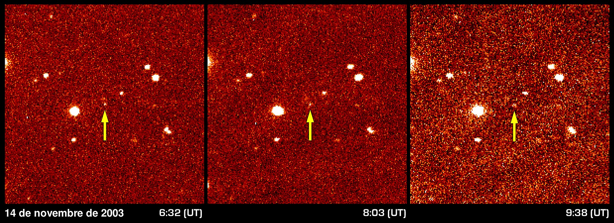
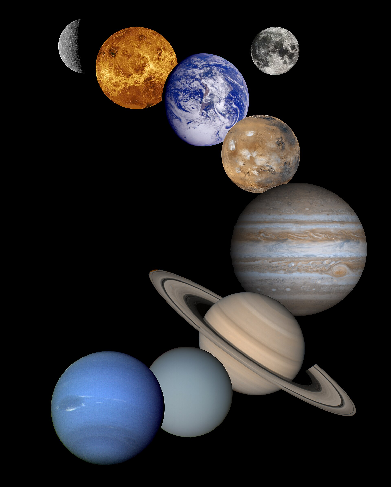

23 years ago today, November 14, 2003, astronomers looking past the known frontiers of our solar system made an astonishing discovery: an icy, reddish dwarf planet roughly 1,000 kilometers across, orbiting billions of miles beyond Neptune. The object, soon officially named Sedna, proved that the distant realm beyond the classical planets was far richer and stranger than anyone had imagined.

## Searching the Dark Borders of Space

For generations after Clyde Tombaugh discovered Pluto in 1930, schoolbooks taught that our planetary neighborhood ended neatly at the ninth planet. Yet astronomers suspected that the true outer reaches of the solar system held thousands of undetected objects. To search for these hidden worlds, Michael Brown of the California Institute of Technology joined forces with Chad Trujillo of the Gemini Observatory and David Rabinowitz of Yale University.

In 2001, the team began an ambitious sky survey using the Samuel Oschin telescope at Palomar Observatory near San Diego, California. The telescope was equipped with Yale's custom-built 160-megapixel Palomar Quest camera, designed to photograph wide swaths of the sky over successive nights so researchers could spot the subtle drift of distant celestial bodies against the background of stationary stars.

## A Slow Drift in the Night Sky

On November 14, 2003, the survey struck gold. Comparing images taken 3.1 hours apart, the astronomers noticed a faint point of light that had shifted by just 4.6 arcseconds. Because closer asteroids move much faster across the sky, that minuscule motion immediately signaled an object at an extreme distance, roughly 100 astronomical units away from the Sun.

The object was provisionally designated 2003 VB12. Michael Brown initially nicknamed it 'The Flying Dutchman,' or simply 'Dutch,' because its sluggish movement across the heavens had kept it hidden from telescope cameras for years. Soon after, astronomers searched through older photographic records in the Palomar Digitized Sky Survey and found precovery images of the object dating all the way back to September 25, 1990.

*Sedna Discovery Image-ca — Photo: NASA/Caltech / Public domain*

## Confirming an Extreme Orbit

To confirm what they had found, the discovery team arranged follow-up observations throughout November and December 2003. They recruited powerful instruments across the Western Hemisphere, including the SMARTS telescope at Cerro Tololo Inter-American Observatory in Chile, the Tenagra IV telescope in Nogales, Arizona, and the giant Keck Observatory atop Mauna Kea in Hawaii.

When orbital calculations were completed, the results stunned planetary scientists. The object was traveling along an extraordinarily stretched, eccentric orbit with an eccentricity of 0.85. At its closest approach, or perihelion, it stays 76.2 astronomical units from the Sun, far beyond Neptune. At its most distant point, or aphelion, it swings out to 937 astronomical units—about 19 times farther out than Pluto. Completing a single circuit around the Sun takes roughly 11,400 years.

*Archive, 2001 — Photo: NASA/JPL / Public domain*

## A Name from Arctic Waters

Having uncovered one of the coldest and most remote worlds known to science, Michael Brown chose a name rooted in mythology. Rather than selecting another Greco-Roman deity, he turned to the Inuit goddess Sedna, who according to legend lives at the frigid bottom of the Arctic Ocean.

Brown explained that the goddess's icy underwater realm was a fitting tribute to a world existing in the perpetual deep freeze of the outer solar system. The name was also easy for English speakers to pronounce, unlike earlier trans-Neptunian discoveries such as Quaoar. Spectroscopic analysis later revealed that Sedna's surface is coated in a mixture of water ice, carbon dioxide ice, ethane ice, and reddish tholin deposits, giving it a distinctive hue.

*California Institute of Technology, Pasadena, California — Photo: Ken Lund / CC BY-SA 2.0*

## The Legacy of a Solitary Traveler

Sedna occupies a unique place in astronomy. With an estimated diameter of about 1,000 kilometers, it is roughly tied with Ceres in the asteroid belt as the largest dwarf planet not known to possess a moon. Because it lacks a companion moon whose orbital motion can be timed, Sedna's exact mass and density remain unknown.

More importantly, its discovery challenged existing models of planetary migration. Its perihelion is too distant for it to have been scattered into place by Neptune, making Sedna the founding member of an enigmatic class of bodies called sednoids. The discovery opened debates about the early evolution of our solar system and set the stage for discoveries that redefined our understanding of dwarf planets.

### Sources

- <https://en.wikipedia.org/wiki/Sedna_(dwarf_planet)>
- <https://commons.wikimedia.org/wiki/File:Sedna_Discovery_Image.jpg>
- <https://commons.wikimedia.org/wiki/File:Sedna_Discovery_Image-ca.jpg>
- <https://commons.wikimedia.org/wiki/File:Solar_system.jpg>
- <https://www.flickr.com/photos/75683070@N00/14516438274>
