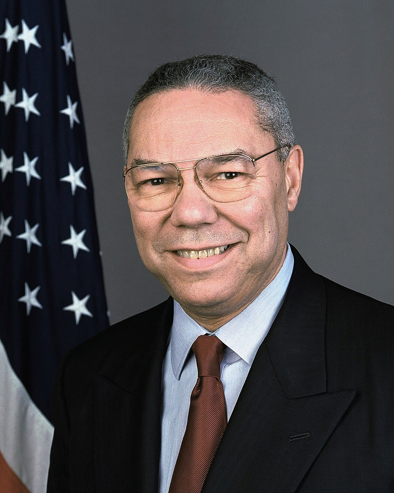

22 years ago today, on November 14, 2004, United States Secretary of State Colin Powell submitted his resignation following the reelection of President George W. Bush. His departure concluded four turbulent and consequential years at the helm of American foreign policy, clearing the way for National Security Advisor Condoleezza Rice to succeed him.

## A Historic Path to the State Department

Colin Luther Powell was born in Harlem in 1937 to Jamaican immigrant parents, Maud Ariel and Luther Theophilus Powell, and grew up in the South Bronx. While attending Morris High School and later the City College of New York, Powell worked in a local baby furniture store, picked up Yiddish, and served as a Shabbos goy for local Orthodox families. He joined the Reserve Officers' Training Corps in college, earned a geology degree, and was commissioned as a second lieutenant in 1958. Powell spent 35 years in the United States Army, rising to four-star general and serving as Commander of the U.S. Army Forces Command in 1989.

## Crisis Leadership and the Powell Doctrine

Before becoming the nation's chief diplomat, Powell built a towering military reputation. He served as the 15th National Security Advisor from 1987 to 1989 and then as the 12th Chairman of the Joint Chiefs of Staff from October 1989 to September 1993. During his tenure as the nation's top military officer, he oversaw 28 major international crises, including the 1989 invasion of Panama and Operation Desert Storm during the 1990 to 1991 Persian Gulf War. Powell formulated the widely known Powell Doctrine, establishing that American military action should be limited unless it satisfies strict criteria regarding national security interests, overwhelming force, and broad public support.

*Archive, 2001 — Photo: Department of State of the United States of America / Public domain*

## The Prestige and Weight of the Secretary of State

When President George W. Bush took office in 2001, he named Powell as the 65th United States Secretary of State. The position, originally established in 1789 with Thomas Jefferson as its first officeholder, represents the executive branch and foreign affairs of the United States. Ranking fourth in the presidential line of succession and standing first among cabinet secretaries, the role carries immense constitutional and administrative authority. Powell became the first Black American to ever hold the office, making him at the time the highest-ranking Black American in the history of the federal executive branch.

*George-W-Bush — Photo: Eric Draper / Public domain*

## Turbulence and the UN Security Council Speech

Powell's four years as Secretary of State were dominated by intense international diplomacy following the events of the early 2000s. He supervised the Department of State, foreign service personnel, and international treaties while advising the president on global strategy. However, his tenure also faced deep historical scrutiny. As Secretary of State, Powell delivered a prominent presentation before the United Nations Security Council presenting the rationale for military intervention in Iraq. Powell later acknowledged publicly that the intelligence and claims presented in that speech contained substantial inaccuracies.

*President George W. Bush Goes Fishing with his Father, President George H. W. Bush — Photo: Series: Photographs Related to the George W. Bush Administra / Public domain*

## November 14, 2004: Stepping Down for a Successor

Following President George W. Bush's victory in the November 2004 presidential election, Powell submitted his official letter of resignation on November 14, 2004. To take his place, President Bush nominated Condoleezza Rice, who had served as the 19th National Security Advisor since 2001. Born in Birmingham, Alabama, in 1954, Rice had previously served on the National Security Council during the dissolution of the Soviet Union and as provost of Stanford University. Following her confirmation by the United States Congress, Rice became the 66th Secretary of State, the second African American after Powell, and the first African-American woman to lead the department.

## A Decorated Career in American Public Service

After leaving the State Department, Powell authored his 2012 book It Worked for Me: In Life and Leadership, having earlier written his autobiography My American Journey in 1995. Over his lifetime of service, Powell received the Purple Heart, the Congressional Gold Medal, the Presidential Citizens Medal, the Secretary's Distinguished Service Award, and two Presidential Medals of Freedom. He passed away in October 2021 from COVID-19 complications while undergoing treatment for blood cancer, leaving behind an indelible imprint on American military and diplomatic history.

### Sources

- <https://en.wikipedia.org/wiki/United_States_Secretary_of_State>
- <https://commons.wikimedia.org/wiki/File:Ki-moon_Powell.jpg>
- <https://commons.wikimedia.org/wiki/File:Colin_Powell_official_Secretary_of_State_photo.jpg>
- <https://commons.wikimedia.org/wiki/File:George-W-Bush.jpeg>
- <https://commons.wikimedia.org/wiki/File:President_George_W._Bush_Goes_Fishing_with_his_Father,_President_George_H._W._Bush.jpg>
