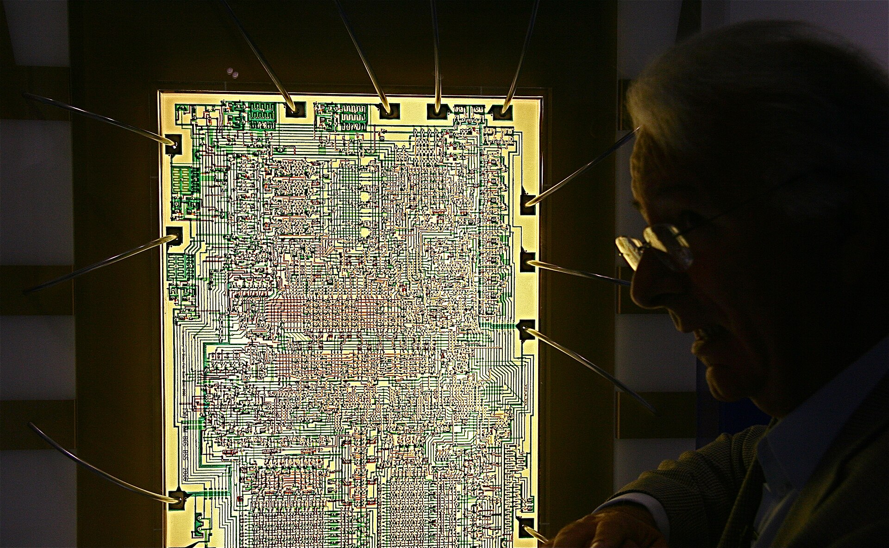

55 years ago today, November 15, 1971, Intel Corporation released the Intel 4004, the world's first commercial single-chip microprocessor. By integrating an entire central processing unit onto a single integrated circuit, Intel launched a technological transformation that would redefine modern computing.

## The Challenge of Early Computing Hardware

Before the arrival of the microprocessor, computers were bulky machines built from multiple racks of circuit boards containing many small- and medium-scale integrated circuits. An entire central processing unit, or CPU, required dozens of interconnected chips and wiring simply to carry out basic arithmetic and logic routines. These complex assemblies were expensive to build, prone to connection failures, and physically too large for portable consumer equipment. Developing a system that could condense all core computing functions into a compact, single-chip format was one of the central engineering ambitions of the late 1960s.

## A Request for a Desktop Calculator

The path to the Intel 4004 began in April 1969, when Japanese calculator manufacturer Busicom Corporation approached Intel in California. Busicom wanted Intel to produce a custom chipset of seven specialized chips for its new lineup of electronic desktop calculators, which included a three-chip CPU architecture. Busicom originally planned to use shift registers for data storage and read-only memory for instructions. Intel engineer Marcian Hoff examined the Japanese proposal and realized that designing seven separate specialized chips was overly complex and inefficient. Instead, Hoff proposed a streamlined architecture based on dynamic random-access memory, or RAM, that could centralize calculation logic onto a single multipurpose processor.

*Man Who Designed the World's First Microprocessor — Photo: Intel Free Press / CC BY-SA 2.0*

## Turning the Concept into Silicon

Busicom agreed to Marcian Hoff's new concept, and Japanese engineer Masatoshi Shima collaborated on the architectural design. In April 1970, engineer Federico Faggin joined Intel to lead the physical design work and bring the concept into production. Faggin had previous experience with metal-oxide-semiconductor silicon gate technology, known as SGT. By utilizing poly-silicon instead of traditional aluminum metal gates, Faggin doubled the circuit density and increased operating speeds fivefold compared to older MOS technologies. Faggin also invented the bootstrap load and buried contact methods, allowing silicon gates to connect directly without intermediate metal wiring. These breakthroughs enabled him to pack 2,300 transistors onto a single silicon die.

*Scene of the era (not a photo of this event) — Photo: Florida Keys--Public Libraries / CC BY 2.0*

## Delivery and the Historic Commercial Debut

By March 1971, Intel delivered the first fully functional 4004 microprocessors to Busicom for use in its prototype 141-PF printing calculator. Busicom soon incorporated the chip into its calculators, teller machines, and billing registers, eventually distributing 100,000 units through an original equipment manufacturing partnership with NCR. Recognizing the revolutionary potential of a general-purpose processor, Intel negotiated the rights to market the chip independently. On November 15, 1971, Intel officially launched the 4-bit 4004 to the global electronics market at an initial unit price of 60 dollars, offering engineers a clock-driven digital processor that could execute stored machine code on a single integrated circuit.

*Scene of the era (not a photo of this event) — Photo: Evert F. Baumgardner / Public domain*

## The Rise of Intel and Silicon Valley

Founded on July 18, 1968, by Gordon E. Moore, Robert Noyce, and Arthur Rock, Intel had started out focused primarily on semiconductor memory chips such as SRAM and DRAM. Andy Grove, the company's third employee, joined early on to help direct operations. The breakthrough success of the 4004 demonstrated that silicon chips could serve not only as digital storage, but as programmable processing engines. The MCS-4 chipset served as an industry blueprint for building complex integrated circuits. The 4004 laid the technological groundwork for subsequent processors, including the improved Intel 4040, the 8-bit 8008, and the 8080, paving the way for the personal computer boom of the 1980s.

## The Legacy of a Silicon Milestone

Today, the original Busicom 141-PF calculator powered by the Intel 4004 is preserved in the Computer History Museum. What started in 1971 as a 2,300-transistor calculation chip ignited an industry that now manufactures microprocessors containing billions of transistors. From desktop workstations and home laptops to embedded controllers inside automobiles and handheld devices, the architecture introduced on November 15, 1971, remains the technological foundation of modern life.

### Sources

- <https://en.wikipedia.org/wiki/Intel>
- <https://commons.wikimedia.org/wiki/File:Intel4004.jpeg>
- <https://commons.wikimedia.org/wiki/File:Man_Who_Designed_the_World%27s_First_Microprocessor.jpg>
- <https://commons.wikimedia.org/wiki/File:Police_Cars_at_City_Hall_Key_West_Florida_1965.jpg>
- <https://commons.wikimedia.org/wiki/File:Family_watching_television_1958.jpg>
