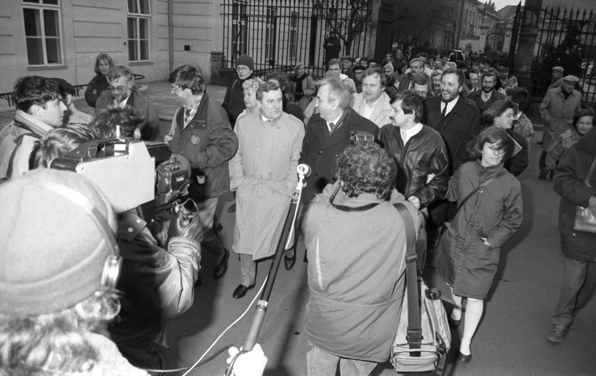
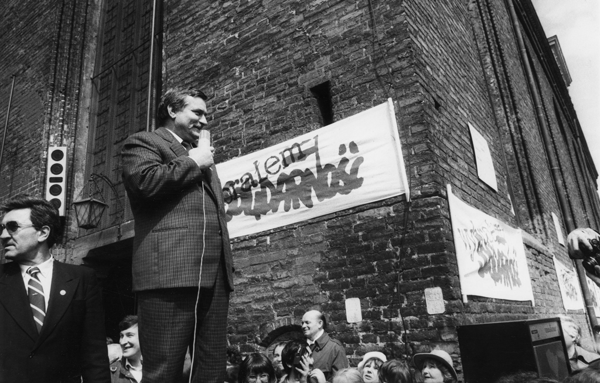
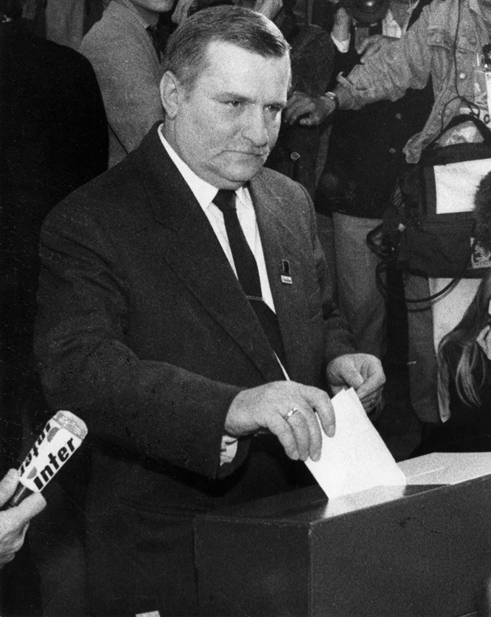

37 years ago today, November 15, 1989, Polish Solidarity leader Lech Wałęsa walked into the United States Capitol and addressed a Joint session of the United States Congress. An electrician who had endured surveillance, firings, and imprisonment under Poland's communist regime stood before American lawmakers as a living symbol of freedom in Central and Eastern Europe.

## An Electrician Standing Before Congress

When Lech Wałęsa took the podium on Capitol Hill on November 15, 1989, he accomplished a rare feat in American diplomatic history. He was the first foreign non-head of state ever invited to address a Joint Meeting of the U.S. Congress. At the time, Wałęsa held no government office; he was simply a trade unionist, an electrician by trade, and a dissident leader whose moral courage had helped crack the Iron Curtain.

## From Shipyard Fence to National Leadership

Wałęsa's journey had begun years earlier on Poland's Baltic coast. In July 1967, after compulsory military service, he started working as an electrician at the Lenin Shipyard in Gdańsk. When economic hardship and official decrees raising food prices led to worker unrest, Wałęsa emerged as a strike organizer. In 1976, he was fired from his job and placed under constant surveillance by the secret police, with his home and workplace persistently bugged. On August 14, 1980, after another food price hike, Wałęsa famously climbed over the Gdańsk shipyard fence to join striking workers and took command of the Inter-Enterprise Strike Committee. On August 31, 1980, he signed the landmark Gdańsk Agreement using an oversized pen, an image that beamed across international television screens and legalized the independent trade union Solidarność, or Solidarity.

*Okrągły Stół 1989 — Photo: Leonard Szmaglik / CC BY-SA 4.0*

## Ten Million Strong and Underground Survival

Solidarity rapidly expanded into a movement claiming over 10 million members, representing more than a quarter of Poland's entire population and one-third of its working-age workforce. The communist authorities attempted to crush the movement, imposing martial law in December 1981, outlawing the union, and placing Wałęsa under arrest. In 1983, Wałęsa was awarded the Nobel Peace Prize, though he sent his wife to accept it out of fear that communist authorities would forbid him from returning home. Operating underground with backing from the Vatican and American supporters, Solidarity kept civil resistance alive through years of repression.

*Wybory 1989 12 — Photo: Stefan Kraszewski / CC BY-SA 4.0*

## The Peaceful End of Communist Rule

By 1989, facing a collapsing economy and deep foreign debt, the Polish government agreed to the historic Round Table talks between February and April. The resulting agreement paved the way for semi-free parliamentary elections on June 4, 1989. The opposition scored an overwhelming victory, and by late August, a Solidarity-led coalition took power, ending more than four decades of Marxist-Leninist rule. Poland became the first Warsaw Pact nation to dismantle its communist regime, unleashing a wave of democratic transformation across Central and Eastern Europe.

*Wybory 1989 13 (cropped) — Photo: Stefan Kraszewski / CC BY-SA 4.0*

## A Historic Speech and American Connections

For American observers, Wałęsa's appearance in Washington held deep emotional resonance. Millions of Polish Americans had followed Solidarity's struggles with intense pride. Wałęsa also held personal ties to the United States: in 1973, his mother Feliksa and stepfather Stanisław had emigrated to Jersey City, New Jersey. The United States government, which had supported the Polish underground movement during the dark years of martial law, welcomed the shipyard electrician with standing ovations inside the House chamber as a hero of modern democracy.

## A Legacy of Peaceful Transformation

The triumph in Washington heralded the next chapter of Poland's transition. In December 1990, Lech Wałęsa was elected President of Poland, becoming the country's first-ever president elected by popular vote. He guided the nation through its transition into a market-based liberal democracy. Today, the Gdańsk Lech Wałęsa Airport bears his name, honoring the electrician who climbed a shipyard fence and helped reshape the political landscape of Europe.

### Sources

- <https://en.wikipedia.org/wiki/November%2015>
- <https://commons.wikimedia.org/wiki/File:Wa%C5%82%C4%99sa_i_Fritz.jpg>
- <https://commons.wikimedia.org/wiki/File:Okr%C4%85g%C5%82y_St%C3%B3%C5%82_1989.jpg>
- <https://commons.wikimedia.org/wiki/File:Wybory_1989_12.jpg>
- <https://commons.wikimedia.org/wiki/File:Wybory_1989_13_(cropped).jpg>
