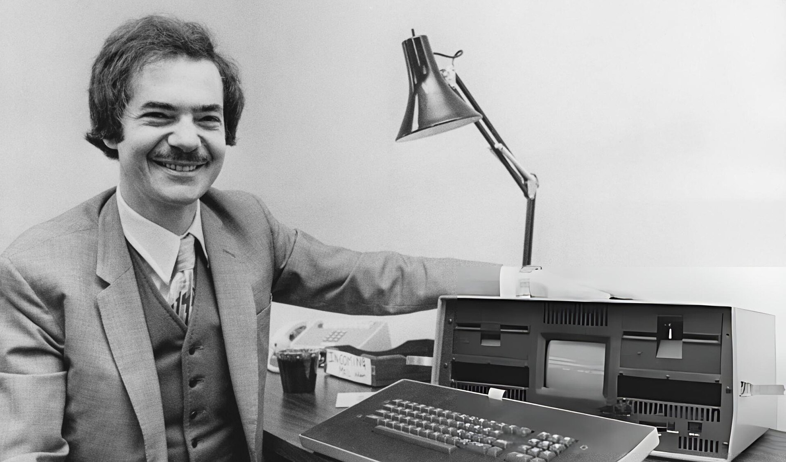
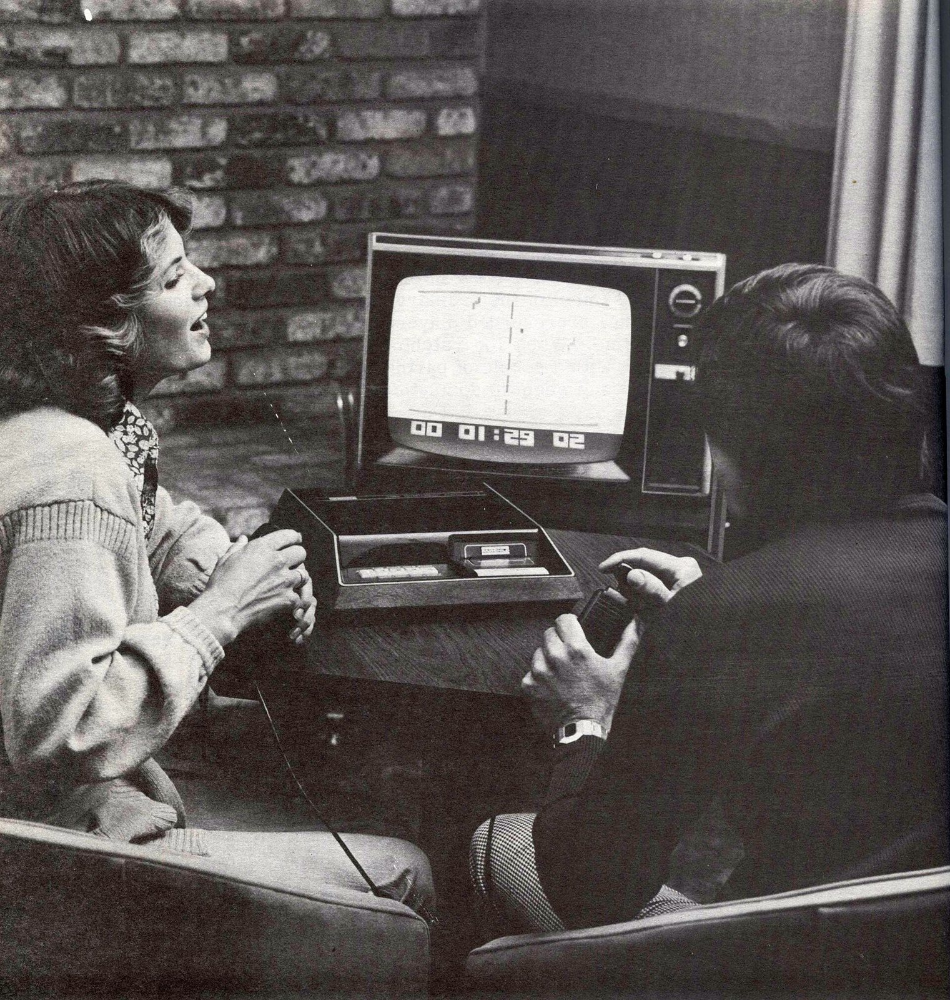
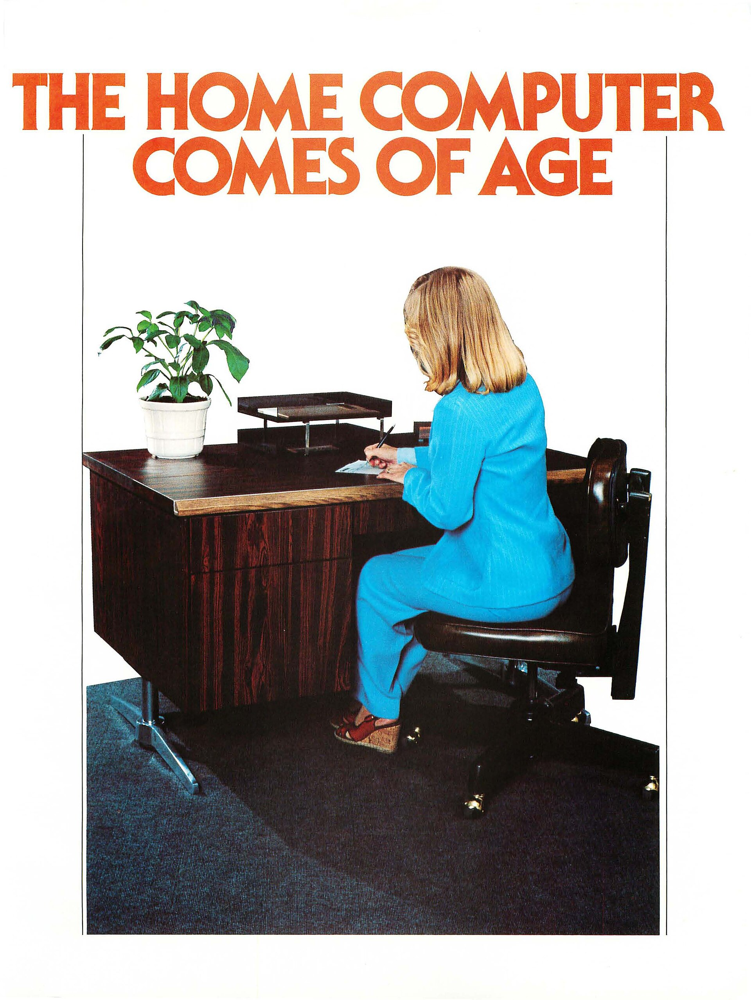

25 years ago today, November 15, 2001, Microsoft released the Xbox home video game console across North America. It marked the arrival of the first major American-made gaming system in nearly a decade, stepping boldly into an arena long ruled by Japanese tech giants.

## A Threat to the Windows Empire

By the late 1990s, Microsoft was the world's dominant personal computer software company, powered by MS-DOS, Windows, and the Microsoft Office suite. However, a major development outside the traditional PC sector rattled the company's leadership in Redmond, Washington. On March 2, 1999, Sony publicly unveiled the PlayStation 2. Sony pitched the upcoming machine not merely as a toy, but as an all-encompassing digital entertainment gateway capable of playing DVD movies and handling home computing tasks.

Microsoft Chief Executive Officer Bill Gates grew concerned that an all-in-one living room console could erode consumer interest in desktop PCs running Windows. Initially, Gates approached Sony's leadership to discuss developing programming software for the PlayStation 2, but Sony declined the offer in favor of proprietary software. Gates also reached out to Nintendo executives Hiroshi Yamauchi and Genyo Takeda. Concluding that Microsoft could not stay on the sidelines as video games evolved into a multi-billion-dollar entertainment medium, Gates authorized an internal team to design an entirely new gaming machine from scratch.

## Building a Computer in a Console Box

Unlike traditional home consoles that relied on custom, proprietary microchips, the Xbox was engineered around standard personal computer components. Underneath its bulky black chassis sat an Intel Pentium III central processing unit and an Nvidia GeForce 3-based graphics processor. Running software rooted in variations of Windows 2000 and DirectX, the Xbox gave developers familiar programming tools.

Most significantly, the Xbox was the first home video game console to feature a built-in hard disk drive as standard equipment, eliminating the immediate requirement for external memory cards to save games. It was also designed with an integrated broadband Ethernet port. While rival consoles still relied on dial-up adapters, Microsoft engineered the Xbox from day one to connect directly to high-speed internet, laying the foundation for its Xbox Live online subscription service, which rolled out the following year in 2002.

*Adam Osborne and Osborne 1 — Photo: Bill Crouch (-1998) / Public domain*

## Record Launch and the Halo Phenomenon

The console hit North American retail shelves on November 15, 2001. It was the first major American-produced console to enter the global market since the release of the Atari Jaguar in 1993. The launch was accompanied by a groundbreaking first-person shooter called Halo: Combat Evolved, which quickly became the system's defining flagship title.

Driven by enthusiastic demand and the critical acclaim of Halo, the Xbox achieved a record-breaking launch in North America. Microsoft sold 1.5 million units before the end of 2001. The console outsold Nintendo's GameCube and Sega's Dreamcast in Western markets, validating Microsoft's ambitious leap into consumer hardware.

*Two people playing a Fairchild Channel F — Photo: Electronic Engineering Times Liane Enkelis (Photography) / Public domain*

## A Four Billion Dollar Investment

Despite strong commercial numbers on store shelves, the business reality was punishing. Microsoft engineered the Xbox with premium PC hardware, which made the manufacturing cost per unit significantly higher than its retail price tag. The company lost money on every console sold.

Over the lifespan of the original Xbox, Microsoft absorbed losses of more than 4 billion dollars. Furthermore, the machine struggled to gain traction outside Western markets, selling poorly in Japan due to its large physical footprint and a software catalog heavily tailored to North American players. Meanwhile, Sony's PlayStation 2 maintained an insurmountable global lead, ultimately vastly outselling the Xbox.

*Noval 760 Byte advertisment June 1977 page 1 of 4 — Photo: Noval, Inc., subsidiary of Gremlin Industries / Public domain*

## The Legacy of the Green Logo

Microsoft discontinued the original Xbox in 2006, eventually shutting down its legacy online services in 2010. By the end of its run, cumulative worldwide sales reached 24 million units, including 16 million consoles sold in North America alone.

Although it resulted in heavy initial financial losses, the gamble established Microsoft as a permanent pillar of the global video games industry. It gave rise to subsequent console generations—including the Xbox 360 in 2005, the Xbox One in 2013, and the Xbox Series X and S in 2020. The original hardware proved that American engineering, internal hard drives, and built-in broadband could transform the modern living room.

### Sources

- <https://en.wikipedia.org/wiki/Microsoft>
- <https://www.flickr.com/photos/51764518@N02/13198681445>
- <https://commons.wikimedia.org/wiki/File:Adam_Osborne_and_Osborne_1.jpg>
- <https://commons.wikimedia.org/wiki/File:Two_people_playing_a_Fairchild_Channel_F.jpg>
- <https://commons.wikimedia.org/wiki/File:Noval_760_Byte_advertisment_June_1977_page_1_of_4.jpg>
