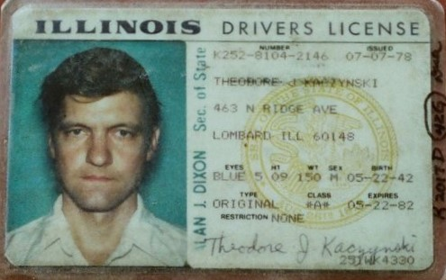
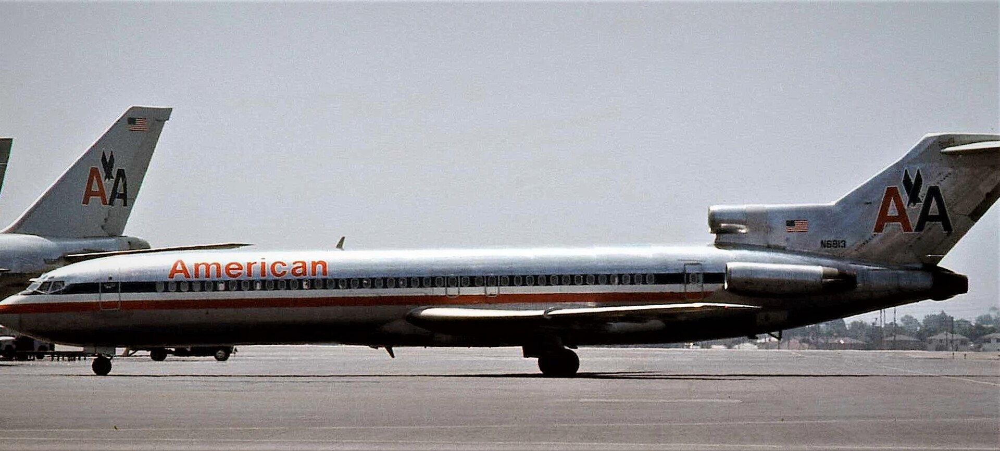
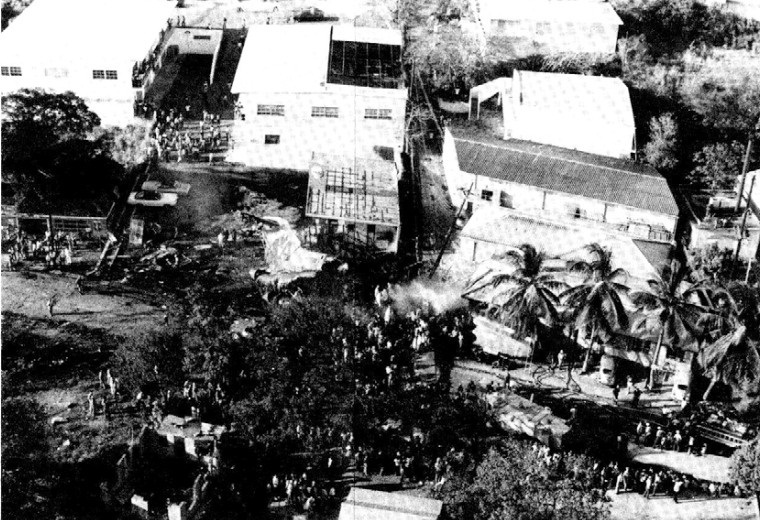

47 years ago today, November 15, 1979, American Airlines Flight 444 was forced into an emergency descent when a mailed explosive device partially detonated in its cargo hold. The midair blast filled the passenger cabin with smoke and propelled federal law enforcement into what would become the longest manhunt in the history of the Federal Bureau of Investigation.

## A Routine Flight Turns Perilous

On November 15, 1979, American Airlines Flight 444 departed Chicago on a regularly scheduled flight bound for National Airport in Washington, D.C. The aircraft, a Boeing 727 carrying passengers and mail, climbed out over the Midwest without any early indication of danger. Hidden inside the aircraft's cargo hold, however, lay a mailed package containing a concealed pipe bomb designed specifically to detonate once the airliner reached a certain cruising altitude.

## Explosion in the Hold and Cabin Smoke

As the jet gained altitude, the mechanism inside the package activated. The device partially detonated within the luggage compartment, causing what was described as a sucking explosion and an immediate loss of pressure. Although the device did not achieve a full detonation that could have destroyed the aircraft midair, large volumes of thick smoke began billowing up from the hold and filling the passenger cabin.

Faced with a rapidly deteriorating environment inside the aircraft, the flight crew initiated an immediate diversion. The pilots steered the Boeing 727 toward Dulles International Airport, where emergency response teams were assembled on the runway.

*NOT FROM THE EVENT · 1978 — Photo: State of Illinois DMV / Public domain*

## Emergency Landing at Dulles

The airliner touched down safely at Dulles International Airport, averting what could have been a catastrophic loss of life. Emergency personnel immediately evacuated the aircraft and administered medical care on the tarmac. Twelve passengers required medical treatment for smoke inhalation sustained during the descent.

When bomb technicians and investigators inspected the cargo hold, they recovered the remnants of the device. Because the pipe bomb had only partially detonated, key components remained relatively intact, providing federal examiners with critical physical evidence from the crime scene.

*NOT FROM THE EVENT · 1974 — Photo: Piergiuliano Chesi / CC BY-SA 3.0*

## The Birth of the UNABOM Investigation

Upon analyzing the construction and materials of the Flight 444 bomb, agents with the Federal Bureau of Investigation made a crucial connection. The device bore striking similarities to two earlier homemade bombs that had detonated at Northwestern University in the Chicago area. The realization that an active bomber was targeting both academic institutions and commercial aviation prompted the federal government to launch a coordinated inter-agency task force.

The FBI assigned the case the internal investigative code UNABOM, an acronym derived from University and Airline Bombing. The news media quickly adopted the file name, coining the term 'Unabomber' to describe the unidentified perpetrator who terrorized the public through the postal system.

*NOT FROM THE EVENT · 1976 — Photo: National Transportation Safety Board / Public domain*

## The Recluse Behind the Bombings

The man behind the package was Theodore John Kaczynski, a former mathematics prodigy born in Chicago in 1942. Kaczynski had attended Harvard University on a scholarship at age 16 and later earned his master's degree and doctorate in mathematics at the University of Michigan. In 1971, he walked away from academia, moving into a remote, isolated cabin near Lincoln, Montana, built without electricity or running water.

From his secluded retreat, Kaczynski waged a nationwide mail bombing campaign spanning from 1978 to 1995. Motivated by an extreme hostility toward modern industrialization and technological expansion, his attacks ultimately killed three people and injured 23 others.

## A 17-Year Manhunt and Final Resolution

The emergency landing of Flight 444 in 1979 marked the moment Kaczynski's campaign escalated to federal aviation, turning the case into the longest and most expensive investigation in FBI history. For years, the bomber left few clues, evading identification while continuing to mail deadly packages across the United States.

The breakthrough came in 1995, after Kaczynski demanded that major publications print his 35,000-word manifesto, Industrial Society and Its Future. The Washington Post published the essay with the backing of the FBI and Attorney General Janet Reno. Reading the manifesto, Kaczynski's brother, David, recognized the prose style and contacted authorities. Federal agents arrested Kaczynski at his Montana cabin in April 1996, concluding the 17-year hunt that had escalated dramatically in the smoke-filled skies of November 15, 1979.

### Sources

- <https://en.wikipedia.org/wiki/Chicago>
- <https://commons.wikimedia.org/wiki/File:ABSCAM-FBI.jpg>
- <https://commons.wikimedia.org/wiki/File:Ted_Kaczynski_drivers_license_Illinois.jpg>
- <https://commons.wikimedia.org/wiki/File:American_Airlines_B-727_N6813.jpg>
- <https://commons.wikimedia.org/wiki/File:American_Airlines_Flight_625.jpg>
