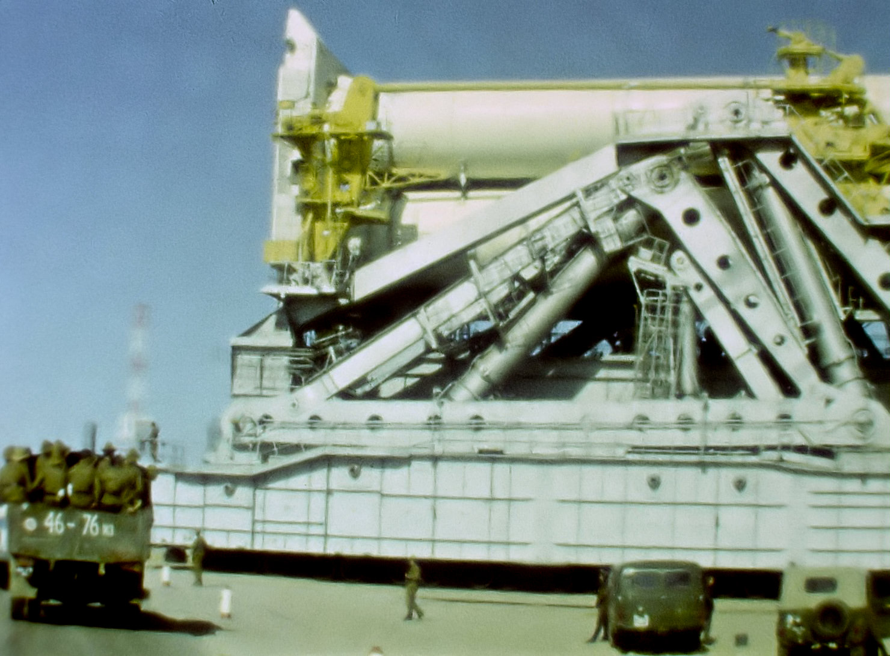
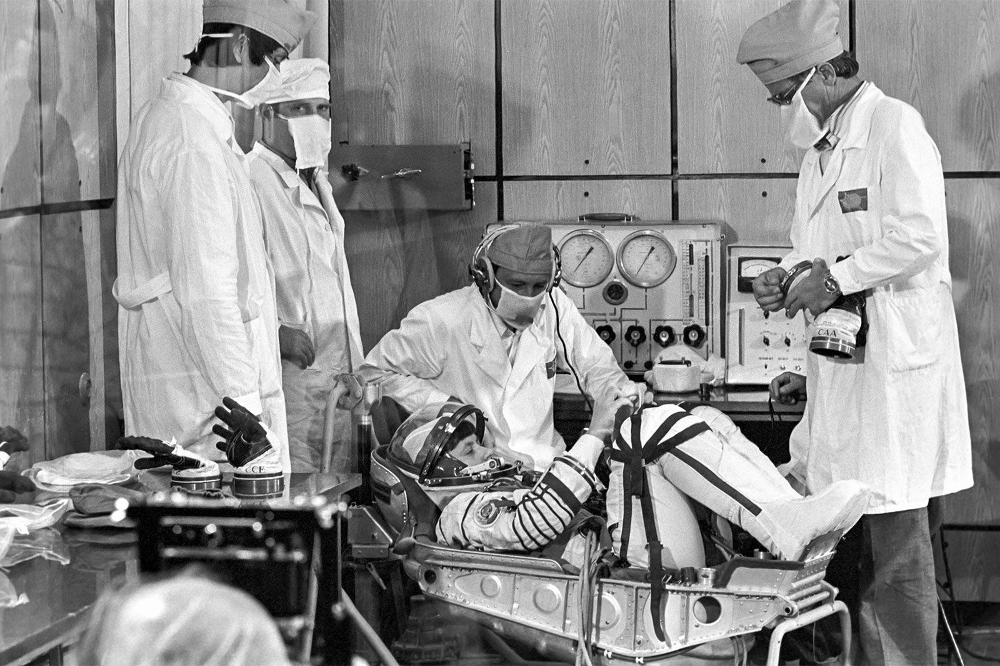
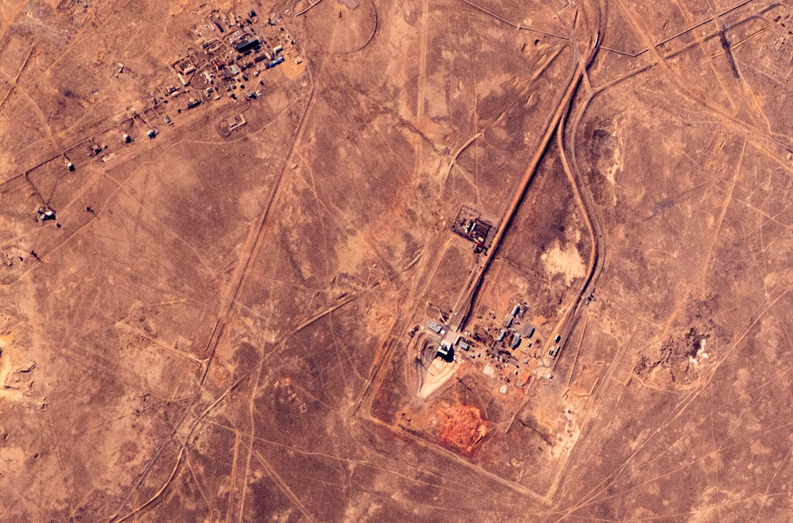

38 years ago today, November 15, 1988. The Soviet Union launched the space shuttle Buran on its very first space flight, sending the massive orbiter into the sky without a single crew member on board. At the height of late Cold War technological rivalry, the flight demonstrated that the Soviets could match the reusable spaceplane technology pioneered by the United States.

## Cold War Competition and the Superpower Space Race

The roots of the Buran project lay deep within the geopolitical contest of the Cold War. Following the formation of the Soviet Union in 1922 and the immense devastation of World War II, the USSR emerged as one of the world's two superpowers. Armed with a centrally planned economy, the world's largest standing military, and a vast nuclear arsenal, Moscow poured immense national resources into technological and scientific prestige.

From the earliest years of the Space Race, Soviet leadership saw achievements in orbit as direct proof of ideological and military parity with the United States. When the American Space Shuttle program began operations, Soviet defense planners grew determined to field an equivalent system capable of heavy-lift orbital missions.

## A Monumental Industrial Undertaking

Construction of the Buran spacecraft officially began in 1980. The project grew into one of the largest engineering efforts in Soviet history, eventually involving over 1,000 industrial companies and research institutes spanning the entire Soviet Union. By 1984, engineers rolled out the first full-scale orbiter, designated construction number 1.01.

Unlike conventional rockets, the reusable orbiter was built around an advanced airframe that constituted approximately 20 percent of its total launch weight. An additional 11 percent was dedicated to payload accommodations and removable structural parts. The vehicle was engineered to ride into orbit attached to the Energia rocket, a newly developed super heavy-lift launch vehicle.

*Energia-rocket-transporter-1 — Photo: Аркадий Тарасов / CC BY-SA 3.0*

## Engineering the Thermal Shield and Automated Systems

Outwardly, the Buran orbiter bore a striking resemblance to the American Space Shuttle, but its thermal protection system featured notable engineering distinctions. The lower surface was shielded by 38,600 carbon-carbon tiles coated in antioxidant molybdenum disilicide to dissipate the brutal friction of atmospheric entry. These tiles were engineered to withstand 100 space missions.

Soviet designers arranged the underside tiles so that the expansion gaps ran parallel and perpendicular to the aerodynamic airflow across the hull. These gaps were insulated with quartz fiber, rope, alkaline elements, brush seals, and waterproofing compounds. Inside the pressurised crew compartment, three distinct decks housed workplaces, sleeping berths, a galley, and life support systems, while the forward cockpit featured three CRT displays configured for automated and crewed flight.

*Savitskaya August 1982 — Photo: mos.ru / CC BY 4.0*

## The Historic Uncrewed Launch of November 15, 1988

On November 15, 1988, Buran stood ready on the launch pad at Baikonur Cosmodrome. While American shuttle missions always carried astronauts, Soviet mission directors chose to fly this maiden test completely uncrewed. Automatic flight control computers were entrusted with the entire profile, from booster separation to reentry and touchdown.

Energia ignited its engines and carried Buran out of Earth's atmosphere into orbit. Operating completely under software guidance, the shuttle executed its mission profile flawlessly, maneuvering in space before plunging back through the upper atmosphere. Guided by automatic systems without human intervention, Buran lined up with the landing strip at Baikonur Cosmodrome and touched down cleanly on its landing gear.

*Baikonur Cosmodrome | Baikonur-Kosmodrom — Photo: Astro_Alex / CC BY-SA 2.0*

## Economic Stagnation and the End of the Buran Programme

Despite the undeniable technical success of the maiden flight, broader political and economic realities sealed Buran's fate. General Secretary Mikhail Gorbachev had introduced glasnost and perestroika in 1985 in an attempt to modernize the stagnating Soviet economy, but state finances were rapidly deteriorating. Maintaining an expensive super heavy-lift shuttle program was no longer sustainable.

By 1989, Soviet-backed regimes across the Eastern Bloc were collapsing, and in December 1991, the Soviet Union itself dissolved into fifteen independent republics. The cash-strapped Russian Federation could not afford to continue testing the orbiters. In 1993, the Buran programme was officially terminated, leaving orbiter 1.01 parked in storage.

## Tragic Destruction and What Remains Today

Buran's final chapter ended not in the heavens, but on the ground. In 2002, the roof of the large assembly and testing hangar at Baikonur Cosmodrome collapsed during a severe storm. The structural failure crushed the orbiter, completely destroying the only Buran spacecraft that had ever flown in space.

Today, the memory of Buran stands as a bittersweet testament to the height of Soviet aerospace engineering. The uncrewed flight of November 15, 1988, demonstrated that an automated shuttle could lift off, navigate orbital space, and glide to a pinpoint runway landing entirely on computer control—a milestone achieved on the very eve of the superpower's collapse.

### Sources

- <https://en.wikipedia.org/wiki/Soviet_Union>
- <https://commons.wikimedia.org/wiki/File:Model_of_Salyut-7_with_two_Soyuz_spacecrafts.JPEG>
- <https://commons.wikimedia.org/wiki/File:Energia-rocket-transporter-1.jpg>
- <https://commons.wikimedia.org/wiki/File:Savitskaya_August_1982.jpg>
- <https://www.flickr.com/photos/72482589@N07/45562642951>
