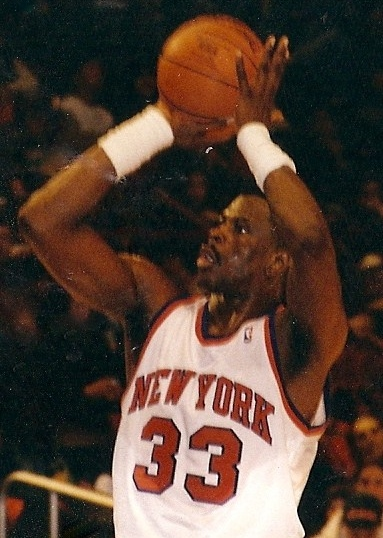
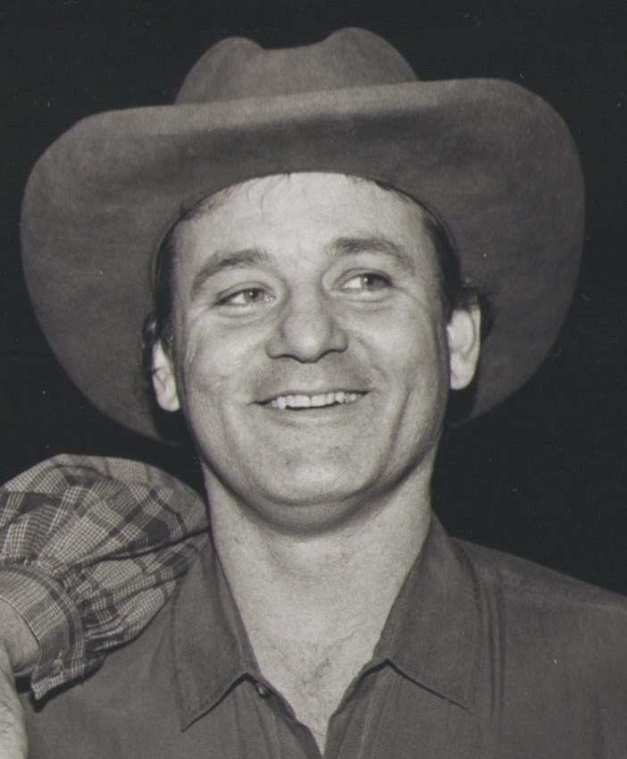
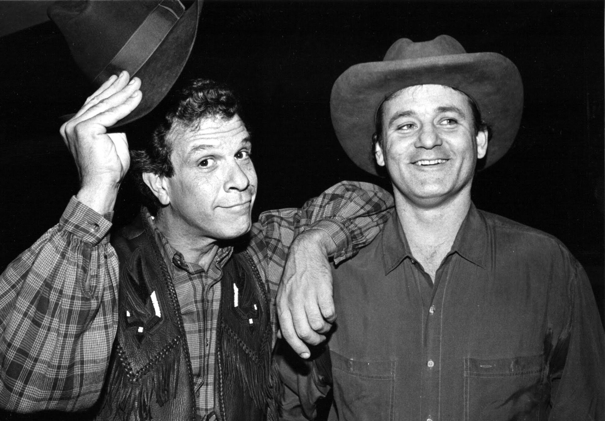

Thirty years ago today, on November 15, 1996, the sports comedy film Space Jam opened in movie theaters across the United States. Directed by Joe Pytka, the film united the world's most famous basketball player, Michael Jordan, with Bugs Bunny and the classic Looney Tunes roster. It offered audiences a one-of-a-kind blend of sports stardom and animation that quickly became a cultural touchstone of the mid-1990s.

## From Television Commercials to the Big Screen

The concept behind Space Jam grew out of commercial advertising. Director Joe Pytka had previously directed the popular 'Hare Jordan' television spots for Nike, which first paired Michael Jordan with Bugs Bunny. Pytka, an acclaimed commercial and music video director who had also worked with celebrities like Michael Jackson and Tiger Woods, was tasked with bringing this unique dynamic to a full-length motion picture. Written by Leo Benvenuti, Steve Rudnick, Timothy Harris, and Herschel Weingrod, the film was backed by an 80 million dollar budget under the Warner Bros. Family Entertainment label.

## An Intergalactic Basketball Showdown

The plot begins in 1973 with a young Michael Jordan telling his father, James, about his aspirations to play in the NBA. Twenty years later, following his father's death, Jordan announces his retirement from basketball to try professional baseball. Meanwhile, in outer space, the proprietor of the failing amusement park Moron Mountain, an alien named Mr. Swackhammer, orders his small minions, the Nerdlucks, to kidnap the Looney Tunes to serve as new attractions. Bugs Bunny convinces the aliens to let the Tunes defend their freedom in a basketball contest.

*Patrick Ewing ca. 1995 cropped — Photo: User:Seidenstud (Seidenstud on the English Wikipedia) / CC BY-SA 3.0*

## The Rise of the Monstars

To ensure victory, the Nerdlucks infiltrate NBA games on Earth. They secretly steal the physical skills and basketball talents of five prominent stars: Charles Barkley, Shawn Bradley, Patrick Ewing, Larry Johnson, and Muggsy Bogues. Powered by the stolen abilities, the tiny aliens transform into the gigantic and menacing 'Monstars.' The loss of talent among the five NBA players triggers a nationwide panic and prompts the suspension of the professional basketball season as doctors and trainers fail to figure out what happened.

*Bill Murray 1989 (cropped) — Photo: Mxbndr / CC BY-SA 4.0*

## Jordan Joins the Tune Squad

Desperate for help against the Monstars, the Looney Tunes pull Michael Jordan down through a golf hole while he is playing a round with Bill Murray, Larry Bird, and his assistant, Stan Podolak. Although initially hesitant, Jordan agrees to join the team, dubbed the Tune Squad, alongside characters like Daffy Duck and Lola Bunny. During the climactic showdown against the Monstars, Jordan raises the stakes: if the Tune Squad wins, the aliens must return the stolen talent to the NBA players; if the Monstars win, Jordan must spend the rest of his life as an attraction on Moron Mountain.

*Paul Binder with Bill Murray 1989 — Photo: Mxbndr / CC BY-SA 4.0*

## The Buzzer-Beater Finish

With the Monstars playing brutally under Swackhammer's orders, most of the Tune Squad ends up injured. Down to just Jordan, Bugs, Lola, and Daffy with only ten seconds remaining on the clock and trailing by one point, Bill Murray unexpectedly appears to complete the lineup. In the final seconds, Murray feeds the ball to Jordan. As the Monstars drag him down, Jordan relies on cartoon physics to stretch his arm across the court and slam dunk the ball right as the final buzzer sounds, securing a dramatic victory.

## Box Office Success and Chart-Topping Music

Space Jam premiered in Los Angeles on November 10, 1996, before its wide theatrical release on November 15. The film proved to be a commercial hit, earning 250.2 million dollars at the worldwide box office. It became the tenth highest-grossing movie of 1996 and the highest-grossing basketball film of its era. The film's soundtrack, released on November 12, 1996, also enjoyed massive success. It climbed to Number 2 on the US Billboard 200 chart by April 1997, earned double platinum certification by January 1997, and was certified 6x platinum in 2001, propelled by tracks like Quad City DJ's theme song and Seal's cover of 'Fly Like an Eagle.'

## An Enduring Pop Culture Legacy

In addition to Jordan, the film featured live-action appearances by Wayne Knight as Stan Podolak and Theresa Randle as Jordan's wife Juanita, alongside cameos from coaches like Del Harris and Paul Westphal and players including Steve Kerr, Alonzo Mourning, and Horace Grant. Danny DeVito provided the voice of Swackhammer, while Billy West voiced Bugs Bunny. Space Jam remains a defining cinematic snapshot of 1990s culture, blending the era's biggest sports figure with timeless animated icons and paving the way for a sequel, Space Jam: A New Legacy, twenty-five years later in 2021.

### Sources

- <https://en.wikipedia.org/wiki/November%2015>
- <https://commons.wikimedia.org/wiki/File:Official_Scorer%27s_Report_-_1995_NBA_Playoffs_-_Orlando_Magic_at_Chicago_Bulls,_May_18,_1995.jpg>
- <https://commons.wikimedia.org/wiki/File:Patrick_Ewing_ca._1995_cropped.jpg>
- <https://commons.wikimedia.org/wiki/File:Bill_Murray_1989_(cropped).jpg>
- <https://commons.wikimedia.org/wiki/File:Paul_Binder_with_Bill_Murray_1989.jpg>
