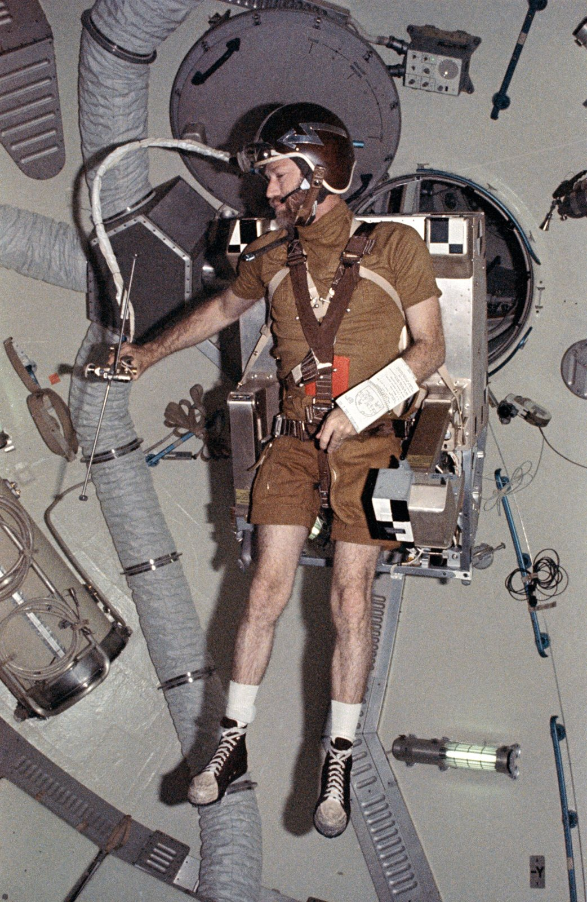
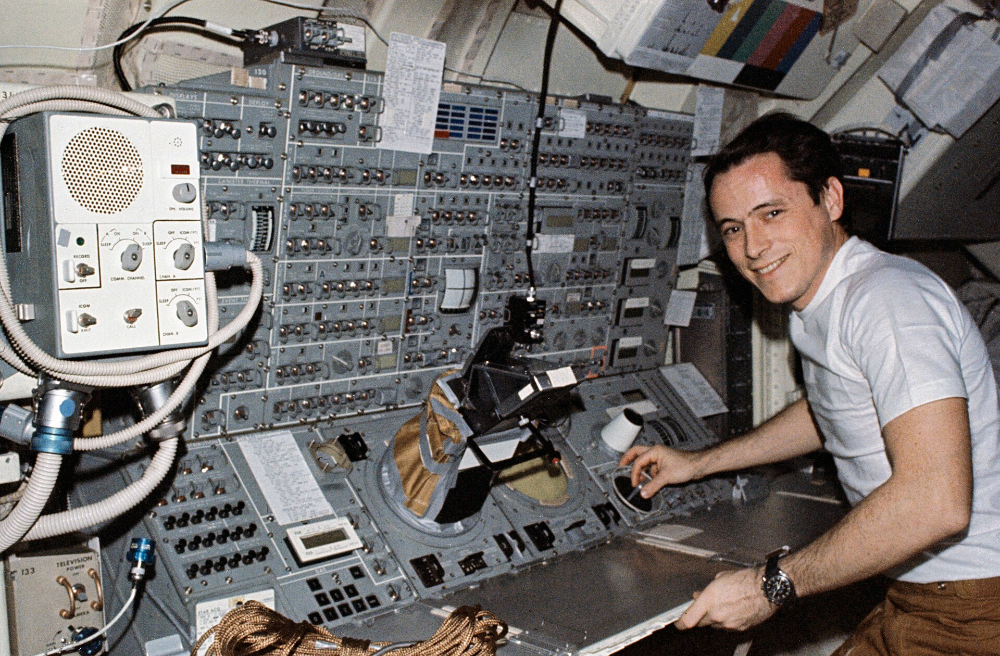
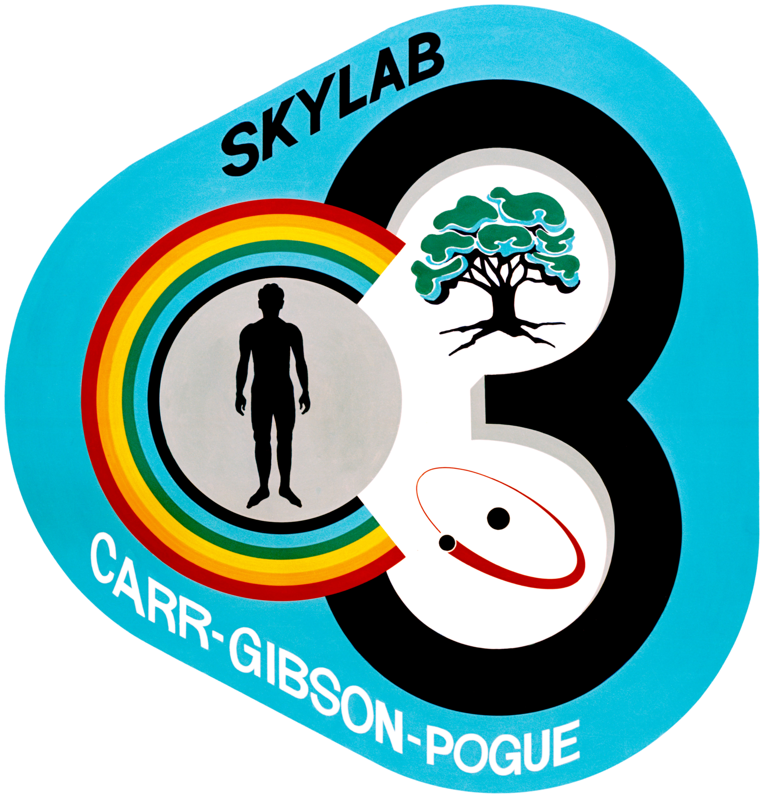

Fifty-three years ago today, on November 16, 1973, NASA launched Skylab 4 from Launch Complex 39B at the Kennedy Space Center in Florida. The Saturn IB rocket carried three astronauts into orbit to begin the third and final crewed visit to Skylab, America's very first space station. Over the course of 84 days, the all-rookie crew overcame technical failures, heavy workloads, and the challenges of extended weightlessness, establishing a milestone in human space exploration.

## The Final Crew for America's First Space Station

Skylab was launched uncrewed in May 1973 as the centerpiece of the Apollo Applications Program. Built inside a repurposed Saturn V third stage, the orbital workshop offered unprecedented living space for research in orbit. NASA planned three crewed expeditions to occupy the outpost, officially designated Skylab 2, Skylab 3, and Skylab 4. When the time came for the third mission, NASA made the rare choice of selecting three astronauts who had never flown into space before: Commander Gerald P. Carr, science pilot Edward Gibson, and pilot William R. Pogue.

## A Historic Launch from Cape Canaveral

The flight was unique from the start. Skylab 4 stood as the largest all-rookie crew ever launched by NASA. After Project Mercury, only four American spaceflights had flown with entirely rookie crews: Gemini 4, Gemini 7, Gemini 8, and Skylab 4. The launch also marked the first crewed flight since the surrounding region's official name was restored from Cape Kennedy to Cape Canaveral in October 1973. Lifting off from LC-39B, the Apollo command and service module docked smoothly with Skylab later that day.

*Archive, 1973 — Photo: NASA / Public domain*

## Surprises and Strains Aboard the Workshop

When Carr, Gibson, and Pogue floated inside the space station, they were met by three figures dressed in flight suits. They soon realized these were prank dummies complete with Skylab 4 emblems left by the departing Skylab 3 crew. The humor was short-lived, however. Early in the flight, the crew attempted to hide Pogue's initial space sickness from flight surgeons. Ground controllers discovered the truth through voice recordings, and astronaut office chief Alan B. Shepard issued a reprimand for their error in judgment.

*Archive, 1973 — Photo: NASA / Public domain*

## Mechanical Crises and Schedule Adjustments

Setting up the station proved exhausting. The crew had to unpack and stow thousands of items while attempting to match the grueling work pace set by their predecessors. Just seven days into the mission, one of Skylab's three attitude-control gyroscopes failed due to insufficient lubrication. The station relied on at least two functioning gyroscopes to hold its position. A second unit later showed signs of distress, requiring emergency operational procedures from ground controllers to prevent the mission from ending prematurely. Meanwhile, tensions mounted over heavy task lists until an open radio conference allowed the crew and ground controllers to adjust the schedule.

*Archive, 1973 — Photo: NASA / Public domain*

## Solar Flares and Scientific Triumphs

Once their workload was rebalanced, the astronauts accomplished an extraordinary scientific program. On Thanksgiving Day, Gibson and Pogue completed a six-and-a-half-hour spacewalk to deploy solar experiments and repair a malfunctioning antenna. In December, the crew tracked Comet Kohoutek with specialized cameras as it approached the Sun, even observing it during a spacewalk. Over their stay, the crew operated Earth-sensing instruments and captured roughly 75,000 telescopic images of the Sun across the X-ray, ultraviolet, and visible spectrums, including an evolving active solar flare filmed by Gibson.

## A Triumphant Splashdown and Lasting Milestone

When Skylab 4 undocked and returned to Earth on February 8, 1974, the crew had logged 84 days, one hour, and 16 minutes in orbit. They had completed four spacewalks and amassed 6,051 astronaut-utilization hours of scientific work, far exceeding initial targets. Skylab remained in orbit until its atmospheric re-entry on July 11, 1979. The lessons learned during Skylab 4 proved that human crews could thrive during months of isolation, providing essential knowledge that paved the way for long-term spaceflight on the International Space Station.

### Sources

- <https://en.wikipedia.org/wiki/Skylab>
- <https://commons.wikimedia.org/wiki/File:Cape_Canaveral,_Kennedy_Space_Center,_Florida_(sl2-106-1194).jpg>
- <https://commons.wikimedia.org/wiki/File:S74-17305.jpg>
- <https://commons.wikimedia.org/wiki/File:Gibson_przy_ATM.jpg>
- <https://commons.wikimedia.org/wiki/File:Skylab3-Patch.png>
