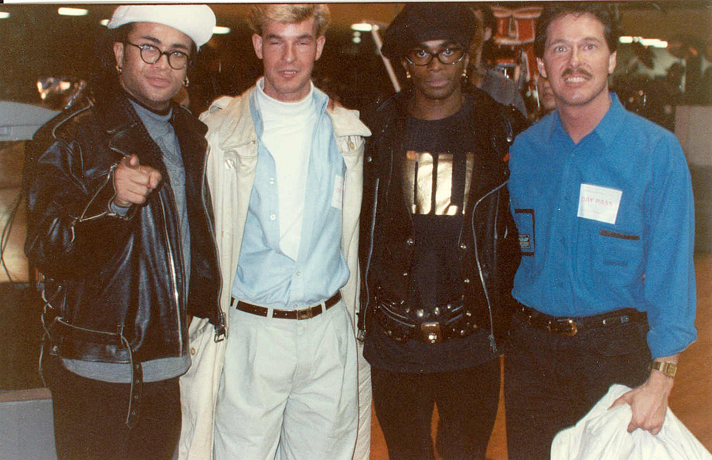
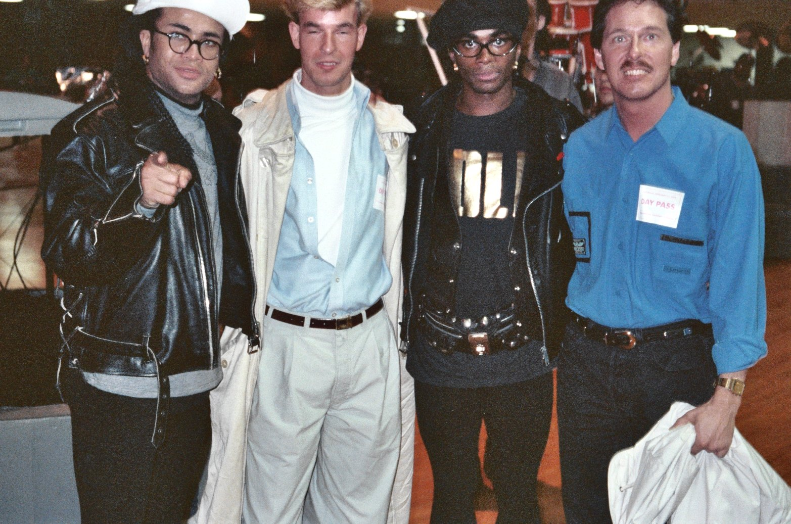
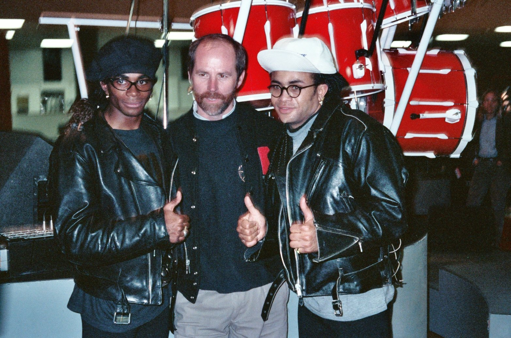

36 years ago today, November 16, 1990, the Recording Academy took an unprecedented step in music history: it stripped the pop duo Milli Vanilli of their Grammy Award. Just months earlier, Rob Pilatus and Fab Morvan were celebrated as one of the most exciting acts in pop music. That acclaim evaporated overnight when the world discovered that neither man had sung a single note on their smash hit album.

## The Rise of an Overnight Sensation

Rob Pilatus, raised in Munich, and Fab Morvan, from Paris, first met in a Los Angeles disco during the mid-1980s before reuniting in Germany. Both were aspiring performers working as background dancers and club hosts while struggling to make ends meet in public housing. Their lives transformed after meeting Frank Farian, a seasoned German music producer known for orchestrating the 1970s disco act Boney M.

Farian had already recorded a cover of the song 'Girl You Know It's True' using seasoned studio session vocalists. Looking for charismatic faces to front the track, Farian recruited Pilatus and Morvan on New Year's Day in 1988. Mesmerized by the promise of fame and wealth, the young duo signed a contract without fully understanding its rigid terms, agreeing to front an act where their only job was to look stylish and lip-sync.

## Conquering the American Pop Charts

The European release of the album All or Nothing quickly gained momentum, prompting Arista Records to repackage the release for the American market in early 1989 as Girl You Know It's True. The timing could not have been better for the burgeoning music video era. With MTV playing their high-energy dance clips around the clock, Milli Vanilli became a global pop juggernaut.

The album dominated the Billboard 200 chart for eight consecutive weeks at number one and earned six-times platinum certification. Three different tracks—'Baby Don't Forget My Number', 'Girl I'm Gonna Miss You', and Diane Warren's 'Blame It on the Rain'—surged to the top of the Billboard Hot 100. By January 1990, the duo captured three American Music Awards, capping off their meteoric ascent in February when they won the Grammy Award for Best New Artist at the 32nd annual ceremony.

*Archive, 1990 — Photo: Alan Light / CC BY 2.0*

## The Studio Singers Kept in the Shadows

Behind the glossy magazine covers and arena tours sat the uncredited musicians who actually created the sound. The soulful lead vocals and harmonies were provided by veteran American and European studio singers, including Brad Howell, John Davis, Charles Shaw, and twin backing vocalists Jodie and Linda Rocco. These experienced performers were paid session rates while remaining hidden from album art and television cameras.

Farian had long operated under the philosophy that pop music was an enterprise combining visual spectacle with engineered audio. But as Milli Vanilli's public profile soared, the deception grew increasingly difficult to contain. Charles Shaw briefly spoke out to a New York newspaper in late 1989 claiming he had sung lead vocals, though he retracted his statement after reaching a financial settlement with the producer.

*Archive, 1990 — Photo: Alan Light / CC BY 2.0*

## A Skipped Tape and the Unraveling Truth

Subtle clues had already begun alerting astute industry observers. During radio and television interviews, Pilatus and Morvan spoke in thick European accents with limited English fluency, contrasting sharply with the polished American accents heard on their hit records. Fearing exposure, their management began quietly turning down opportunities that required unassisted live singing, including a scheduled appearance on The Arsenio Hall Show.

The most infamous crack in the armor came on July 21, 1989, during a live Club MTV concert broadcast from the Lake Compounce theme park in Bristol, Connecticut. While performing their signature hit, the backing audio track jammed, looping the lyric 'Girl, you know it's...' repeatedly across the sound system. Pilatus and Morvan froze, attempted to keep dancing, and then fled the stage in sheer panic. Although the incident was initially shrugged off by the young crowd, Pilatus later acknowledged that moment was the beginning of the end.

*Archive, 1990 — Photo: Alan Light / CC BY 2.0*

## The Confession and Historic Revocation

By late 1990, the strained relationship between the performers and their producer reached a breaking point. Pilatus and Morvan insisted on singing on their upcoming second album, refusing to continue the charade. Unwilling to yield artistic control, Farian preemptively called a press conference in Germany in November 1990 and confessed that Pilatus and Morvan had never contributed vocals to any of Milli Vanilli's recordings.

The public backlash in the United States was swift and unforgiving. On November 16, 1990, the National Academy of Recording Arts and Sciences took back the Grammy Award for Best New Artist, an action never before taken in the award's three-decade history. Arista Records immediately purged Girl You Know It's True from its catalog, and a flood of consumer class-action lawsuits forced the label to provide cash refunds to millions of disillusioned record buyers.

## Aftermath and Industry Legacy

The fallout wrecked both young men's careers. Farian attempted to release the duo's planned material under the name 'The Real Milli Vanilli', while Morvan and Pilatus released a self-titled independent album in 1993 under the name Rob & Fab that sold barely 2,000 copies. Haunted by public humiliation and addiction, Pilatus tragically died of an accidental drug overdose in 1998 on the eve of a planned comeback tour.

In recent decades, retrospective documentaries and cultural critics have re-examined the Milli Vanilli scandal with far more nuance. While the deception remains a cautionary tale about pop music packaging, many now view Pilatus and Morvan not as masterminds, but as naive pawns exploited by record executives and industry machinery willing to trade authenticity for multi-million-dollar profits.

### Sources

- <https://en.wikipedia.org/wiki/Pop_music>
- <https://commons.wikimedia.org/wiki/File:Milli_Vanilli_and_C._Michael_Greene.jpg>
- <https://commons.wikimedia.org/wiki/File:Milli_Vanilli_(254819198).jpg>
- <https://commons.wikimedia.org/wiki/File:Milli_Vanilli_(2087312481).jpg>
- <https://commons.wikimedia.org/wiki/File:Milli_Vanilli_(2087313977).jpg>
