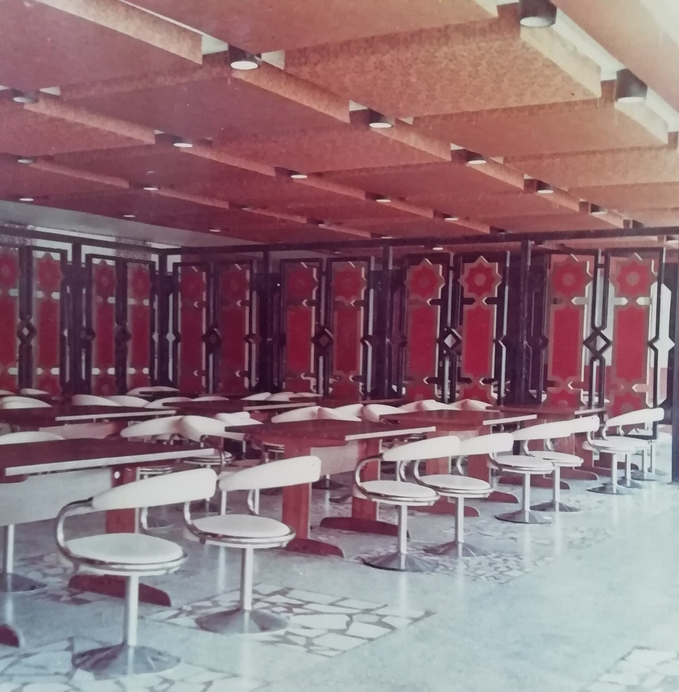
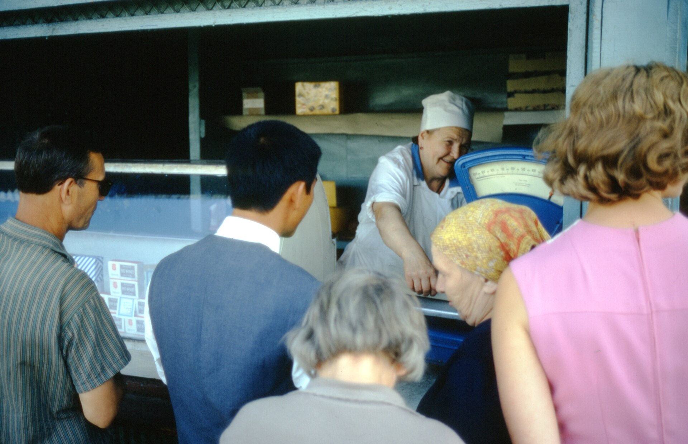
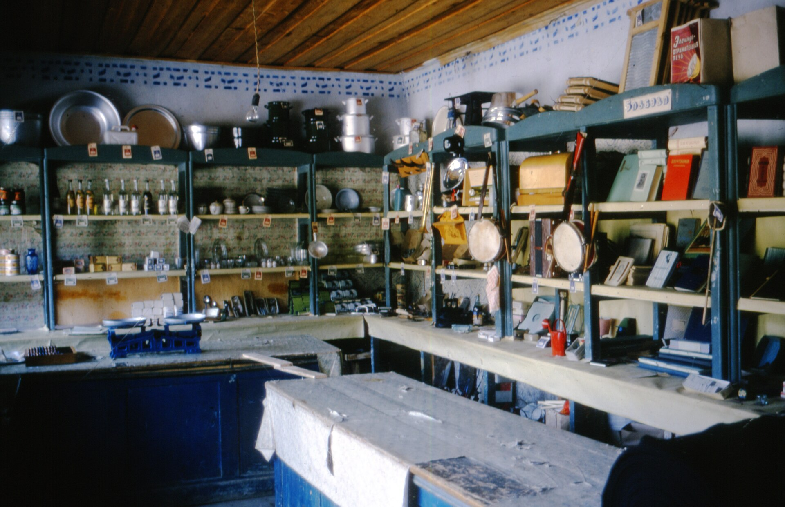

On November 16, 1972, PepsiCo chairman D. M. Kendall announced an agreement that made headlines across the globe. A reciprocal arrangement had been reached with the Soviet Ministry of Trade to establish a Pepsi-Cola plant inside the Soviet Union. The historic move ensured that Pepsi-Cola would become the first American consumer product manufactured and sold on Soviet soil.

## The Historic Announcement of 1972

When Chairman D. M. Kendall delivered the news on November 16, 1972, it signaled a remarkable turning point in international trade. Under the reciprocal agreement reached with the Soviet Ministry of Trade, PepsiCo secured permission to construct a plant to bottle and sell its signature soft drink directly to Soviet consumers.

The pact was structured as a landmark barter deal, enabling trade between two completely different economic systems. For an American consumer brand to establish manufacturing inside the Soviet Union was entirely unprecedented, making Pepsi a pioneer of Western commerce in that part of the world.

## The Pharmacy Origins of Brad's Drink

The soft drink that crossed into the Soviet Union had originated nearly eight decades earlier in North Carolina. In 1893, Caleb Bradham created a beverage called Brad's Drink at his drugstore in New Bern, seeking to offer a fountain drink that would boost energy and aid digestion.

In 1898, Bradham renamed the beverage Pepsi-Cola because the recipe incorporated the essence of pepsin, a digestive enzyme, alongside sugar and vanilla. Early advertisements highlighted its medicinal qualities, promoting it as a remedy for indigestion, headaches, and drowsiness. Bradham incorporated the Pepsi-Cola Company on December 24, 1902, and moved syrup production to a rented warehouse in 1903, selling 7,968 gallons that year.

*Туркменистан. Интерьер кафе Айна в г. Ашхабаде. Автор Высотин В. IMG 20260104 121021 — Photo: Vysotina / CC0*

## Rapid Expansion, Bankruptcy, and Revival

In 1904, the company introduced six-ounce bottles, and sales rapidly climbed to 19,848 gallons of syrup. By 1909, race pioneer Barney Oldfield became the first celebrity to endorse the beverage, praising it as refreshing and invigorating. The slogan Delicious and Healthful remained the cornerstone of Pepsi's advertising over the next two decades.

However, severe financial turbulence struck after World War I due to wild fluctuations in sugar prices. The company went bankrupt in 1923, and although Roy C. Megargel acquired the trademark, he struggled to secure funding. The brand was subsequently purchased and revived by Charles Guth, president of the candy firm Loft, Inc., who reformulated the syrup.

*Moscow Hammond Slides 06 — Photo: Thomas Taylor Hammond (1920-1993) / CC BY-SA 4.0*

## The Great Depression and the Cola Wars

During the Great Depression, Pepsi achieved massive popularity by introducing a 12-ounce bottle accompanied by the catchy Nickel, Nickel jingle. Emphasizing extraordinary value at a difficult economic time allowed the company to double its sales. In 1951, the brand shortened its marketing name simply to Pepsi.

In the mid-20th century, Pepsi expanded its market share further by targeting the African American market with positive portrayals and endorsements. Soon, an intense cultural and commercial rivalry with Coca-Cola developed into what became known as the cola wars. Initiatives like the Pepsi Challenge taste tests pushed both companies into intense global competition, even prompting Coca-Cola to release New Coke.

*Hammond Slides Central Asia 90 — Photo: Thomas Taylor Hammond (1920-1993) / CC BY-SA 4.0*

## Opening the Door to the Soviet Market

Pepsi's international expansion found one of its most remarkable successes through the 1972 agreement with the Soviet Ministry of Trade. By utilizing a reciprocal barter system, PepsiCo overcame complex currency barriers that had kept Western consumer goods out of the country.

The resulting plant allowed Soviet consumers to purchase genuine Pepsi-Cola on their own streets. The initiative provided Pepsi with enduring popularity in the region, establishing brand recognition that outpaced competitors for years to come.

## An Enduring Global Soft Drink Pioneer

Over time, PepsiCo expanded its beverage lineup with offerings such as Diet Pepsi and Pepsi Max alongside its flagship cola. By 2023, Pepsi stood as the second most valuable soft drink brand worldwide, trailing only Coca-Cola in their ongoing global rivalry.

The bold trade initiative announced on November 16, 1972, remains an enduring milestone in modern business. It proved that commercial bridges could be built across deep geopolitical divides, forever linking the American soda fountain to Soviet store shelves.

### Sources

- <https://www.nytimes.com/1972/11/17/archives/russians-to-get-pepsicola-plant-soft-drink-to-be-first-us-consumer.html>
- <https://commons.wikimedia.org/wiki/File:Hammond_Slides_1972_09.jpg>
- <https://commons.wikimedia.org/wiki/File:%D0%A2%D1%83%D1%80%D0%BA%D0%BC%D0%B5%D0%BD%D0%B8%D1%81%D1%82%D0%B0%D0%BD._%D0%98%D0%BD%D1%82%D0%B5%D1%80%D1%8C%D0%B5%D1%80_%D0%BA%D0%B0%D1%84%D0%B5_%D0%90%D0%B9%D0%BD%D0%B0_%D0%B2_%D0%B3._%D0%90%D1%88%D1%85%D0%B0%D0%B1%D0%B0%D0%B4%D0%B5._%D0%90%D0%B2%D1%82%D0%BE%D1%80_%D0%92%D1%8B%D1%81%D0%BE%D1%82%D0%B8%D0%BD_%D0%92._IMG_20260104_121021.jpg>
- <https://commons.wikimedia.org/wiki/File:Moscow_Hammond_Slides_06.jpg>
- <https://commons.wikimedia.org/wiki/File:Hammond_Slides_Central_Asia_90.jpg>
