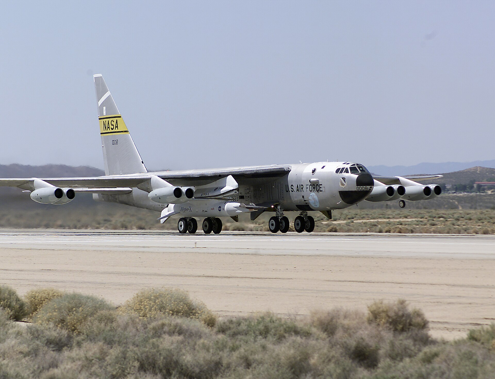
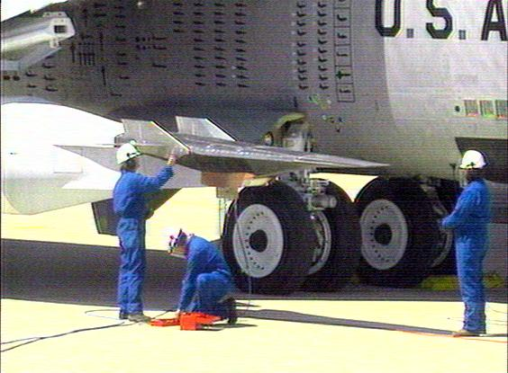
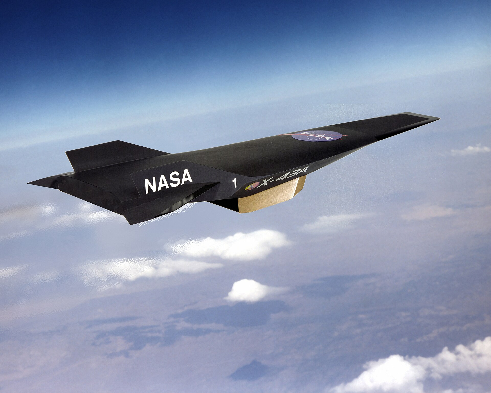

22 years ago today, on November 16, 2004, NASA made aviation history when an unmanned experimental craft reached a velocity of approximately 7,000 miles per hour. Flying at Mach 9.6, nearly ten times the speed of sound, the hypersonic scramjet shattered world records and proved that an airbreathing engine could achieve what had previously been reserved for multi-stage rockets.

## Breaking the Hypersonic Barrier

The flight conducted on November 16, 2004, pushed experimental aviation into an entirely new operational realm. In aerodynamics, speeds exceeding Mach 5 are classified as hypersonic, an environment where intense kinetic energy transforms into extreme heat upon meeting atmospheric air. By accelerating to Mach 9.6, NASA's unmanned experimental vehicle demonstrated that controlled supersonic combustion was not just theoretically possible, but viable in actual flight conditions.

## The Mechanics of Supersonic Combustion

Unlike standard jet engines, which rely on rotating compressor blades and turbines to force air into combustion chambers, a scramjet—short for supersonic combustion ramjet—features no moving parts. Instead, the engine relies entirely on the vehicle's extreme forward velocity to forcefully compress incoming air before ignition. In a traditional ramjet, incoming airflow is decelerated to subsonic speeds using shock cones, but a scramjet keeps the airflow moving at supersonic speeds throughout the entire engine core, relying on shockwaves produced by its ignition source.

*Archive, 2004 — Photo: NASA/Tom Tschida / Public domain*

## Severe Thermal and Aerodynamic Challenges

Operating in hypersonic conditions presents massive engineering hurdles. The air passing through the engine resides inside the combustor for only a few milliseconds, requiring fuels with high energy-to-weight ratios and high thermal capacity to ignite instantaneously. Furthermore, intense aerodynamic heating generates immense thermal loads along the vehicle's nose, leading wing edges, and air intake ramps. At such speeds, boundary layers expand and air molecules undergo vibrational excitation, dissociation, and ionization, turning the surrounding atmosphere into a severe aerothermal environment.

*Archive, 2004 — Photo: NASA / Public domain*

## Decades of Aeronautical Heritage

NASA's achievement on this day was rooted in a tradition dating back to the National Advisory Committee for Aeronautics (NACA), established by Congress in 1915 after the United States recognized it lagged behind European aviation. NACA conducted pioneering research alongside the US military, jointly developing the supersonic Bell X-1 in 1947. Following the establishment of NASA in 1958 under the National Aeronautics and Space Act, the agency absorbed NACA's research laboratories and launched the North American X-15 program, a hypersonic rocket plane that served as an early testbed for ramjet and scramjet propulsion concepts.

*Archive, 1999 — Photo: NASA / Public domain*

## Pioneers of Supersonic Combustion

The scramjet concept gained momentum during the aerospaceplane initiatives of the 1950s and 1960s, championed by researchers like Alexander Kartveli and Antonio Ferri. In November 1964, Ferri achieved a major milestone by demonstrating an experimental scramjet that generated 517 pounds-force of net thrust in ground testing. That same year, Frederick S. Billig and Gordon L. Dugger submitted a landmark patent application for a supersonic combustion ramjet, which was later issued in 1981. Ground testing progressed internationally in 1981 under Professor Ray Stalker at the Australian National University's T3 ground test facility.

## A Benchmark for Modern Aerospace

The successful demonstration on November 16, 2004, validated decades of ground tests and analytical models. By proving that an airbreathing scramjet could maintain combustion at Mach 9.6 and survive temperatures generated at 7,000 miles per hour, NASA opened vital pathways for potential applications in high-speed intercontinental transport and future space launch systems. That November test flight remains one of the most remarkable technical milestones in the agency's history.

### Sources

- <https://en.wikipedia.org/wiki/NASA>
- <https://commons.wikimedia.org/wiki/File:X-43A.jpg>
- <https://commons.wikimedia.org/wiki/File:B-52_carries_X-43A.jpg>
- <https://commons.wikimedia.org/wiki/File:X-43A_technicians.jpg>
- <https://commons.wikimedia.org/wiki/File:X43a2_nasa_scramjet.jpg>
