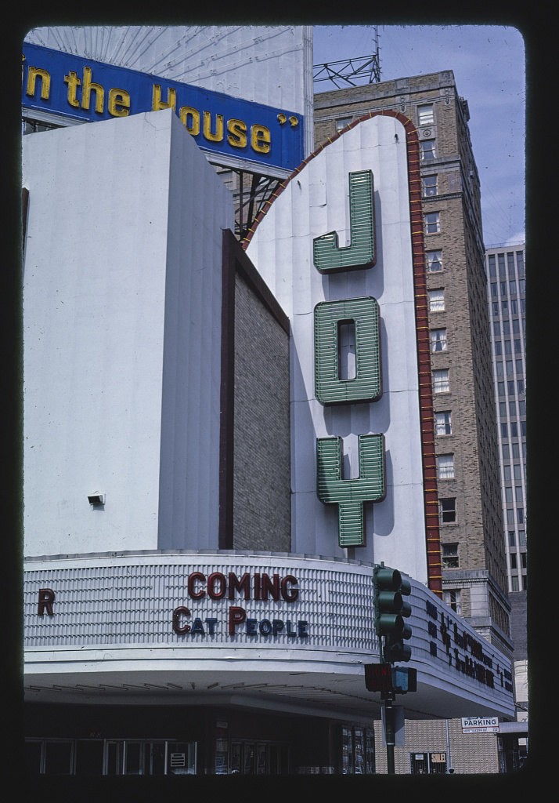
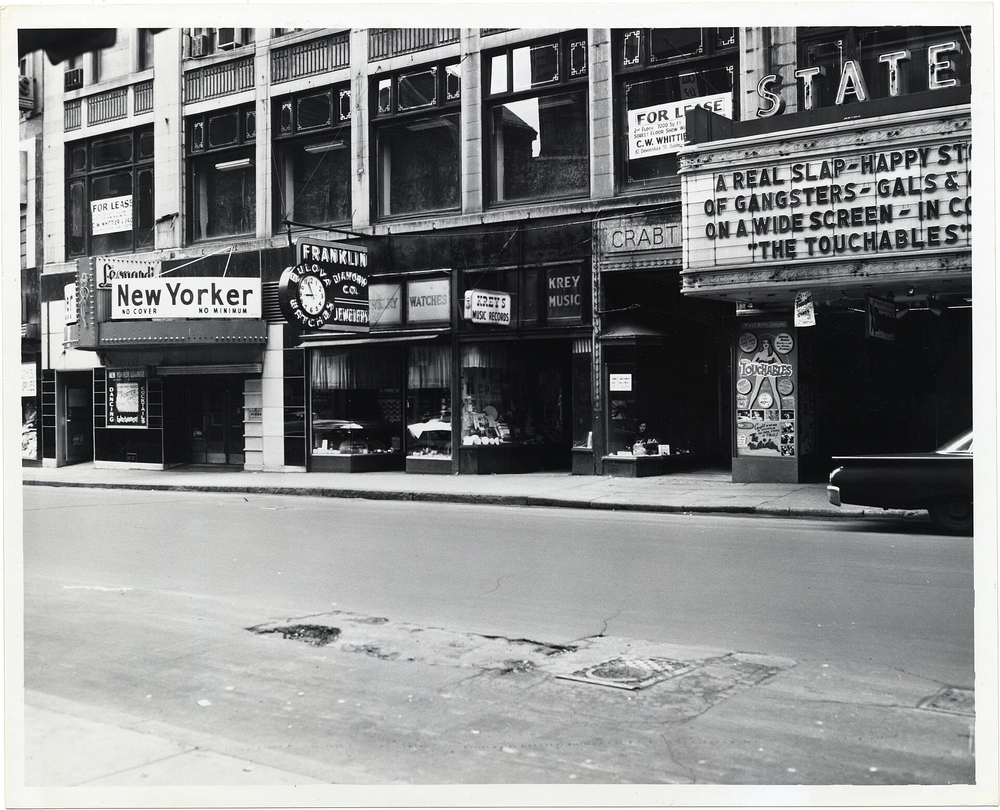
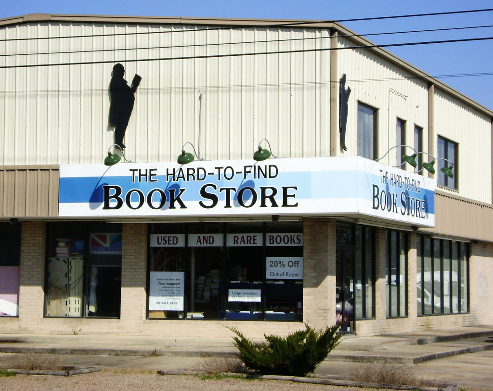

25 years ago today, November 16, 2001, movie theaters across the United States welcomed the theatrical release of 'Harry Potter and the Sorcerer's Stone.' Directed by Chris Columbus, the film introduced millions of filmgoers to the young wizard with the lightning bolt scar, igniting one of the most lucrative and beloved franchises in motion picture history.

## A Literary Craze Demands a Big Screen Adaptation

The journey to the silver screen began on June 26, 1997, when British author J. K. Rowling published her debut fantasy novel, 'Harry Potter and the Philosopher's Stone,' through Bloomsbury in the United Kingdom. Released by Scholastic Press in the United States under the title 'Harry Potter and the Sorcerer's Stone,' the book rapidly transformed into an international cultural force. Capturing readers of all generations, the story of an orphaned boy who learns he is a wizard sparked extraordinary excitement. Recognizing the story's massive commercial potential, Warner Bros. Pictures moved swiftly, acquiring the film rights in 1999 for a reported £1 million, or approximately $1.65 million.

## Finding the Right Vision Behind the Camera

Securing the rights was only the first challenge for Warner Bros. Pictures. The studio faced the daunting task of translating a rich, beloved fantasy universe into a compelling visual medium. The search for a director drew interest from prominent Hollywood filmmakers, including Steven Spielberg and Rob Reiner. Ultimately, the studio selected American filmmaker Chris Columbus to helm the production. Columbus had established a strong track record directing family comedies and working successfully with child performers, having directed the box office hits 'Home Alone' and 'Mrs. Doubtfire.' With Steve Kloves hired to craft the adapted screenplay, the production took shape with a production budget set at $125 million.

*Joy Theater marquee, Canal Street, New Orleans, Louisiana (LOC) — Photo: The Library of Congress / Public domain*

## The Search for Harry, Ron, and Hermione

From the outset, author J. K. Rowling established a key condition: the central cast had to be kept strictly British and Irish to preserve the authenticity of the British school setting. Casting directors launched an extensive open search in 2000 to find the three young actors who would shoulder the entire story. In August 2000, the filmmakers made their historic announcement. Daniel Radcliffe was chosen to portray Harry Potter, Rupert Grint was cast as Ron Weasley, and Emma Watson was selected to play Hermione Granger. Filming commenced in September 2000 at Leavesden Film Studios and at historic landmarks and cathedrals across the United Kingdom, concluding in March 2001.

*Street scene of downtown Boston showing the New Yorker Lounge, a Jeweler, and a movie theater marquee (12777786333) — Photo: City of Boston Archives from West Roxbury, United States / CC BY 2.0*

## November 16, 2001: The Magic Arrives in Theaters

After holding its world premiere at the Odeon Leicester Square in London on November 4, 2001, 'Harry Potter and the Sorcerer's Stone' opened broadly in theaters in the United States and the United Kingdom on November 16. Audiences poured into cinemas to watch Harry escape the oppressive home of the Dursleys, board the Hogwarts Express, and step into the majestic Great Hall. The adaptation stayed remarkably faithful to Rowling's novel, following the trio's encounters with a three-headed dog named Fluffy and Harry's climactic confrontation with Lord Voldemort over the Philosopher's Stone.

*The Hard - to - Find Book Store, Humble, Texas 0224101015 — Photo: Patrick Feller / CC BY 2.0*

## A Historic Box Office Triumph

The theatrical release turned into an immediate financial and cultural juggernaut. During its initial theatrical run, 'Harry Potter and the Sorcerer's Stone' grossed $974 million at the worldwide box office. Later re-releases pushed its global gross past the $1 billion mark. It became the highest-grossing film released in 2001 and the second-highest-grossing motion picture in cinematic history at that time. The industry also recognized its technical and creative achievements, awarding the film three Academy Award nominations for Best Original Score, Best Art Direction, and Best Costume Design.

## The Foundation of a $25 Billion Empire

The success of the 2001 premiere laid the cornerstone for an unprecedented cinematic run. Warner Bros. Pictures went on to produce seven sequels, culminating in 2011 with 'Harry Potter and the Deathly Hallows – Part 2.' By 2016, the total value of the Harry Potter franchise was estimated at $25 billion, expanding to encompass themed lands at Universal Destinations & Experiences theme parks worldwide, studio tours in London, and the spin-off series 'Fantastic Beasts.' Even a quarter of a century later, November 16, 2001, stands as the day a literary universe permanently reshaped the landscape of global cinema.

### Sources

- <https://en.wikipedia.org/wiki/Harry_Potter_and_the_Philosopher's_Stone_(film)>
- <https://www.flickr.com/photos/41577730@N00/5933585262>
- <https://commons.wikimedia.org/wiki/File:Joy_Theater_marquee,_Canal_Street,_New_Orleans,_Louisiana_(LOC).jpg>
- <https://commons.wikimedia.org/wiki/File:Street_scene_of_downtown_Boston_showing_the_New_Yorker_Lounge,_a_Jeweler,_and_a_movie_theater_marquee_(12777786333).jpg>
- <https://www.flickr.com/photos/32345848@N07/4385477910>
