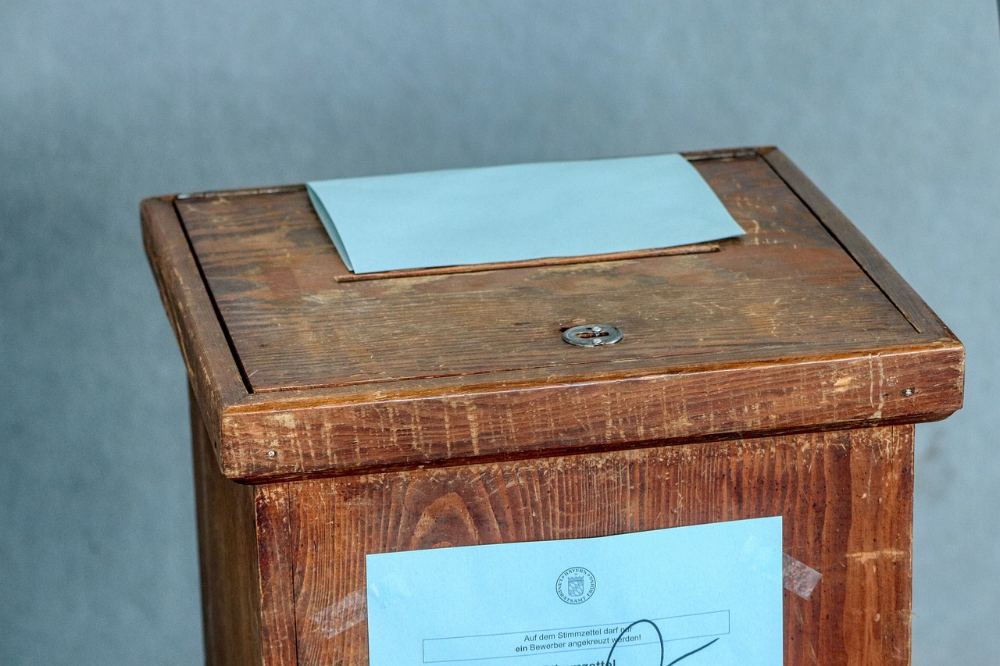
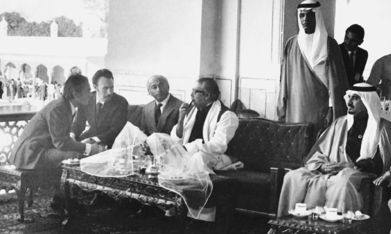
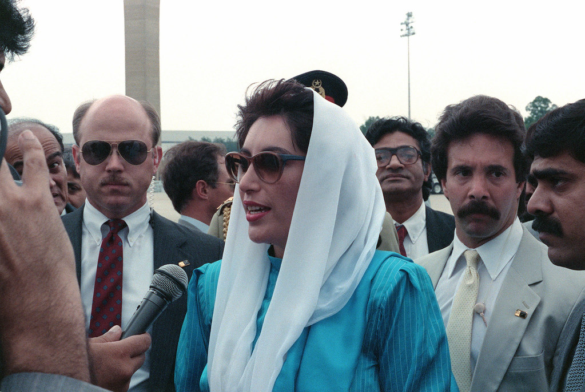

38 years ago today, November 16, 1988, voters in Pakistan went to the polls in the country's first open election in more than a decade. Populist candidate Benazir Bhutto led the Pakistan People's Party to victory, becoming the first woman ever elected to head a democratic government in a Muslim-majority nation.

## A Political Legacy and Family Tragedy

Benazir Bhutto was born in Karachi in 1953 into a prominent and wealthy Sindhi aristocratic family. Her father, Zulfikar Ali Bhutto, had founded the Pakistan People's Party in 1967 and served as both president and prime minister of Pakistan. Benazir received an elite Western education, studying at Radcliffe College at Harvard University from 1969 to 1973 before attending the University of Oxford, where she served as President of the prestigious Oxford Union.

She returned to Pakistan in 1977 during her father's socialist government, expecting a career in diplomacy. However, that same year, the military staged a coup d'état led by General Zia-ul-Haq. Zulfikar Ali Bhutto was arrested and later executed, a traumatic shock that fundamentally transformed Benazir's life and propelled her directly into the center of Pakistani resistance politics.

## Years of Imprisonment and the Struggle for Democracy

Following her father's execution, Benazir Bhutto and her mother, Nusrat Bhutto, took charge of the Pakistan People's Party. They spearheaded the Movement for the Restoration of Democracy, openly challenging General Zia's authoritarian military regime. In response, the military government subjected Bhutto to repeated house arrests and harsh prison sentences.

In 1984, Bhutto went into self-imposed exile in Britain. While abroad, she continued to lobby international leaders and rally expatriate support against the dictatorship. She returned to Pakistan in 1986, greeted by immense crowds who saw her as the living symbol of civilian democracy and popular resistance against military dominance.

*Not a photo of the event itself · NOT FROM THE EVENT · Stock image — Photo: planet_fox / Pixabay Content License*

## The Historic Election of November 16, 1988

The political landscape shifted dramatically when General Zia died in August 1988, creating an opening for free parliamentary elections. It was Pakistan's first open and competitive election in over a decade. Bhutto campaigned aggressively across the provinces, shifting her party's economic platform toward a more liberal agenda while maintaining its populist core message of social progress.

On November 16, 1988, millions of Pakistani citizens cast their votes for members of the National Assembly. Despite fierce opposition from conservative and religious political alliances, Bhutto's Pakistan People's Party won the largest share of seats. At just 35 years old, she secured the mandate to become the head of government as the prime minister.

*OIC Leaders in Shalimar Gardens, Lahore — Photo: Unknown authorUnknown author / Public domain*

## A Complex and Fragile Transition to Power

Under the Pakistani constitution, executive authority is formally vested in the prime minister, who leads the cabinet and acts as chief executive. However, Bhutto entered office facing intense institutional obstacles. The chief of the army staff remained the de facto most powerful office in the country, and the presidency held extraordinary powers to dissolve parliament.

Conservative and Islamist factions actively pushed back against her secular, modernizing agenda. Although Bhutto sought to enact sweeping reforms, her first administration was under constant pressure from President Ghulam Ishaq Khan and the military high command. Her government lasted under two years before being dismissed in 1990, reflecting the chronic instability of Pakistani civilian governance.

*Public Domain: Prime Minister Benazir Bhutto, 1988 (DF-SC-91-09102 DOD) — Photo: pingnews.com / Public domain (PDM) 1.0*

## Global Significance and American Connections

Bhutto's victory in 1988 resonated strongly across the United States and the Western world. Having earned her undergraduate degree at Harvard, Bhutto was well known to American political leaders and diplomats. During her early years, she had met prominent American figures such as Henry Kissinger and Hubert Humphrey when they visited her father.

For American observers and senior citizens who followed foreign policy during the late Cold War, her election was viewed as a crucial test for democracy in South Asia. At a time when Pakistan was a key American ally in the region, Bhutto's rise was seen as an inspiring breakthrough for democratic values and human rights in the broader Islamic world.

## An Enduring Legacy for Women and Democracy

Bhutto would return to power for a second term as prime minister from 1993 to 1996, continuing to champion economic privatization and women's legal rights despite persistent political opposition and corruption controversies. After another period of exile, she returned to Pakistan in 2007 to contest democratic elections once more, only to be assassinated following a rally in Rawalpindi.

Despite the intense polarization that surrounded her career, Bhutto's election on November 16, 1988, remains an undisputed watershed moment in world history. She proved that a woman could win popular power in a deeply patriarchal and conservative society, establishing a precedent that continues to inspire democratic movements worldwide.

### Sources

- <https://en.wikipedia.org/wiki/Prime_Minister_of_Pakistan>
- <https://pixabay.com/photos/ballot-box-choice-federal-election-2586565/>
- <https://pixabay.com/photos/ballot-box-democracy-politics-poll-4933481/>
- <https://commons.wikimedia.org/wiki/File:OIC_Leaders_in_Shalimar_Gardens,_Lahore.jpg>
- <https://www.flickr.com/photos/39735679@N00/2012399162>
