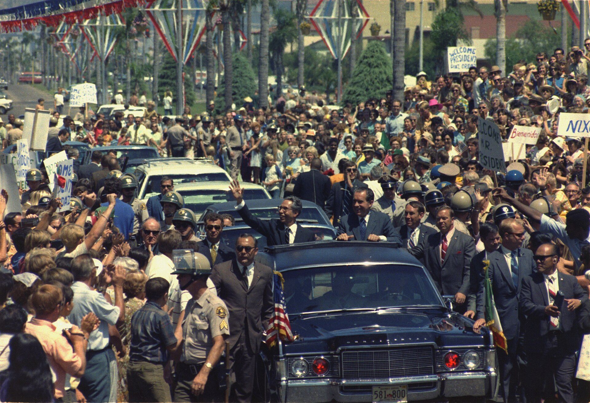
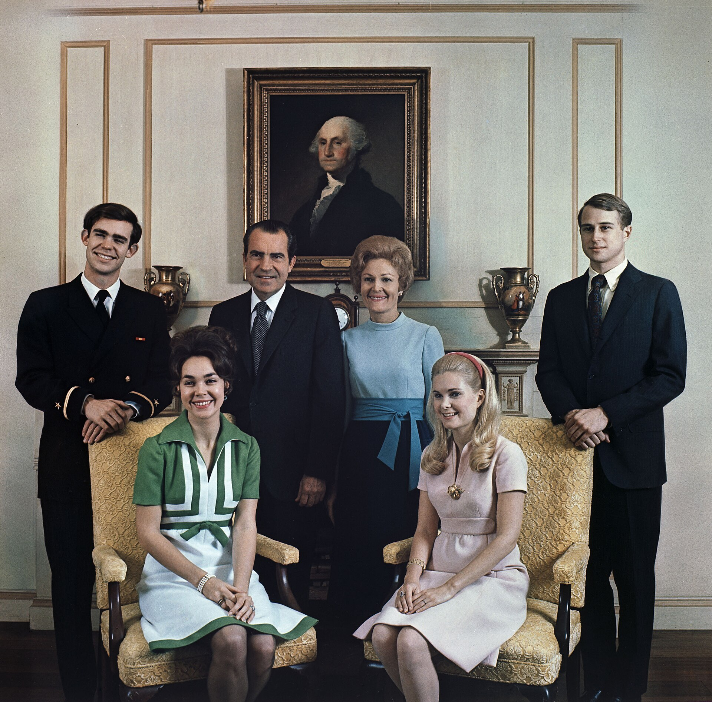
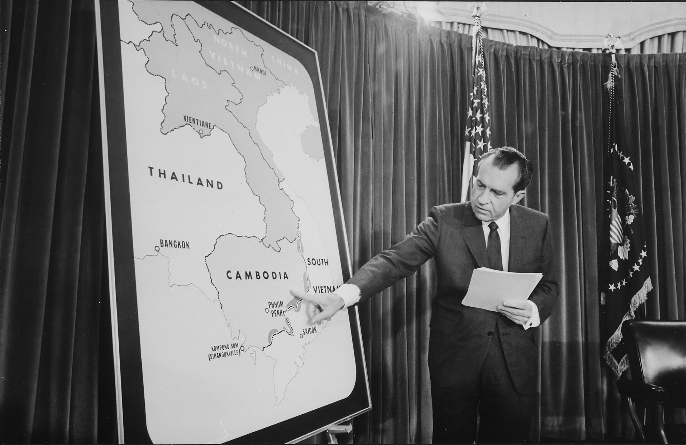

53 years ago today, November 17, 1973. In Orlando, Florida, President Richard Nixon stood before an audience of 400 Associated Press managing editors and uttered one of the most famous and fateful sentences in American political history: "I am not a crook." The televised exchange was intended to halt the spiraling Watergate scandal, but it instead became the indelible symbol of a presidency collapsing under the weight of cover-ups and constitutional crisis.

## The Seeds of the Break-In

Richard Nixon entered the White House as the 37th president in 1969, inheriting the Vietnam War and a nation deeply divided by protests and political unrest. Determined to halt government leaks, his administration established a secret covert unit known colloquially as the "Plumbers," organized under former intelligence figures E. Howard Hunt and G. Gordon Liddy.

On June 17, 1972, five operatives associated with the Committee for the Re-Election of the President were arrested inside the Democratic National Committee headquarters at Washington, D.C.'s Watergate complex. They were caught carrying wiretapping equipment, cameras, and burglary tools. Although White House spokesmen immediately dismissed the incident as a third-rate burglary, the arrest set in motion an unprecedented chain of political espionage investigations.

## A Landslide Followed by Collapse

Initially, the White House succeeded in containing the fallout. Nixon's campaign denied any administration involvement while senior aides paid hush money to the burglars and actively worked to impede federal investigators.

Helped by the successful cover-up, Nixon won a massive re-election victory in November 1972, carrying 49 states. However, revelations from the burglars' 1973 trial and explosive testimony before a Senate committee soon shattered the White House narrative, revealing a secret Oval Office recording system that had captured presidential conversations.

*Archive, 1970 — Photo: White House photo by Atkins, Oliver F., photographer / Public domain*

## The Saturday Night Massacre and the Florida Defense

The crisis reached a boiling point in October 1973 when special prosecutor Archibald Cox subpoenaed the Oval Office tapes. Nixon refused to surrender them, citing executive privilege, and ordered Attorney General Elliot Richardson to fire Cox. Richardson refused and resigned, as did his deputy William Ruckelshaus, before Solicitor General Robert Bork carried out the firing in what became known as the "Saturday Night Massacre."

The public backlash was swift and furious. Seeking to steady his administration, Nixon traveled to Orlando, Florida, on November 17, 1973, to address the annual convention of the Associated Press Managing Editors Association. Facing sharp questions from 400 journalists, Nixon insisted on live television that he had never profited from public office and had never obstructed justice, uttering the defiant phrase: "I am not a crook."

*Archive, 1971 — Photo: President (1969-1974 : Nixon). White House Photo Office. 196 / Public domain*

## The Smoking Gun and Historic Resignation

Rather than reassuring the American public, Nixon's declaration cast a long, defensive shadow over his administration. In July 1974, the United States Supreme Court ruled unanimously that Nixon had to turn over the unedited White House tape recordings to federal prosecutors.

Among the recordings was the infamous "Smoking Gun" tape from June 23, 1972, which documented Nixon instructing Chief of Staff H. R. Haldeman to order the Central Intelligence Agency to halt the Federal Bureau of Investigation's inquiry into the Watergate break-in. With congressional support evaporated and the House Judiciary Committee recommending impeachment articles for obstruction of justice, abuse of power, and contempt of Congress, Nixon addressed the nation on August 8, 1974. The following day, August 9, he became the first president in United States history to resign.

*Archive, 1970 — Photo: Jack E. Kightlinger (White House Photo Office) / Public domain*

## The Legacy of a Presidential Crisis

The Watergate scandal resulted in criminal charges against 69 individuals, including two cabinet members, with dozens ultimately pleading guilty or receiving prison sentences. Although Nixon was granted a full presidential pardon by his successor, Gerald Ford, his legacy remained permanently scarred by the scandal.

The affair fundamentally altered the relationship between the American public and the presidency, ushering in an era of heightened media scrutiny and distrust of government institutions. More than five decades later, the words spoken in Orlando remain a cautionary reminder of presidential power, accountability, and the fragility of public trust.

### Sources

- <https://en.wikipedia.org/wiki/Watergate_scandal>
- <https://commons.wikimedia.org/wiki/File:NIXONcampaigns.jpg>
- <https://commons.wikimedia.org/wiki/File:Gustavo_Diaz_Ordaz_Richard_Nixon_San_Diego.jpg>
- <https://commons.wikimedia.org/wiki/File:Formal_Nixon_Family_Portrait_with_Julie_and_David_Eisenhower;_President_Richard_Nixon,_First_Lady_Pat_Nixon,_Tricia_and_Edward_Cox_-_DPLA_-_4cdb5ada26f5bc179a46bc005a4d523f.jpg>
- <https://commons.wikimedia.org/wiki/File:NixononCambodia.jpg>
