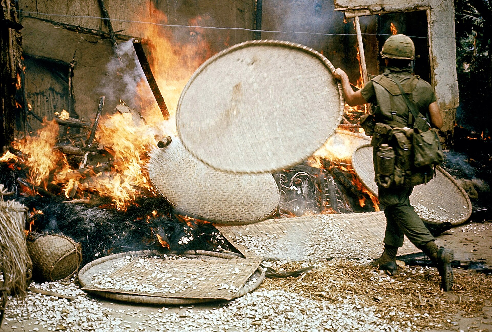
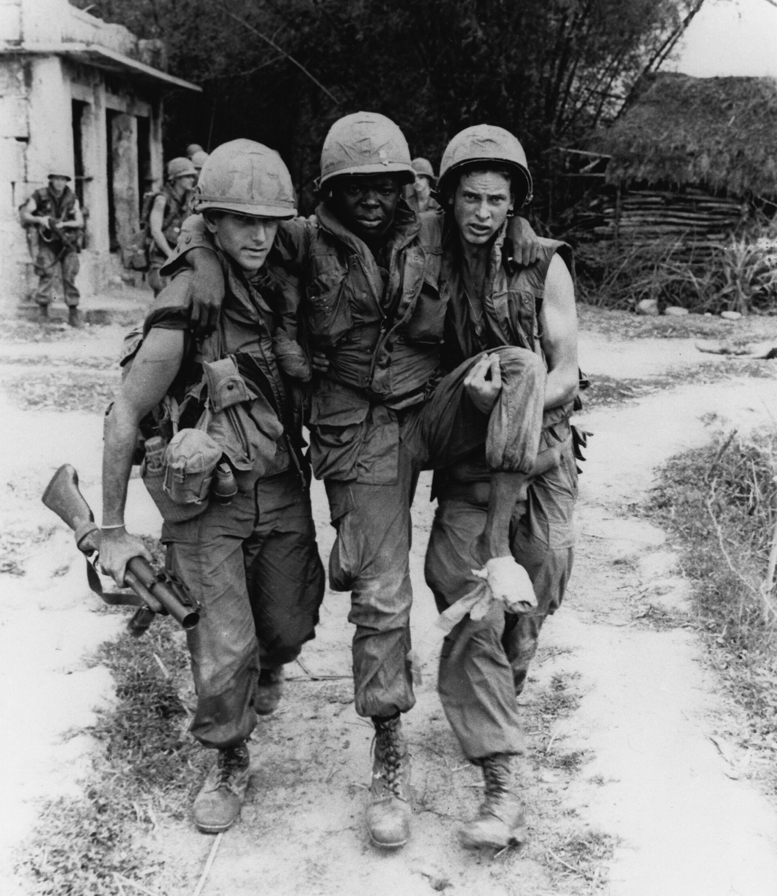
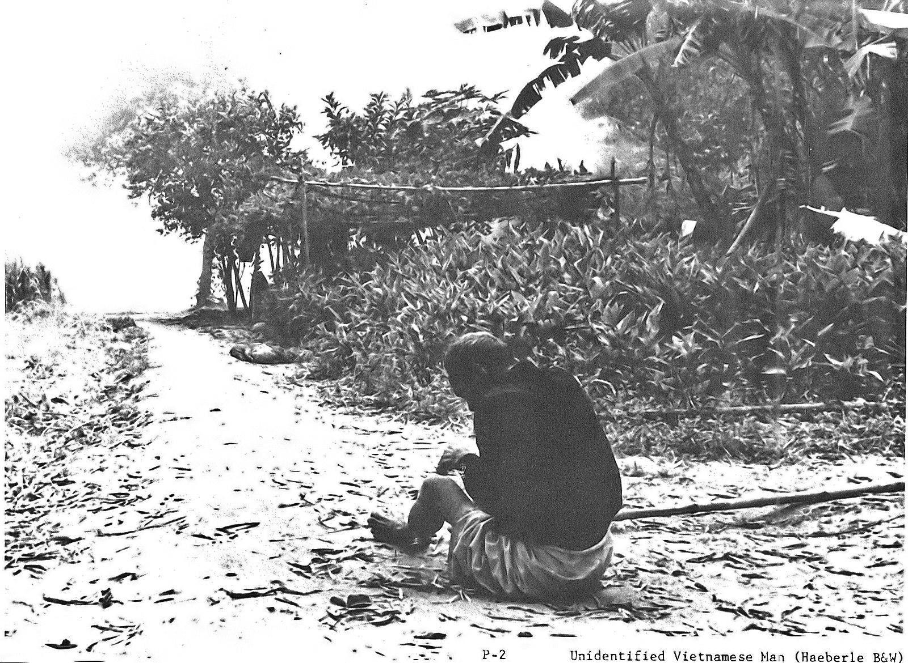

Fifty-six years ago today, on November 17, 1970, United States Army Lieutenant William Calley went on trial before a military court-martial. He was charged with the premeditated murder of unarmed South Vietnamese civilians in the hamlet of My Lai. The proceedings forced the American public to confront one of the darkest chapters of the Vietnam War.

## The Morning at My Lai 4

The massacre occurred on the morning of March 16, 1968, in Son My village, Quang Ngai province. Soldiers of Charlie Company, 1st Battalion, 20th Infantry Regiment, 11th Infantry Brigade of the 23rd Americal Division landed near the hamlet expecting an engagement with the Viet Cong's 48th Battalion.

Instead of armed combatants, the troops found only elderly men, women, children, and infants. Despite encountering no enemy resistance and taking no hostile fire, American soldiers systematically killed the villagers using automatic weapons, bayonets, and grenades. Homes were burned and livestock slaughtered.

The official American military estimate concluded that 347 civilians were killed. Vietnamese memorial records list the names and ages of 504 victims, including 60 elderly men, 282 women, and 173 children.

## A Year of Silence and the Exposure

The military initially reported the operation as a successful victory against enemy combatants, burying the reality of the killings under an internal cover-up. For over a year, the events remained largely concealed from the public.

The truth surfaced through the persistence of Ronald Ridenhour, a veteran who had served in the 11th Brigade. In April 1969, after gathering accounts from fellow soldiers, Ridenhour mailed detailed letters to the President, the Chairman of the Joint Chiefs of Staff, the Secretary of Defense, and thirty members of Congress.

On September 5, 1969, the Army formally charged Calley under Article 118 of the Uniform Code of Military Justice. In November 1969, investigative journalists Seymour Hersh and Wayne Greenhaw broke the story to newspapers nationwide, igniting widespread domestic and international outrage.

*Archive, 1968 — Photo: Ronald L. Haeberle / Public domain*

## The Court-Martial Begins

Calley's murder trial officially commenced on November 17, 1970. Because international treaties excluded allied civilians from protected status in that specific jurisdiction, the charges proceeded strictly under military law rather than as international war crimes.

Military prosecutors Aubrey M. Daniel III and Captain John Partin faced significant hurdles from the start. Many soldiers summoned to testify exercised their Fifth Amendment rights against self-incrimination, refusing to speak on the record.

Military judge Reid W. Kennedy presided over the courtroom, establishing ground rules for testimony that would expose the exact sequence of orders issued during the operation.

*Archive, 1968 — Photo: Ronald L. Haeberle / Public domain*

## Harrowing Testimony from the Platoon

The prosecution's case hinged heavily on eyewitness accounts from Calley's own men. Private First Class Paul David Meadlo, granted immunity and ordered by Judge Kennedy to testify, delivered crucial testimony about the executions.

Meadlo recounted that he and Private Dennis Conti had rounded up about thirty villagers in a defoliated area. When Calley approached, he told Meadlo, 'You know what to do with 'em.' Meadlo initially believed he was simply ordered to guard them.

Ten minutes later, Calley returned, became furious that the villagers were still breathing, and insisted he wanted them dead. Calley stepped back twenty feet, began firing directly into the civilians, and ordered Meadlo to fire as well. Additional witnesses, including Leonard Gonzalez, testified to finding groups of unarmed women dead from grenade launcher rounds.

*Archive, 1968 — Photo: Ronald L. Haeberle / Public domain*

## The Verdict and the Aftermath

The prosecution demonstrated that Calley had ordered the men of his 1st Platoon to kill everyone in the hamlet, rejecting defense claims that the casualties resulted from an accidental airstrike or standard rules of engagement.

Calley was convicted of the premeditated murder of 22 South Vietnamese civilians. He was originally sentenced to life imprisonment at hard labor, standing as the only serviceman convicted among twenty-six individuals charged in connection with the massacre.

Just three days after the sentencing, President Richard Nixon intervened, ordering Calley transferred from the military stockade to house arrest at Fort Benning. His sentence was subsequently reduced to twenty years, then ten, and Calley ultimately served three years of house arrest before gaining his release.

## A Permanent Scar on American Memory

The trial of William Calley polarized the American public, creating deep divisions between those who viewed him as a scapegoat for high-ranking commanders and those horrified by the deliberate murder of civilians. The case spurred the creation of the Vietnam War Crimes Working Group to examine other unreported incidents.

After his dismissal from the military, Calley avoided public attention for decades. He passed away on April 28, 2024, at the age of 80, an event that went unnoticed in public records for three months.

Today, the site at My Lai preserves the names of the victims on a marble plaque. The trial that began in November 1970 remains a sobering reminder of the moral costs of the Vietnam War and the accountability demanded of those in uniform.

### Sources

- <https://en.wikipedia.org/wiki/Vietnam_War>
- <https://commons.wikimedia.org/wiki/File:My_Lai_massacre_woman_and_children.jpg>
- <https://commons.wikimedia.org/wiki/File:Burningdwelling2.jpg>
- <https://commons.wikimedia.org/wiki/File:Haeberlewounded.jpg>
- <https://commons.wikimedia.org/wiki/File:Mylaiman.jpg>
