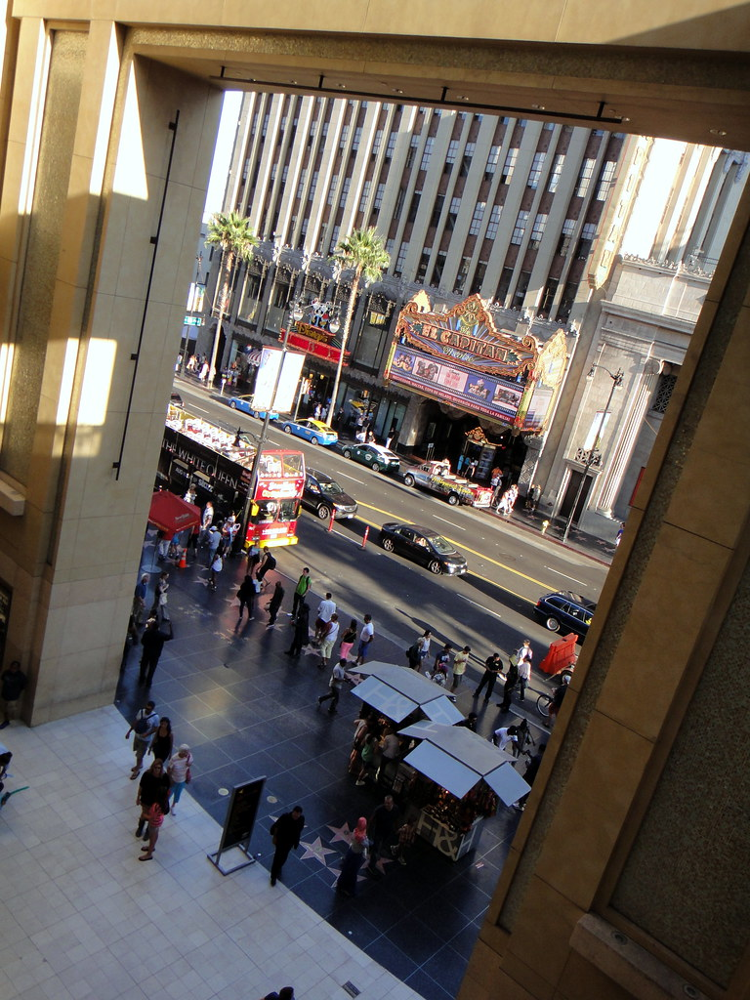
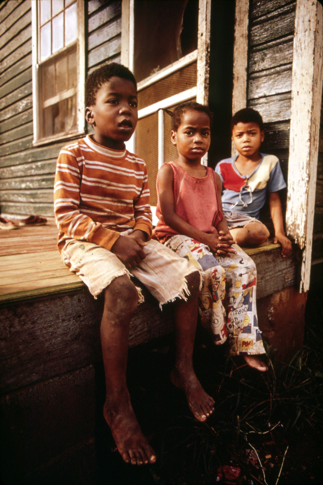

37 years ago today, November 17, 1989, Walt Disney Feature Animation released its 28th animated feature film, The Little Mermaid, in movie theaters across the nation. The vibrant adaptation of Hans Christian Andersen's fairy tale dazzled audiences, took home two Academy Awards, and revitalized Disney animation.

## Returning to a Shelved Fairy Tale

Hans Christian Andersen published his classic Danish fairy tale The Little Mermaid back in 1837. Walt Disney himself had once considered adapting the story for a planned package film featuring several of Andersen's literary works, but that early effort was eventually scrapped. The story languished in the studio archives for years until two young filmmakers saw its untapped cinematic potential.

In 1985, while working on the animated mystery The Great Mouse Detective, directors John Musker and Ron Clements came across the fairy tale once again. They believed the underwater setting and the emotional core of a heroine dreaming of another world could create a visually captivating animated feature. They decided to write an outline and pitch the concept directly to Disney studio leadership.

## Overcoming Executive Doubts

When Clements and Musker presented the project to Walt Disney Studios chairman Jeffrey Katzenberg, the executive initially declined to move forward. The studio was already considering a sequel to its 1984 live-action comedy hit Splash, and Katzenberg worried that two mermaid films would feel redundant. He also expressed concern that a story centered on a female protagonist would attract a narrower audience and generate lower box office returns than other projects.

Despite these initial hesitations, the directing team persisted in championing the emotional weight and visual richness of the story. Katzenberg eventually changed his mind, approved the project for production, and grew convinced that the film could become a blockbuster hit for the company.

*El Capitan Theatre, Hollywood Boulevard — Photo: mattk1979 / CC BY-SA 2.0*

## Broadway Craft Meets Feature Animation

To elevate the production, producer and lyricist Howard Ashman joined the project alongside composer Alan Menken. Ashman envisioned structuring the animated film like a classic Broadway musical, where songs actively drove character development and advanced the plot. Together, Ashman and Menken wrote a soundtrack full of energetic numbers and heartfelt ballads while the animation crew was simultaneously finishing work on the 1988 release Oliver & Company.

The film assembled a talented vocal cast that brought Andersen's reimagined characters to life. Jodi Benson voiced the curious teenage mermaid princess Ariel, while Christopher Daniel Barnes played Prince Eric. Pat Carroll delivered a memorable performance as the sea witch Ursula, and Samuel E. Wright voiced the court composer crab Sebastian, who performs the show-stopping calypso tune Under the Sea.

*Children at Kosciusko pool (cropped) — Photo: Danny Lyon / Public domain*

## Box Office Triumph and Critical Acclaim

When The Little Mermaid arrived in theaters on November 17, 1989, film critics praised its stunning traditional animation, engaging characters, and unforgettable musical score. Audiences of all ages flocked to theaters, disproving earlier executive concerns about demographic appeal. It became one of the studio's biggest financial successes up to that point.

During its initial theatrical release, the film grossed 84 million dollars at the domestic box office. Its worldwide lifetime gross eventually reached 235 million dollars, securing its place as the sixth-highest-grossing film of 1989. For a feature animation division that had experienced an uneven commercial stretch in previous years, the film represented an undeniable artistic and financial breakthrough.

*"Little Korea", an area of sub-standard housing in South Birmingham - NARA - 545436 — Photo: LeRoy Woodson / Public domain*

## The Dawn of the Disney Renaissance

The critical and commercial victory of The Little Mermaid was cemented during awards season. The film won two Academy Awards, earning honors for Best Original Score and Best Original Song for Under the Sea. The critical recognition highlighted the artistic strength of Disney's musical storytelling format.

Alongside the earlier successes of 1986's The Great Mouse Detective, 1988's Oliver & Company, and the 1988 live-action and animated hybrid Who Framed Roger Rabbit, The Little Mermaid transformed the studio's fortunes. Historians widely credit the film with launching the era known as the Disney Renaissance, a period where animated features became the company's most celebrated and lucrative productions.

## Preserved in American Film History

The success of the 1989 film laid the groundwork for an enduring multi-decade franchise. It inspired a television prequel series that ran on CBS from 1992 to 1994, follow-up film releases in 2000 and 2008, and a Broadway stage musical that premiered in Denver in 2007 before opening in New York in 2008. In 2023, a live-action adaptation directed by Rob Marshall also made its way to theaters.

In 2022, the Library of Congress selected The Little Mermaid for preservation in the United States National Film Registry, officially recognizing it as culturally, historically, or aesthetically significant. Decades after its November 1989 premiere, the story of Ariel continues to stand as a landmark achievement in the history of American animation.

### Sources

- <https://en.wikipedia.org/wiki/Walt_Disney_Animation_Studios>
- <https://www.flickr.com/photos/75683070@N00/2997200450>
- <https://www.flickr.com/photos/24879135@N04/9712843379>
- <https://commons.wikimedia.org/wiki/File:Children_at_Kosciusko_pool_(cropped).jpg>
- <https://commons.wikimedia.org/wiki/File:%22Little_Korea%22,_an_area_of_sub-standard_housing_in_South_Birmingham_-_NARA_-_545436.jpg>
