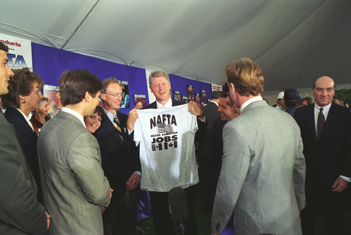
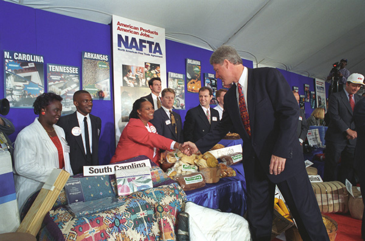
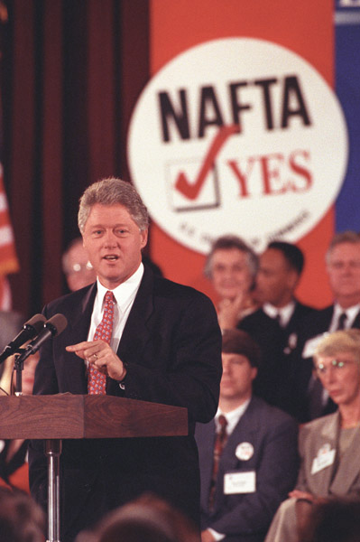

33 years ago today, November 17, 1993, the United States House of Representatives passed a resolution to establish the North American Free Trade Agreement. The vote marked the climactic breakthrough for NAFTA, creating one of the largest trade blocs in the world by gross domestic product.

## The Origins of a Continental Trade Area

The idea of opening borders to commerce across North America originated long before the 1993 vote. President Ronald Reagan initially promoted the concept during his presidential campaign after declaring his candidacy in November 1979. Building on that momentum, the United States and Canada enacted the Canada–United States Free Trade Agreement in 1988. Shortly thereafter, leaders recognized the opportunity to expand the framework southward to include Mexico, creating a truly continental partnership.

## Negotiating Across Three Capitals

The negotiations for NAFTA brought together the administrations of three national leaders: U.S. President George H. W. Bush, Mexican President Carlos Salinas de Gortari, and Canadian Prime Minister Brian Mulroney. In December 1992, the leaders signed the proposed agreement and submitted it for legislative ratification in Washington, Ottawa, and Mexico City. The treaty aimed to dismantle tariff barriers, lower investment restrictions, and streamline cross-border trade among the three contiguous neighbors.

*Photograph of President William J. Clinton Participating in a North American Free Trade Agreement (NAFTA) Products Event — Photo: President (1993-2001 : Clinton). White House Photograph Offi / Public domain*

## Fierce Debate and Side Agreements

Despite high-level diplomatic support, NAFTA encountered fierce opposition across the United States. Critics raised significant concerns regarding domestic manufacturing, employment impacts, and disparities in environmental standards. To address these contentious issues, negotiators crafted two supplementary accords in 1993: the North American Agreement on Labor Cooperation and the North American Agreement on Environmental Cooperation. These side agreements sought to protect worker conditions and environmental standards across all participating countries.

*Photograph of President William J. Clinton Participating in a North American Free Trade Agreement (NAFTA) Products Event — Photo: President (1993-2001 : Clinton). White House Photograph Offi / Public domain*

## The Decisive House Showdown

The ultimate test came inside the south wing of the United States Capitol, home to the 435 voting members of the House of Representatives. Under the Constitution, Congress holds the legislative authority to pass federal measures governing interstate and foreign commerce. On November 17, 1993, after intense public lobbying and spirited floor debates, the House passed the resolution to implement the agreement. The pivotal vote cleared the path for the Senate and presidential approval.

*Photograph of President William J. Clinton Speaking at the North American Free Trade Agreement (NAFTA) Event at the Unit — Photo: President (1993-2001 : Clinton). White House Photograph Offi / Public domain*

## Implementation and Long-Term Legacy

NAFTA officially took effect on January 1, 1994, superseding the 1988 bilateral agreement between the United States and Canada. The agreement governed trade relationships across North America for more than a quarter-century. Negotiations to update the pact began under President Donald Trump in 2017, culminating in the United States–Mexico–Canada Agreement reached in September 2018. Following final ratifications in 2020, the new USMCA took effect on July 1, 2020, formally replacing NAFTA while preserving the integrated North American trading bloc born out of the historic 1993 vote.

### Sources

- <https://en.wikipedia.org/wiki/United_States_House_of_Representatives>
- <https://commons.wikimedia.org/wiki/File:Photograph_of_President_William_J._Clinton_and_Vice_President_Al_Gore_Meeting_with_Environmental_Groups_Endorsing_the_North_American_Free_Trade_Agreement_-_DPLA_-_76633517c5d59d945dd722a1e919473e.jpg>
- <https://commons.wikimedia.org/wiki/File:Photograph_of_President_William_J._Clinton_Participating_in_a_North_American_Free_Trade_Agreement_(NAFTA)_Products_Event_on_the_South_Lawn_-_DPLA_-_5d40c7798ff420f1bbc53cb72445baa7.jpg>
- <https://commons.wikimedia.org/wiki/File:Photograph_of_President_William_J._Clinton_Participating_in_a_North_American_Free_Trade_Agreement_(NAFTA)_Products_Event_on_the_South_Lawn_-_DPLA_-_ed1c536bfddf7f9b27760532929fe645.jpg>
- <https://commons.wikimedia.org/wiki/File:Photograph_of_President_William_J._Clinton_Speaking_at_the_North_American_Free_Trade_Agreement_(NAFTA)_Event_at_the_United_States_Chamber_of_Commerce_-_DPLA_-_6fa8a3d5de42247a97329652282abbf3.jpg>
