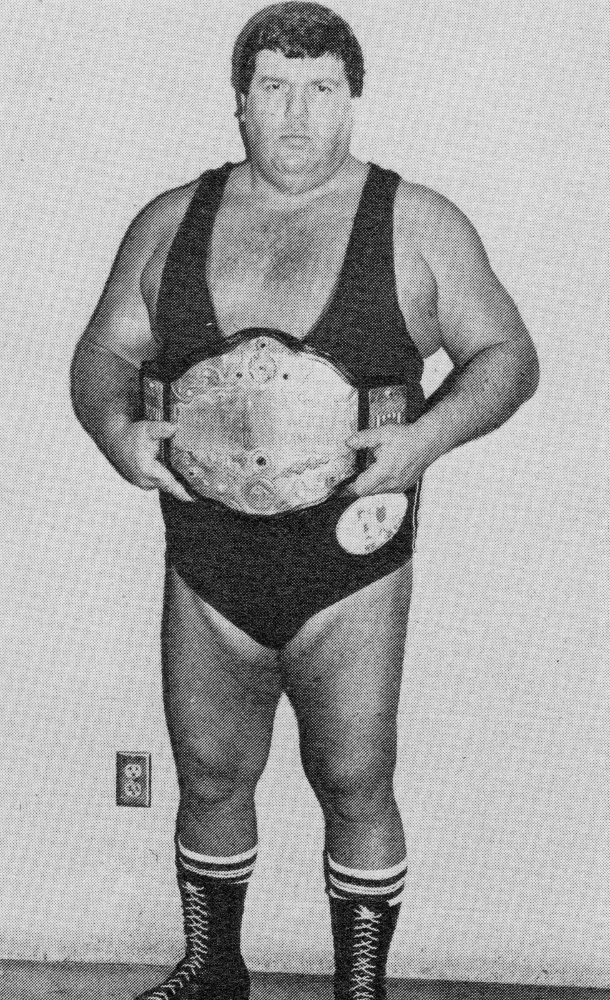
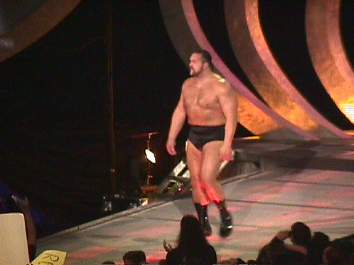
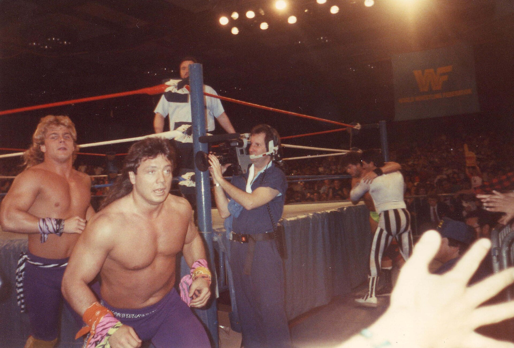

24 years ago today, November 17, 2002, World Wrestling Entertainment held its sixteenth annual Survivor Series pay-per-view event at Madison Square Garden in New York City. The night marked the official debut of one of the most punishing match concepts in sports entertainment: the Elimination Chamber.

## A Year of Major Transitions for WWE

The year 2002 was a defining period of structural change for the promotion. Following a trademark dispute with the World Wildlife Fund, the company dropped its longtime name of the World Wrestling Federation (WWF) and officially rebranded as World Wrestling Entertainment (WWE) in May. Months earlier, in March 2002, the company launched its inaugural brand extension, dividing its extensive talent roster exclusively between two distinct weekly touring brands: Raw and SmackDown.

## Returning to Madison Square Garden

Survivor Series has stood as an annual November tradition since its inception in 1987, making it WWE's second longest-running pay-per-view event behind WrestleMania. Along with the Royal Rumble and SummerSlam, it formed the core 'Big Four' events on the company's annual calendar. The 2002 edition marked only the second time Survivor Series had visited Manhattan's Madison Square Garden, having previously taken place in the historic arena back in 1996. Rock group Saliva provided the official theme song, 'Always', performing live from The World alongside their rendition of Chris Jericho's entrance music.

*Otto Wanz with AWA Championship — Photo: Joji Inoue / Public domain*

## The Debut of the Elimination Chamber

Traditionally, Survivor Series centered around classic tag team elimination bouts featuring squads of four or five competitors. The 2002 edition broke tradition as only the second Survivor Series in history to omit the classic match format. In its place, the Raw brand unveiled the first-ever Elimination Chamber match. The contest took place inside an enormous roofed steel cage enclosing both the ring and the ringside floor. Six superstars—reigning World Heavyweight Champion Triple H, Shawn Michaels, Chris Jericho, Booker T, Rob Van Dam, and Kane—battled in a match without disqualifications, where wrestlers were systematically eliminated through pinfall or submission.

*The Big Show 1999 WWF Smackdown (WWE) — Photo: scorpio10708 / CC BY-SA 2.0*

## Shawn Michaels Reaches the Summit

The brutal chamber match pushed every participant to their physical limits across the steel grating and chain link structure. Ultimately, the contest came down to longtime rivals Triple H and Shawn Michaels. Michaels scored the deciding pinfall after eliminating Triple H, claiming the World Heavyweight Championship before a packed Madison Square Garden crowd.

*Rockers defeat Davis and Horowitz (86290688) — Photo: John McKeon from Lawrence, KS, United States / CC BY-SA 2.0*

## SmackDown Superstars Make History

While Raw showcased the steel cage, the SmackDown brand delivered its own major title shakeups. In the featured SmackDown championship match, Big Show defeated Brock Lesnar to capture the WWE Championship. Earlier on the undercard, Los Guerreros—the tag team of Eddie Guerrero and Chavo Guerrero—captured the SmackDown WWE Tag Team Championship by outlasting Edge and Rey Mysterio, as well as the tandem of Kurt Angle and Chris Benoit, in a triple threat elimination tag team clash.

## A Lasting Legacy in Sports Entertainment

The 2002 Survivor Series established a pivotal milestone during WWE's transition into a modern global entertainment company. By proving the dramatic and commercial potential of the brand split and introducing the Elimination Chamber structure, November 17, 2002, reshaped the company's pay-per-view lineup for years to follow.

### Sources

- <https://en.wikipedia.org/wiki/WWE>
- <https://commons.wikimedia.org/wiki/File:Harley_Race_with_the_NWA_Worlds_Heavyweight_Championship.png>
- <https://commons.wikimedia.org/wiki/File:Otto_Wanz_with_AWA_Championship.jpg>
- <https://www.flickr.com/photos/24688894@N06/3468713752>
- <https://commons.wikimedia.org/wiki/File:Rockers_defeat_Davis_and_Horowitz_(86290688).jpg>
